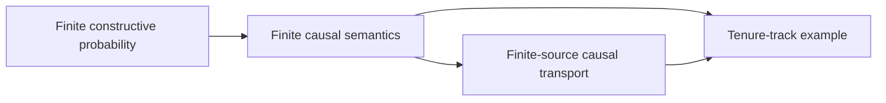

# Mathematical inference: science and logic

This repository holds Jelmer de Boer's *Mathematical inference: science and
logic*: the Master's thesis in Artificial Intelligence submitted to the Open
University in 2026, and a book manuscript based on that thesis.

The work develops a finite, constructive account of mathematical inference.
It brings together Jaynes-style probability, Pearl-style structural causal
models, and explicit changes in epistemic state, with selected constructions
and proofs checked in Lean 4. It also considers the scientific practices and
institutions in which inference is performed.

## Read the texts

- The submitted thesis is available as a [PDF](latex/Thesis_Jelmer_de_Boer.pdf).
- The book manuscript is available as a [PDF](latex/mathematical_inference.pdf).

## Lean formalisation

The Lean development formalises selected finite constructions from the work.
Its public entry points are:

- `Thesis.Probability` — finite constructive probability;
- `Thesis.Causality` — finite structural causal models, interventions, modal
  edits, and counterfactual semantics; and
- `Thesis.CausalTransport` — finite-source correspondence and explicit
  interfaces to externally established causal results.

The complete development also includes a tenure-track example that combines
these components.



### Verification

The project uses Lean `v4.30.0-rc2` and has no third-party Lake dependencies.
To build the development:

```sh
cd lean
lake build
```

To enforce the project-wide kernel-axiom policy, run:

```sh
cd lean
lake build Thesis.AxiomAudit
```

The audit checks every declaration owned by an imported `Thesis.*` library
module and fails the build if a transitive kernel dependency is not `propext`
or `Quot.sound`. Continuous integration builds this audit target explicitly.
Finite-model soundness, d-separation correctness, and positive-model joint
and conditional completeness are implemented constructively. The public
constructors are `ObservedGraph.publishedSoundness` and
`ObservedGraph.publishedCompleteness`; completeness requires a value-rich
finite signature (two supplied distinct labels at each observed node).
Both joint and conditional fields return inspectable do-calculus/probability
derivations, with no external countermodel-family assumption or new Lean axiom.

The same positive-model result is implemented for every finite original
hidden DAG, with fixed observed domains and arbitrary finite hidden-variable
and private-noise domains. The constructor is
`FiniteLatentProjection.publishedHiddenDAGCompleteness`. In
`HiddenDAGCorrespondence`, `HiddenDAGModelClass.identifyJointKernel_identifiable_iff`
and `HiddenDAGModelClass.identifyConditionalKernel_identifiable_iff` prove that
the corrected ID/IDC engines succeed exactly for identifiable queries in the
full positive original-DAG class. Failure constructs actual original-DAG
countermodels, including genuine conditional value disagreement on common
support; no external latent-projection interface is assumed.

The finite probability records permit zeros. Native hidden-DAG soundness
already accepts explicit local derivation-support witnesses, and guarded
observational-chain compilation handles null prefixes without assigning a
value to `0 / 0`. Guarded joint ID and conditional IDC now have uniform
recursive local-data compilers and native interpretation. A zero-aware
completeness boundary remains open; the positive-model engine equivalences
above do not silently cover that larger zero-permitting class.

The current-input algebra is also zero-permitting: recursive marginal
certificates no longer require observed positivity, and exact prefix-quotient
derivations accept support at their enumerated input variants plus positivity
of the one displayed denominator. Their numerator may be zero. Native
hidden-DAG adapters preserve those same local conditions without assuming
canonical membership of a collapsed model. Component-factor extraction now
uses the graph-derived exchange/deletion rules with explicit local support;
its exchange intermediate can obtain support from observable predecessor
overlap. `PublishedCurrentKernelReduction.guardedComponent_supportedAt`
now constructs the whole prefix-first guarded component tree: each quotient
retains the actual current input, and its subtrees are requested only on a
positive causal or displayed prefix branch. The native adapter
`hiddenDAG_guardedComponent_supportedAt` preserves these same explicit local
conditions for original hidden DAGs, including noncanonical multi-child
collapsed roots. Regressions exercise an undefined quotient skipped by a
zero prefix, without replacing it by an arbitrary conditional value.

The reverse component-to-host bridge is also implemented by
`PublishedCurrentKernelReduction.hostFactorOfComponent_supportedAt` and its
native adapter `hiddenDAG_hostFactorOfComponent_supportedAt`. It keeps the
independently compiled component's exact prefix quotient and builds the two
reversed graph-rule trees from explicit local data, without assuming a
reduction of the whole host joint. Zero-outcome regressions exercise both a
compound component marginal and a noncanonical original hidden-DAG model.

Whole-host component-family assembly is implemented by
`PublishedComponentKernelReductionFamily.guardedReduction_supportedAt`.
Its guarded topological fold reads each independently compiled component's
exact quotient. Components may interleave; no whole-host reduction or
strict-product regrouping is assumed. A regression has a supported zero
first component and an undefined later component input: the guarded host
is still a supported zero, while the old strict product remains undefined.
`GuardedHostChain` provides the shared bounded derivation/support induction
for this assembly and the earlier whole-component extraction.

Native component-family assembly is implemented by
`PublishedComponentKernelReductionFamily.hiddenDAG_guardedReduction_supportedAt`.
Both prefix guards, the component conditional, finite input trees and the
displayed denominator are native data. Literal term and observational-record
preservation construct the full original-DAG support tree without requiring
a canonical collapse or a positive complete observed law. A nonpositive
five-node regression with a three-child collapsed root checks the supported
zero host and its genuinely undefined, skipped final quotient.

`identifyGuardedJointKernel` now computes the full guarded current-kernel ID
program, including pruning, action augmentation, component restriction and
multi-component assembly. Successful formulas remain action-free. Its graph
decisions and exact failure witnesses match the corrected positive engine,
and its public calls never return the unfinished sentinel. A complete native
mediator regression identifies structurally in both programs: the guarded
formula gives a supported zero while the strict formula is undefined.

The guarded `identified` outcome is still a candidate, not a blanket
semantic claim. `identifyGuardedKernelFuelLocalCompilation` and
`identifyGuardedJointKernelLocalCompilation` now construct its formula-aligned
derivation and support tree from recursively composed primitive local data.
The initial observational compilation requires only unit data; marginals
request inherited data at their actual enumerated variants, and guarded
folds request quotient data only on positive prefix branches.
`identifyGuardedJointKernel_soundAt` interprets the exact successful expression
in compatible root models, and `identifyGuardedJointKernel_hiddenDAG_soundAt`
reads it in every original finite hidden-DAG model at the stated boundary.
The native two-model identification adapter requests data in both models:
the boundary includes causal-conditional support, so complete data transfer
is not inferred from observational agreement alone.
`identifyGuardedConditionalKernel` retains the established finite rule-2
search, uses guarded joint ID at termination, and keeps the exact Bayes
numerator and its marginal denominator. Its decisions and failure witnesses
match positive IDC, with no public unfinished sentinel.
`identifyGuardedConditionalKernelFuelLocalCompilation` and
`identifyGuardedConditionalKernelLocalCompilation` compose the complete
promotion/Bayes support tree from primitive data; a terminal branch-data
lemma makes that boundary inspectable without normalizing the graph search.
`identifyGuardedConditionalKernel_hiddenDAG_soundAt` gives the native
interpretation, and its two-model adapter again requests local data on both
sides. A nonpositive native regression actually populates the compiler data
and applies the generic theorem to a supported-zero conditional, rather than
only comparing numerical evaluations.
A zero-aware completeness boundary and additional recursive/promotion data
regressions remain to be established.
These local constructors are sufficient support boundaries, not an
unrestricted identification equivalence for all distributions with zeros.

Continuous probability, general measure theory, and a complete formalisation
of every philosophical or sociological claim are outside this project's scope.
