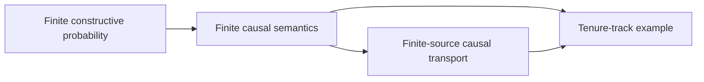

# Mathematical inference: science and logic

This repository holds Jelmer de Boer's *Mathematical inference: science and
logic*: the Master's thesis in Artificial Intelligence submitted to the Open
University in 2026, and a book manuscript based on that thesis.

The work develops a finite, constructive account of mathematical inference.
It brings together Jaynes-style probability, Pearl-style structural causal
models, and explicit changes in epistemic state, with selected constructions
and proofs checked in Lean 4. It also considers the scientific practices and
institutions in which inference is performed.

## Read the texts

- The submitted thesis is available as a [PDF](latex/Thesis_Jelmer_de_Boer.pdf).
- The book manuscript is available as a [PDF](latex/mathematical_inference.pdf).

## Lean formalisation

The Lean development formalises selected finite constructions from the work.
Its public entry points are:

- `Thesis.Probability` — finite constructive probability;
- `Thesis.Causality` — finite structural causal models, interventions, modal
  edits, and counterfactual semantics; and
- `Thesis.CausalTransport` — finite-source correspondence and explicit
  interfaces to externally established causal results.

The complete development also includes a tenure-track example that combines
these components.



### Verification

The project uses Lean `v4.30.0-rc2` and has no third-party Lake dependencies.
To build the development:

```sh
cd lean
lake build
```

To enforce the project-wide kernel-axiom policy, run:

```sh
cd lean
lake build Thesis.AxiomAudit
```

The audit checks every declaration owned by an imported `Thesis.*` library
module and fails the build if a transitive kernel dependency is not `propext`
or `Quot.sound`. Continuous integration builds this audit target explicitly.
Finite-model soundness, d-separation correctness, and positive-model joint
and conditional completeness are implemented constructively. The public
constructors are `ObservedGraph.publishedSoundness` and
`ObservedGraph.publishedCompleteness`; completeness requires a value-rich
finite signature (two supplied distinct labels at each observed node).
Both joint and conditional fields return inspectable do-calculus/probability
derivations, with no external countermodel-family assumption or new Lean axiom.

The same positive-model result is implemented for every finite original
hidden DAG, with fixed observed domains and arbitrary finite hidden-variable
and private-noise domains. The constructor is
`FiniteLatentProjection.publishedHiddenDAGCompleteness`. In
`HiddenDAGCorrespondence`, `HiddenDAGModelClass.identifyJointKernel_identifiable_iff`
and `HiddenDAGModelClass.identifyConditionalKernel_identifiable_iff` prove that
the corrected ID/IDC engines succeed exactly for identifiable queries in the
full positive original-DAG class. Failure constructs actual original-DAG
countermodels, including genuine conditional value disagreement on common
support; no external latent-projection interface is assumed.

The finite probability records permit zeros. Native hidden-DAG soundness
already accepts explicit local derivation-support witnesses, and guarded
observational-chain compilation handles null prefixes without assigning a
value to `0 / 0`. A full recursive zero-aware ID/IDC compiler is still open;
the positive-model engine equivalences above do not silently cover that
larger zero-permitting model class.

The current-input algebra is also zero-permitting: recursive marginal
certificates no longer require observed positivity, and exact prefix-quotient
derivations accept support at their enumerated input variants plus positivity
of the one displayed denominator. Their numerator may be zero. Native
hidden-DAG adapters preserve those same local conditions without assuming
canonical membership of a collapsed model. The remaining compiler work is
to propagate these conditions through component extraction, the recursive ID
branches, and conditional IDC/Bayes assembly.

Continuous probability, general measure theory, and a complete formalisation
of every philosophical or sociological claim are outside this project's scope.
