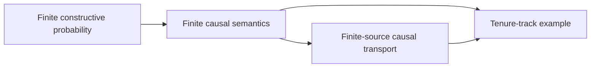

# Lean development history and preserved evidence

This is the single historical archive. Current policy and commands are in
[AGENTS.md](AGENTS.md); current mathematical scope is in [REFERENCE.md](REFERENCE.md).
The snapshots below are evidence, not live instructions or a list of open gaps.
They retain old paths, old resource limits, failed attempts and subsequently
completed obligations exactly as written. Do not execute historical commands
without consulting current policy. All retained Lean results remain separately
inside actual build and axiom-audit coverage.

## Archive index

- [Former root README](#archived-readme) — `README.md`
- [Former refactoring ledger](#archived-refactoring-ledger) — `lean/REFACTORING.md`
- [Local build investigation](#archived-local-checks) — `lean/LOCAL_CHECKS.md`
- [Theorem coverage and bounded research assessments](#archived-theorem-coverage) — `lean/THEOREM_COVERAGE.md`
- [Entropy and analytic development record](#archived-entropy) — `lean/ENTROPY.md`
- [Former structure guide](#archived-structure) — `lean/docs/structure.md`
- [First-pass preservation ledger](#archived-first-pass-ledger) — `lean/docs/history/refactoring-pass1.md`
- [Historical completeness source inventory](#archived-completeness-inventory) — `lean/docs/history/completeness-development.md`

## Targeted maintenance measurements — 2026-10-23

These measurements belong to working pass 1, not to the frozen acceptance
checkpoint. The uncommitted documentation changes during the pilots did not
change their Lean inputs. The baseline Lean source was `1ab81d2`; each trial
changed only the selected proof. Source/configuration SHA-256 manifests and
ordinary dependency-trace validation are retained in the local reports below.

Platform: macOS arm64, pinned Lean `v4.30.0-rc2`, one low-priority compiler,
one Lean thread, 4608 MiB Lean threshold, 5120 MiB sampled process-group RSS,
30 seconds per invocation. Each sample freshly elaborated the whole selected
module into disposable output against validated normal cached dependencies.
No shared cache was deleted or populated with a pilot artifact. Diagnostic
profiling runs were separate from the unprofiled timed samples.

| Selected module | Before: seconds / sampled MiB | Trial: seconds / sampled MiB | Decision |
| --- | --- | --- | --- |
| `Examples.HedgeConditionalLatentCollider` | 21.904 / 3711.8; 21.904 / 3712.2 | 21.967 / 3712.6; 22.380 / 3712.5 | No improvement. Restore the original file exactly; no further pilot on this module. |
| `Examples.HedgeConditionalCompensatedReadout` | 20.856 / 2905.6; 20.477 / 2965.7 | 11.519 / 2855.6; 10.552 / 2859.1 | Retain the same engine assertion with a proof reusing the exhausted exchange and checked joint branch. About 47% lower selected-module time; memory is broadly unchanged. |

Report directories under `.lake/local-pilots-v1/`: baseline/trial pairs
`20261023-160102-_9wbka8r` / `20261023-160501-vq2k2n3r` and
`20261023-160332-as08q5hm` / `20261023-160619-6wwtecx1` respectively.
Declaration profiling localized the expensive finite computations to the
exchange/failure proof constants. Reusing a checked fact was not sufficient
in the first fixture: the retained joint check still incurred essentially
the same total cost. That failed experiment is not an implemented speedup.

These are repeated fresh **selected-module** checks, not repeated cold full
builds or a twofold project speedup. Other machine load was not controlled;
sampled RSS may miss short peaks. A subsequent full/native traversal must
still check the kept source and all audit gates.

The preceding repaired-walk traversal used normal cached dependencies and
rebuilt 418 targets, then passed the actual native build and full audit in
`.lake/local-builds-v1/20261023-114435-rk5ikvpv/`. It was a representative
incremental traversal, not a completely cold build. ReadoutGeometry's static
project closure changed 20→18. The sampling extraction changes DepletingUrn
54→49, DepletingWord 56→51, DepletingConditioning 57→54 and
DepletingAggregationConditioning 80→77. Counts include the selected module;
they are dependency measurements, not elapsed-time improvements.

## Preserved guide snapshots

Snapshot source: maintenance checkpoint `5a0803f` (its unmodified documentation
inputs, before consolidation). Delimited snapshot bytes are preserved exactly;
the tests continue to verify the original historical source/body hashes.

<a id="archived-entropy-8b1f99b"></a>

## Newer published auxiliary-value guide, through `8b1f99b`

This guide version was reconciled while combining newer main work. Its older
open-status sentences are retained as evidence, not current instructions; the
canonical reference includes the subsequent ordered-product and positive-log
interfaces present in the combined source.

<!-- BEGIN ARCHIVE lean/ENTROPY.md@8b1f99b -->
````markdown
# Finite entropy and maximum-entropy implementation

The goal retains rational probability laws and the existing constructive axiom
policy. Entropy values may be irrational; exact symbolic logarithms and rational
interval certificates are auxiliary values, never new atom weights. Units are bits.

## Checkpoint 1: exact logarithmic arithmetic

- `PositiveRatio` supplies unreduced positive rational arguments, equivalence,
  order, products, inverses and powers.
- `ExactLog` represents `log₂(argument) / degree` with a positive natural degree.
  Equivalence and order compare rational powers at common degrees. Addition,
  negation, natural scaling and positive natural division respect the value.
- `ExactLogRational` embeds signed rational numbers of bits and proves exact
  correspondence with integer cross-product comparison.
- `ExactLogEnclosure.enclose` terminates for every positive rational tolerance.
  It returns a common-denominator rational interval containing the exact value,
  with a proved width strictly below the requested tolerance. Binary-length
  initial bounds and depth selection avoid a linear-depth precision search.
- `Thesis.Examples.ExactLog` checks root/argument presentation changes, negative
  values, exact bounds around `log₂(3)`, and executed certified bisection.
  Both full and early arithmetic axiom gates import the regressions.

These are symbolic logarithms with an exact ordered arithmetic interpretation,
not a newly assumed real logarithm. A separate semantic bridge to a completed
real-number model would need its own proof and is not silently assumed.

## Checkpoint 2: entropy and positive-reference KL

- `ExactLogWeights` proves congruence for both rational coefficients and exact
  logarithm values, monotonicity, and finite-sum congruence/permutation laws.
- `EntropyValue` defines `-p log₂(p)` and `p log₂(p/r)`, with explicit zero
  observed-mass branches and positive reference masses. Both respect unreduced
  rational presentations. Entropy contributions in `[0,1]` are nonnegative.
- `Distros.EntropyGrid` requires distinct observable outcomes. `Distro.entropy`
  and `Distro.relativeEntropy` require almost-sure grid support, so extra null
  atom labels remain admissible. They aggregate the original singleton PMFs.
- Entropy and KL are invariant under `SameLaw`. Entropy is nonnegative and
  invariant under grid permutation and adjoining a zero-mass cell. Positive
  reference laws have zero self-divergence.
- Executed regressions cover fair and point laws, duplicate/split/reordered
  records, rescaled denominators, a retained null outlier, grid changes, and
  unequal positive prior weights. The fair-law/prior `(1/4,3/4)` KL value is
  certified exactly as `log₂(4/3)/2`.

## Checkpoint 3: constructive arithmetic–geometric mean foundation

`FiniteAMGM` proves the denominator-cleared finite inequality at every list
length, using Cauchy's finite doubling/descending proof. Natural multiplicities
then give weighted AM–GM, including zero values and weights. Both non-strict and
strict common-denominator product bounds are available for the rational Gibbs
inequality. Later checkpoints use this foundation to establish KL and entropy
bounds; strict concavity and the total optimizer remain separate tasks.

## Checkpoint 4: rational Gibbs inequality and KL nonnegativity

`RationalAMGM` clears the finitely supplied argument denominators and proves
weighted rational products are at most one whenever their arithmetic mean is
at most one, including empty and zero-weight families. `LogMeanInequality`
transports that algebraic result to common-degree exact logarithms.

`Distros.EntropyGibbs` proves grid PMF normalization and numerator sums, then
`Distro.relativeEntropy_nonnegative` for every rational law and positive reference
law on the declared grid. It imposes no positivity assumption on observed masses.
The proof includes aggregation of duplicate atom occurrences and null outliers.
Executed regressions include a point law on a three-state grid with two zero
observed cells, whose uniform-reference KL equals `log₂(3)` exactly.

KL nonnegativity alone does not establish the equality or optimality results;
the following checkpoints prove those additional statements separately.

## Checkpoint 5: equality in Gibbs and KL

`FiniteAMGMEquality` proves the weighted equality case using midpoint
comparisons and the already established finite AM–GM bound. `RationalAMGMEquality`
and `LogMeanEquality` transport it to arbitrary positive rational arguments;
zero-weight arguments remain unrestricted.

`Distro.relativeEntropy_equiv_zero_iff` proves that KL vanishes exactly when
the laws agree on every Boolean event. Equality at positive observed cells
and normalization also force equality at zero observed cells. The regressions
check a split/rescaled/reordered law with a null outlier, a genuinely different
point law, and an unrestricted zero-weight argument in the rational equality
lemma. No literal atom-list equality is assumed.

## Checkpoint 6: entropy bounds and the cross-entropy criterion

`ExactLogLinear` proves rational bilinearity and the finite-sum identities needed
for entropy comparisons. `CrossEntropyValue` and `Distros.CrossEntropy` establish
KL = cross entropy minus entropy, the global cross-entropy upper bound, and a
positive-candidate optimality criterion: fixing the candidate cross entropy
makes the candidate a global entropy maximum, with equality exactly at the same
law. The bridge from rational moment constraints and a log-linear score to this
cross-entropy equality is still required.

`EntropyGrid.uniform` retains every declared cell with weight one.
`Distros.EntropyUniform` proves its entropy is exactly `log₂(cardinality)` and
that every supported law satisfies `0 ≤ H ≤ log₂(cardinality)`. Equality in the
upper bound holds exactly for the uniform law. Null cells in the declared grid
remain part of the cardinality, and null atom outliers remain admissible.

`Thesis.Examples.EntropyBounds` checks the three-state uniform bound and its
equality case, and the nonuniform candidate `(1/4, 1/4, 1/2)` with entropy `3/2`
bits. A competitor with the same cross entropy and a retained null outlier has
strictly smaller entropy.

## Checkpoint 7: strict concavity, including the boundary

`Distro.mixture` wraps the scale-and-append rational record construction, keeping
both atom lists and their null outliers. Singleton masses and cross entropy obey
the expected affine formulas even when input denominators differ.

`Distro.entropy_mixture_comparison` proves concavity for any two positive natural
mixing masses, normalized by their sum, and equality exactly when the input laws
are `SameLaw`. `Distro.entropy_strict_concave` states the strict consequence for
different laws. Shared zero-mass cells are handled by an internal positive-support
restriction with a proved entropy-preservation lemma; the caller's declared grid
and atom records are never replaced. No full-grid positivity premise remains.

`Distro.entropy_maximum_unique` proves that any attained maximum in a class closed
under midpoints is unique as a law. This is a conditional uniqueness theorem,
not an existence assertion for exact rational maximizers. Regressions exercise
shared zero cells, null outliers, unequal denominators, unequal mixing weights,
strict inequality for distinct point laws, and equality for split presentations.

## Checkpoint 8: moment feasibility and the first continuity estimate

`EntropyMomentConvex` proves affine signed rational expectations for the actual
mixture constructor, and preservation of every closed rational moment interval.
`PartialMomentProblem.Admissible` includes the original almost-sure grid support
and all existing constraint rows. Its entropy uniqueness theorem now applies
directly to exact and interval problems, with no row independence or interior
mass hypothesis. The existing feasibility/refutation solver remains the source
of exactly feasible rational witnesses and infeasibility certificates.

Regressions combine an exact mean, a signed response interval, a forced-zero
coordinate, duplicate redundant rows, unrelated input denominators and retained
null outliers. Mixture feasibility is proved for all such problems, not checked
only on a denominator grid.

`FiniteBernoulli` proves finite power difference and complement bounds by natural
induction. `EntropySmallMass` derives
`log₂(den/(den-1)) ≤ 1/m` whenever `2m ≤ den`, and exact-log monotonicity in a
nonnegative rational coefficient. These are proved ingredients for the boundary
continuity argument, not yet a full entropy continuity modulus or an optimizer.

## Checkpoint 9: quantitative entropy continuity at zero

`EntropyTermBounds` derives a scalar cross-entropy bound from the actual
Gibbs theorem, using an auxiliary two-state reference. The observed mass may
be zero or one. For every `k`, it proves
`p ≤ 1/2^(k+1) → -p log₂ p ≤ (k+3)/2^(k+1)`.

`entropyBoundaryThreshold` supplies a positive rational threshold for every
positive rational tolerance. `entropyTerm_near_zero` proves that every rational
probability below that threshold has entropy contribution at most the requested
error. Its construction uses finite powers and binary lengths, with no
unbounded search, real logarithm axioms or denominator restriction on the input.
Regressions include probability zero and a non-dyadic mass `3/10000000`.

This completes the scalar boundary estimate. The uniform two-point continuity
modulus, moment/log-linear bridge and total constrained optimizer remain open.

## Checkpoint 10: uniform two-point entropy continuity

`EntropyIncrement` proves algebraic bounds on the change of an entropy term
between positive probabilities. `EntropyContinuity` combines those bounds with
the zero-boundary estimate. For every natural precision `n`, coordinate distance
at most `1/2^(3n+6)` gives entropy-contribution error at most `1/2^n`. The theorem
covers arbitrary unreduced rational presentations and both probability endpoints.
A total rational threshold interface also accepts every positive rational error.

`Distros.EntropyContinuity` lifts that result to full entropy on the caller's
declared grid. Its explicit coordinate threshold depends only on grid cardinality
and requested error. The resulting symmetric entropy bounds quantify over all
supported rational laws, without a denominator cap or an interior-support premise.
Regressions exercise zero, one, interior probabilities, unrelated denominators,
a zero cell gaining positive mass, a shared null cell and null record outliers.

The finite-box constrained optimizer and the moment/log-linear optimality bridge
remain unfinished. Uniform continuity is now a proved input to that optimizer,
rather than an assumption left to its caller.

## Checkpoint 11: total certified rational entropy optimization

`ProbabilityBoxes` enumerates a finite cover by rational coordinate intervals.
Every rational probability in `[0,1]` has a floor-selected box, and any two points
in one box differ by at most its width. The mesh controls interval width, never
the denominator of an input law or a feasible solver witness.

`EntropyBoxes` adds these coordinate intervals to the unchanged
`PartialMomentProblem` grid and original exact/interval rows. `EntropyBoxSearch`
uses the existing complete feasibility solver in each box. A box containing a
feasible law cannot be rejected, and its exactly feasible witness is close enough
for the proved entropy continuity bound. Exact comparisons select a maximum
among those finitely many candidates. The result bounds every feasible rational
law, not just those candidates. A universal-entropy-bound fast path can avoid the
exhaustive cover when it already certifies the supplied feasible witness.

`ExactLogPositiveEnclosure` clips a lower endpoint at zero only under a proved
nonnegativity hypothesis. Its integer conversions use explicit constructive
cases. `PartialMomentProblem.solveEntropy` either retains the original certified
infeasibility result or returns an `EntropyCertificate` containing an actual
compatible rational law `q` and nonnegative rational `L,U` with

- `L ≤ H(q)`;
- `H(p) ≤ U` for every exactly feasible rational law `p`;
- `L ≤ U ≤ L + epsilon`.

Optimization error and enclosure width each receive half of the requested
positive rational tolerance. The fallback is a total reference algorithm; its
finite Cartesian box enumeration may be very expensive. No practical runtime or
exact rational maximizer is asserted.

Executed regressions check arbitrary-denominator box indexing, feasible and
infeasible boxes, an infeasible moment problem, the full singleton solver with a
clipped zero lower endpoint, and a fair-law certificate at tolerance `1/1000`.
The whole dependency closure passes the constructive arithmetic axiom gate.

## Checkpoint 12: signed-moment log-linear optimality

`LogExpectation` integrates exact logarithmic observables against aggregated
PMFs and proves finite affine integration. `ShiftedMoments` computes a finite
offset for each signed integer response on the original declared grid. Fixed
signed expectations therefore fix the corresponding nonnegative natural moments;
unsupported zero-weight atom labels impose no extra shift hypothesis.

`PartialMomentProblem.LogLinearReference` records a positive rational reference,
an affine log score and selected exact rows from the original problem. The
coefficients are arbitrary exact logarithm values and may be negative. The
selected endpoints need only be equivalent rational presentations; redundant
rows and other interval constraints remain admissible.

`LogLinearReference.crossEntropy_fixed` proves equal cross entropy for every two
feasible laws. A feasible anchor consequently gives a universal entropy upper
bound even when the reference itself has the wrong target expectation. If the
positive reference is feasible, `LogLinearReference.optimal` proves global
maximality and equality exactly at the same probability law. This is the promised
fixed-expectation bridge, not merely a stationary-point assertion.

The reference positivity premise includes every declared cell. A candidate with
forced zeros cannot satisfy that premise on the full grid; the total optimizer
has no such premise and already handles those boundaries. The entropy-preserving
internal support restriction is available for separate boundary score arguments.
Regressions prove a nonuniform global maximum under a negative integer response,
with a retained null outlier. The constructive arithmetic audit passes.

## Checkpoint 13: tight mean-one-half certificate and validation

`EntropyHomogeneous` proves an equivalent common-degree entropy formula, allowing
concrete certificates to execute without multiplying all the individual root
degrees. `Thesis.Examples.EntropyMeanHalf` uses the exactly feasible rational law
`(62/100, 26/100, 12/100)`, with a split atom and a retained null outlier. It keeps
the original grid, exact mean `1/2` and duplicate redundant signed rows.

A rational Gibbs reference with ratio `13/30` gives a global upper bound through
the proved moment/log-linear bridge, even though that reference has a different
mean. Exact rational-power comparisons certify the interval `[2599/2000,
2601/2000] = [1.2995,1.3005]` bits, with width exactly `1/1000`, for the requested
rational optimum certificate. No exact rational maximizer is asserted.

The same example exposes the general total algorithm at every positive rational
tolerance. Additional executed regressions retain a forced-zero cell and repeated
signed constraint rows. `EntropyCertificate.width_bound` also states the width as
the existing witnessed rational subtraction `U - L ≤ epsilon`.

All six planned mathematical activities are now implemented for rational laws.
The complete build and full axiom audit remain mandatory publication gates.
Practical improvements to the exhaustive fallback and the separate real-number
semantic development are extensions beyond this completed rational scope.

## Standard real-valued semantics: additional bridge required

The kernel results above concern exact symbolic logarithms and the framework's
rational probability laws. No completed real-number type, real logarithm axioms,
choice principle or real-valued maximizer is silently imported.

To interpret the same certificates in the usual finite real model, a separate
semantic development must establish the following facts.

1. Interpret an `ExactLog` as `log₂(argument)/degree` in a real-number model with
   a logarithm on positive arguments, and prove that equivalence, addition, rational scaling and
   rational-power order agree with that interpretation. Embed rational bit bounds
   by the same ordered map. This identifies the symbolic entropy with
   `-sum p_i log₂(p_i)`, using the proved zero convention.
2. Embed the original rational moment rows into real finite-coordinate space and
   prove density of exactly feasible rational points in their real feasible
   polytope. Rounding coordinates independently is insufficient for exact moment
   equalities. A suitable route is a finite rational-vertex representation followed
   by rational approximation of convex combination coefficients; that preserves
   exact equalities, closed intervals, forced-zero faces and redundant rows.
3. Prove continuity of real finite entropy, including zero. Density and the closed
   order relation then transfer each universal rational upper certificate to
   every real feasible law. Compactness of the nonempty bounded closed polytope
   and continuity yield an attained usual real maximum, if that existence claim
   is wanted. Constructive real existence would require its own corresponding
   compactness or effective-limit proof.

These are additional semantic/density theorems, not premises exposed by the
rational algorithm. The implementation already returns the requested universal
rational certificates without assuming those real theorems.

## The three-state mean-one-half real model

In the usual real interpretation, a positive Gibbs law on `{0,1,2}` with mean
`1/2` has probabilities `(1,r,r²)/(1+r+r²)`, where `3r²+r-1=0`. The positive
solution is `r=(sqrt(13)-1)/6`. It satisfies the constraint, and the global Gibbs
inequality certifies it as the real entropy maximum. Strict concavity gives
uniqueness. Since `r` is irrational and equals the ratio of its second and first
probabilities, that exact real optimizer cannot have all rational probabilities.

This real-model explanation is not asserted as a new Lean theorem about a real
number type. The rational library instead certifies exactly feasible rational
approximations and universal error bounds. Its separate real semantic/density
bridge, described above, is what would formally connect those certificates to
the displayed real optimizer.

## Verification and scope

Every new example is included in both the early constructive audit and the full
project audit. Completed mathematical checkpoints are published to main only
after the complete CI build and full axiom gate pass. The implementation keeps
rational laws, exact symbolic logarithms, and certified rational approximations;
it does not claim an efficient exhaustive search or a completed real semantics.

Ordinary local Lake builds use `LEAN_NUM_THREADS=1`, the committed 4608 MiB
compiler threshold and the existing cache. Only one build may run on the machine
at a time. Targeted checks do not establish full-project success; the full build
and axiom audit remain mandatory. Remote CI repeats both gates for published
checkpoints before they are reported as verified on main.


## Foundational and physical extension: in progress

The completed six-activity rational implementation above defines Shannon
entropy and proves its theory and certified optimization. The subsequent
seven-activity goal additionally asks for a characterization from uncertainty
requirements, constructive analytic semantics, a real feasible-polytope and
optimizer bridge, multiplier necessity and sufficiency, partition-function
calculus, and a conditional finite thermodynamic identification. These further
activities are not claimed complete by the earlier checkpoint descriptions.

The first foundation now includes:

- `EntropyGrouping`: the exact product-mass identity, finite two-stage grouping,
  independent-product additivity, rational presentation congruence, permutation
  and insertion of null coordinates. Zero branch weights are allowed.
- `Distros.UncertaintyMeasure`: normalized rational probability vectors and an
  explicit abstract uncertainty specification. Its requirements are coordinate
  representation invariance, permutation, null insertion, grouping, monotone
  uniform uncertainty, and fair-bit normalization in `ExactLog`. No uniform
  logarithm formula, derivative or uniqueness conclusion is a premise.
- `UncertaintyMeasure.shannon`: the implemented entropy satisfies every listed
  requirement. The bridge from an existing `Distro` uses aggregated singleton
  masses, so split records and null outliers do not become extra states.
- `Distros.UncertaintyUniform`: grouping implies `h(mn) = h(m) + h(n)`,
  `h(1) = 0`, and `h(n^k) = k h(n)` for every abstract measure, including
  exponent zero. These are the first steps of the number-theoretic proof.
  The subsequent checkpoints establish uniform uniqueness and then the full
  rational-vector characterization.

The new regressions include unequal rational denominators, a three-way
refinement with a zero-weight branch, retained zero coordinates, abstract
uniform power laws, and the aggregated distribution bridge. Both early and
full audits import the regression module. The remaining analytical and
physical work retains its full requested scope and requires separate proofs.

### Uniform uncertainty is now characterized

`ExactLogSeparation` proves an explicit Archimedean separation principle for
exact symbolic logarithms. A positive exact value has a computed natural
multiple of at least one bit, by a finite Bernoulli lower bound. Consequently,
if every natural amplification of `x` is at most the same amplification of
`y` plus one bit, then `x ≤ y`. No real completion, derivative, general excluded
middle, or extra separation axiom is used.

`Distros.UncertaintyUniformUniqueness` compares each uniform choice with the
two adjacent powers of two around its repeated product. Grouping and fair-bit
normalization put every admissible uncertainty measure inside the same bit
bracket. The proved separation principle forces two such measures to agree.
Thus `UncertaintyMeasure.uniform_log` derives `h(n) = log₂(n)` from the listed
requirements. The subsequent refinement checkpoint applies this result to
arbitrary rational vectors, including their null cells.

### Complete rational Shannon characterization

`ProbabilityVectorCounts` computes a common natural-count presentation of every
normalized rational vector using the existing constructive denominator-clearing
algorithm. It proves coordinate equivalence without imposing a denominator cap.
`UncertaintyRefinement` groups a uniform space into positive count blocks and
uses the proved uniform uniqueness to force agreement between any two admissible
uncertainty measures on those rational vectors.

`UncertaintyCharacterization` extends the result to arbitrary zero coordinates
using permutation and null insertion. These transformations occur inside the
proof; its public theorem concerns the entire original vector. Its theorem
`UncertaintyMeasure.unique` compares any two measures satisfying the listed
requirements. `UncertaintyMeasure.characterization` then specializes one of them
to the proved Shannon instance and yields exactly the implemented entropy.
`distro_characterization` connects the result to the existing `Distro.entropy`
on aggregated observable grids, including split atoms and null outliers.

This completes the rational `ExactLog` characterization requested in activity 1.
No uniform logarithm formula, continuity, derivative or entropy formula was a
premise about the arbitrary measure. The proof uses the established order
separation of the chosen exact value space. It does not assert a characterization
for arbitrary other value spaces or for unrestricted real probability vectors.

The uncertainty requirements identify the quantity. They do not alone imply
that an inference procedure must maximize it. Choosing maximal uncertainty
subject to known constraints is an additional inference criterion; the existing
certified optimizer proves that criterion is met to the supplied tolerance.
An alternative justification through a sampling/allocation model requires that
model and its asymptotic argument as additional premises. Neither the probability
rules nor fixed averages alone silently supply this policy.

Activity 2 now has the initial value foundation described below. Activities 3–6
remain open: real feasible-law and optimizer bridges, multiplier necessity and
interval/boundary qualifications, partition-function calculus, and the
conditional physical correspondence.
Activity 7 remains ongoing as each new stage is tested and audited. The rational
characterization regressions include unreduced unequal denominators, null cells
at several positions, generic arbitrary measures, and the existing law adapter.


### Constructive analytic values: first foundation

`RationalApproximation` proves rational order closure under arbitrarily small
positive rational errors, with an explicit separating precision. The proof
works with unreduced signed fractions. `ConstructiveReal` then presents an
auxiliary real value by an executable enclosure at every positive rational
precision. Its intervals are mutually consistent and their widths are bounded
by the requested precision. Rational values have singleton enclosures. Closed
order is a proposition comparing all enclosure bounds; no arbitrary real
comparison or equality decision is assumed.

`ConstructiveRealAdditive` and `ConstructiveRealScaling` construct addition,
negation, finite sums, natural division and nonnegative rational scaling, with
proved congruence and additive/order laws. These values remain auxiliary;
`Distro` atom weights and exactly feasible solver outputs are still rational.
The current arithmetic gives correctness constructions, without a claim of
an optimized numerical evaluator.

`ExactLogRationalArithmetic` proves signed rational-bit addition and natural
amplification identities. `ExactLogInterpretation` constructs a real presentation
from the existing rational bisection certificates. It preserves and reflects
`ExactLog` order and equivalence, agrees with the rational embedding, and
preserves addition, negation, finite sums, natural division and rational scaling.
Thus existing exact comparisons can be used as real-value bounds, and the
interpretation does not identify unequal exact values.

`EntropyInterpretation` constructs base-two logarithms of positive rational
arguments in this value space, proves their product/inverse laws, and connects
the existing rational entropy and KL summands to `−p log₂(p)` and
`p (log₂(p) − log₂(r))`. The finite entropy sum is preserved. Zero observed
mass contributes zero without evaluating `log(0)`; KL retains its explicit
positive-reference hypothesis.

This is a partial implementation of activity 2. The subsequent checkpoint
below constructs effective rational limits and real ring arithmetic. General
limit and continuity rules, multiplicative order laws, logarithms on general
positive real arguments, exponentials, differentiation and certified Taylor remainder
bounds still require separate proofs. No calculus, ideal optimizer existence,
rational feasible-polytope density, multiplier existence or physical entropy
identification is claimed by this initial value foundation.

The new audited regressions compute rational enclosures of `log₂(3)`, transfer
an exact lower bound to real order, exercise arbitrary-presentation additive
laws and rational scaling, and preserve null entropy coordinates and KL terms.


### Effective rational limits

`ConstructiveRealLimits` completes a regular rational approximation net by an
explicit interval construction. It proves a bound around every supplied
approximant and uniqueness of the resulting real value among presentations
satisfying those bounds. A `RationalCauchySequence` includes an executable
modulus and a proved tail-error estimate. A common later index turns it into
a regular net, without requiring a monotone modulus. The resulting limit has
proved error bounds for every sufficiently late sequence term.

Every existing `ConstructiveReal` also supplies a regular net of computed
rational lower endpoints. Completing that net is proved equivalent to the
original real presentation. This is scalar rational reconstruction; it does
not independently round probability coordinates or establish density inside
a constrained feasible polytope.

The regressions construct the nonconstant sequence `1 − 1/(n+1)`, give it a
valid modulus, and prove its independently constructed limit equals one.
They also check tail bounds and reconstruction for arbitrary real presentations
and the certified `log₂(3)` presentation. The approximation modulus is explicit
input data: these results do not assert convergence from strict concavity or
supply the quantitative optimizer estimates still required in activity 3.


### Exact rational error calculus

`RationalNorm` defines the magnitude of an auxiliary signed rational as an
unreduced nonnegative fraction. It proves presentation invariance, negation
and product identities, the triangle inequality, and equivalence between an
absolute-error bound and its two signed inequalities. Magnitude zero is proved
equivalent to rational zero, including unreduced presentations.

The product-error theorem bounds `|ab − cd|` by
`|a − c| |b| + |c| |b − d|`, with a corollary using supplied error and magnitude
bounds. Inputs may be negative and the nonnegative bounds need not be at most
one. These are exact auxiliary arithmetic estimates for constructing real
multiplication and later certified series. The following checkpoint constructs
general real products and ring laws; the remaining order and calculus proofs
remain open. Regressions cover mixed signs, cancellation,
unreduced magnitudes and a product difference of magnitude `1/24`.


### Certified real products

`ConstructiveRealDistance` defines two-sided rational error certificates in the
closed real order. It proves the triangle and congruence rules and that values
within every positive rational tolerance are equivalent. Regular rational
approximants satisfy these real error bounds. Two regular nets with the same
limit satisfy cross-error bounds, and any fixed natural multiple of the
requested errors still forces agreement of their limits.

`RationalPrecision` computes positive precision division and a cap at one.
`RegularRationalAlgebra` computes integer magnitude bounds for approximants at
precision at most one. It then constructs product nets whose input precision
is divided by those bounds, using the exact product-error theorem. The proof
allows different input presentations to compute different bounds and schedules.
Equivalent input limits are proved to give equivalent product limits.

`ConstructiveRealMultiplication` consequently defines multiplication of general
real presentations. It proves presentation congruence, commutativity, zero and
unit laws, agreement with exact signed-rational multiplication, and certified
bounds around the computed rational product approximants. The regressions
compute a negative product enclosure, change unreduced input presentations,
and exercise the generic laws, including multiplication of `log₂(3)` by one.

### Real ring laws and finite polynomials

`ConstructiveRealAssociativity` compares the two nested product schedules using
an explicit common error bound. Its associativity theorem applies to arbitrary
real presentations, even when reconstruction changes the computed magnitude
bounds and precision schedules.

`ConstructiveRealAdditionLimits` constructs sums of regular rational nets and
proves that completion preserves addition. It also proves addition of real
error certificates and uniqueness from approximation in the real order.
`ConstructiveRealDistributivity` uses these bounds and the rational product-error
inequality to prove both distributive laws for general real values.

`ConstructiveRealRing` derives the signed product and subtraction identities,
natural powers and their addition law, and multiplication through arbitrary
finite sums. Rational powers agree with the existing exact signed-rational
monomials. All algebraic equalities use value equivalence; they do not assume
that real presentations have decidable equality or choose quotient representatives.
The regressions exercise the general laws, compute `(3/2)^3 = 27/8`, and check
that one and zero remain inequivalent.

Multiplicative order and continuity laws, general real logarithms, exponentials
and differentiation still require further proofs. These components do not
complete activity 2 or the subsequent optimizer and physical activities.


### Effective limits of real-valued sequences

`ConstructiveRealCauchy` constructs a real limit from a real-valued sequence,
an executable Cauchy modulus and a proved two-sided tail estimate. It computes
a rational endpoint of a sufficiently late real term, proves that the resulting
rational net is regular, and completes that net. The construction and proof
allow a nonmonotone input modulus and use no countable choice or decidability
of real order.

The constructed limit has an explicit tail-error bound. Uniqueness accepts an
explicit convergence modulus for a competing limit. Termwise equivalent
sequences have equivalent limits even when their moduli differ. Constants,
pointwise addition and arbitrary finite sums preserve effective convergence,
and their limit identities are proved. Embedding a rational Cauchy sequence
before completion gives the same value as its earlier rational completion.

The audited regressions include distinct sequence terms, a nonconstant sequence
approaching zero, and its shift by an arbitrary real value, specialized to
`log₂(3)`. This supplies general effective scalar limits for subsequent analytic
constructions. It does not provide the quantitative convergence estimates for
an entropy optimizer, general real logarithms, exponentials or derivatives.
````
<!-- END ARCHIVE lean/ENTROPY.md@8b1f99b -->

<a id="archived-readme"></a>

## Former root README

<!-- BEGIN ARCHIVE README.md -->
````markdown
# Mathematical inference: science and logic

This repository holds Jelmer de Boer's *Mathematical inference: science and
logic*: the Master's thesis in Artificial Intelligence submitted to the Open
University in 2026, and a book manuscript based on that thesis.

The work develops a finite, constructive account of mathematical inference.
It brings together Jaynes-style probability, Pearl-style structural causal
models, and explicit changes in epistemic state, with selected constructions
and proofs checked in Lean 4. It also considers the scientific practices and
institutions in which inference is performed.

## Read the texts

- The submitted thesis is available as a [PDF](latex/Thesis_Jelmer_de_Boer.pdf).
- The book manuscript is available as a [PDF](latex/mathematical_inference.pdf).

## Lean formalisation

The Lean development formalises selected finite constructions from the work.
Its public entry points are:

- `Thesis.Probability` — finite constructive probability;
- `Thesis.Causality` — finite structural causal models, interventions, modal
  edits, and counterfactual semantics; and
- `Thesis.CausalTransport` — finite-source correspondence, constructive
  ID/IDC theorems, and support-aware applications of causal formulas.

The complete development also includes a tenure-track example that combines
these components.



### Finite distributions

[`Thesis.Probability.Distros`](lean/Thesis/Probability/Distros.lean) exposes
the named finite laws and their checked interpretations. Geometric and
negative-binomial outcomes count Bernoulli failures before the requested
successes. Truncation conditions on success within the finite window;
censoring clips the failure count to the cap and retains the entire tail.
Both laws are derived from actual finite Bernoulli products, and the
one-success negative binomial equals geometric.

The lattice Gaussian uses the rational kernel `q^(x²)` on `x ∈ [-radius, radius]`,
with `0 ≤ q ≤ 1`. Zero gives a point mass and one gives the discrete uniform
law. Equivalent rational presentations of the kernel give the same Gaussian
and finite χ² laws on every event. Its signed mean is zero and its variance is the exact finite second
centred moment. The finite χ² law sums independent squared coordinates:
equal radius and kernel give additivity in the degrees of freedom, mean
`df · m₂`, and variance `df · (m₄ − m₂²)`.

The library includes reusable expectation, map, independent-sum and PGF laws;
closed Bernoulli, binomial, geometric, hypergeometric and beta-binomial
moments; general rational censored PGFs; and a multivariate multinomial PGF
with matching occupancy dimensions. Beta-binomial normalization is the
rising factorial `(α+β)↑trials`, and its success-count law agrees on every
event with sequential finite Pólya urn draws and same-colour reinforcement.
Ordered Pólya words are exchangeable. Conditioning on a supported prefix
updates the two urn counts by the observed colour counts, with the exact
future law and both next-draw probabilities proved. The `*DistroOfTotal`
constructors permit zero success weight in censored waiting times and one
zero beta-binomial colour count. Their deterministic point-mass laws are
proved; beta-binomial moments and the urn correspondence include both
endpoints. Existing strict constructors agree with these variants.
Law equivalence transports event agreement through maps, products, positive
conditioning, expectations, moments, variance and PGFs, without requiring
finite enumerations of outcome types. Chebyshev is connected to variance
and holds at every positive rational radius. Finite generating functions
determine numeric and bounded count-vector laws constructively. Independent draws from the categorical constructor produce
the multinomial occupancy law on every event, including zero-weight colours.
Arbitrary category partitions produce multinomial laws with summed weights;
coordinate counts have binomial marginals, closed means and variances.
Distinct-coordinate cross moments and nonpositive covariances are proved with
integer numerators over positive denominators. The generic covariance agrees
with the centered product integral and with witnessed variance on its diagonal.
The signed-observable API extends this to integer coordinates, with symmetry,
bilinearity, law/map transport, zero covariance under independence, and the
covariance term in dependent-sum variance. Integer-observable variance is
proved nonnegative and agrees with the existing witnessed natural variance.
Falling-factorial moments of binomial, hypergeometric and beta-binomial laws
are proved at every order,
including orders above their finite support. General negative-binomial
factorial moments reduce to shifted finite generating sums; their means,
second moments and witnessed variances include the cap boundary terms and
the censored zero-success-weight endpoint. Conditioning a larger truncated
geometric or NB law on a smaller window recovers that smaller law; clipping
a larger right-censored law gives the smaller censored law on every event.
Hypergeometric is also realized by actual sequential two-colour urn draws
without replacement: each Bernoulli colour draw removes one ball of that
colour. Its count law agrees on every event, including empty and single-colour
urns, and the mean and finite-population variance transport to that process.

Multicolour Pólya paths draw from the current categorical weights and add one
to the chosen colour. Their occupancy law is Dirichlet-multinomial, with
multinomial coefficients times rising-factorial factors and normalizer
`(sum α)↑trials`. The categorical first-step semantics, every-event count
correspondence, support and PMF are proved, with zero individual parameters
permitted. Two colours recover the positive-total beta-binomial numeric law.
Natural likelihood reweighting transports through law equivalence and maps.
A general urn can add any natural number of balls after each draw. Its
rising-factorial normalizer and count law recover multinomial at increment
zero and the existing Pólya / Dirichlet-multinomial at increment one.
Scaling initial counts and reinforcement together preserves the law.
Arbitrary nonnegative rational Pólya parameters are implemented by clearing
one common denominator and adding that denominator after each draw. The
ordered and occupancy laws are invariant under equivalent rational
presentations and recover the original natural-parameter constructors.
Every joint falling-factorial moment is proved for multinomial,
Dirichlet-multinomial and arbitrary reinforcement. The formula is the total
falling trial factor times the product of coordinate rising factors, divided
by the rising total; at zero reinforcement these become weight powers.
The identities include zero colours and orders above the trial count.
Merging any categories in a reinforced path or count law sums their initial
weights and retains their reinforcement increment. Every Dirichlet-multinomial
coordinate has its beta-binomial marginal, closed mean and variance, with
zero-weight and single-colour endpoints included. Joint factorial moments
also give the individual factorial moments, means and distinct-coordinate
cross moments and signed covariances for every reinforcement increment.
Ordered reinforced words are exchangeable: equal colour counts give equal
word probabilities. Conditioning the actual path record on observed counts
and dropping the observed draws gives exactly the urn with parameters
increased by the increment times those counts. Counts are therefore
sufficient for every future event; the next-colour probability is
`(alpha[i] + d * count[i]) / (sum alpha + d * observed draws)`.

Variance uses the existing witnessed `QProb.sub` operation, and boundary
cases are covered by theorem statements and kernel-checked
[`DistributionLaws`](lean/Thesis/Examples/DistributionLaws.lean) and
[`DistributionExtensions`](lean/Thesis/Examples/DistributionExtensions.lean) regressions.

### Verification

See the [theorem-coverage guide](lean/THEOREM_COVERAGE.md) for the public
soundness/completeness results, fixed-law extensions, and application support
boundaries. [Local build instructions and measurements](lean/LOCAL_CHECKS.md)
document the verified complete local build, native Lake route, and optional
resource-monitored checks. Full verification also runs in continuous integration.

The project uses Lean `v4.30.0-rc2` and has no third-party Lake dependencies.
To build the development locally with ordinary Lake and one compiler at a time:

```sh
cd lean
export LEAN_NUM_THREADS=1
lake build
```

To enforce the project-wide kernel-axiom policy, run:

```sh
cd lean
export LEAN_NUM_THREADS=1
lake build Thesis.AxiomAudit
```

The audit checks every declaration owned by an imported `Thesis.*` library
module and fails the build if a transitive kernel dependency is not `propext`
or `Quot.sound`. Continuous integration builds this audit target explicitly.
The executable's explicit Lake prerequisite still checks the complete `Thesis`
facade, but its tiny runtime no longer imports and links every proof module.
The committed compiler settings retain one Lean thread and the measured
4608 MiB per-compiler memory threshold. `LEAN_NUM_THREADS=1` also limits Lake's
worker pool; the compiler's `-j1` setting alone does not do that. No Python
script is needed for these native commands. The optional monitored helper
adds an aggregate-RSS watchdog and wall-time stops that ordinary Lake lacks;
see the local-build instructions before attempting a cold parallel build.

Finite-model soundness, d-separation correctness, and positive-model joint
and conditional completeness are implemented constructively. The public
constructors are `ObservedGraph.publishedSoundness` and
`ObservedGraph.publishedCompleteness`; completeness requires a value-rich
finite signature (two supplied distinct labels at each observed node).
Both joint and conditional fields return inspectable do-calculus/probability
derivations, with no external countermodel-family assumption or new Lean axiom.

The same positive-model result is implemented for every finite original
hidden DAG, with fixed observed domains and arbitrary finite hidden-variable
and private-noise domains. The constructor is
`FiniteLatentProjection.publishedHiddenDAGCompleteness`. In
`HiddenDAGCorrespondence`, `HiddenDAGModelClass.identifyJointKernel_identifiable_iff`
and `HiddenDAGModelClass.identifyConditionalKernel_identifiable_iff` prove that
the corrected ID/IDC engines succeed exactly for identifiable queries in the
full positive original-DAG class. Failure constructs actual original-DAG
countermodels, including genuine conditional value disagreement on common
support; no external latent-projection interface is assumed.

The finite probability records permit zeros. Native hidden-DAG soundness
already accepts explicit local derivation-support witnesses, and guarded
observational-chain compilation handles null prefixes without assigning a
value to `0 / 0`. Guarded joint ID and conditional IDC now have uniform
recursive local-data compilers and native interpretation. The one-way
all-model boundary is also implemented: identifiability in the full class
allowing zeros returns an actual guarded success and its local-data
compilation, while guarded failure constructs native countermodels in that
class. This does not make the local data automatically available everywhere.
The positive-model engine equivalences above remain distinct.

The current-input algebra is also zero-permitting: recursive marginal
certificates no longer require observed positivity, and exact prefix-quotient
derivations accept support at their enumerated input variants plus positivity
of the one displayed denominator. Their numerator may be zero. Native
hidden-DAG adapters preserve those same local conditions without assuming
canonical membership of a collapsed model. Component-factor extraction now
uses the graph-derived exchange/deletion rules with explicit local support;
its exchange intermediate can obtain support from observable predecessor
overlap. `PublishedCurrentKernelReduction.guardedComponent_supportedAt`
now constructs the whole prefix-first guarded component tree: each quotient
retains the actual current input, and its subtrees are requested only on a
positive causal or displayed prefix branch. The native adapter
`hiddenDAG_guardedComponent_supportedAt` preserves these same explicit local
conditions for original hidden DAGs, including noncanonical multi-child
collapsed roots. Regressions exercise an undefined quotient skipped by a
zero prefix, without replacing it by an arbitrary conditional value.

The reverse component-to-host bridge is also implemented by
`PublishedCurrentKernelReduction.hostFactorOfComponent_supportedAt` and its
native adapter `hiddenDAG_hostFactorOfComponent_supportedAt`. It keeps the
independently compiled component's exact prefix quotient and builds the two
reversed graph-rule trees from explicit local data, without assuming a
reduction of the whole host joint. Zero-outcome regressions exercise both a
compound component marginal and a noncanonical original hidden-DAG model.

Whole-host component-family assembly is implemented by
`PublishedComponentKernelReductionFamily.guardedReduction_supportedAt`.
Its guarded topological fold reads each independently compiled component's
exact quotient. Components may interleave; no whole-host reduction or
strict-product regrouping is assumed. A regression has a supported zero
first component and an undefined later component input: the guarded host
is still a supported zero, while the old strict product remains undefined.
`GuardedHostChain` provides the shared bounded derivation/support induction
for this assembly and the earlier whole-component extraction.

Native component-family assembly is implemented by
`PublishedComponentKernelReductionFamily.hiddenDAG_guardedReduction_supportedAt`.
Both prefix guards, the component conditional, finite input trees and the
displayed denominator are native data. Literal term and observational-record
preservation construct the full original-DAG support tree without requiring
a canonical collapse or a positive complete observed law. A nonpositive
five-node regression with a three-child collapsed root checks the supported
zero host and its genuinely undefined, skipped final quotient.

`identifyGuardedJointKernel` now computes the full guarded current-kernel ID
program, including pruning, action augmentation, component restriction and
multi-component assembly. Successful formulas remain action-free. Its graph
decisions and exact failure witnesses match the corrected positive engine,
and its public calls never return the unfinished sentinel. A complete native
mediator regression identifies structurally in both programs: the guarded
formula gives a supported zero while the strict formula is undefined.

The guarded `identified` outcome is still a candidate, not a blanket
semantic claim. `identifyGuardedKernelFuelLocalCompilation` and
`identifyGuardedJointKernelLocalCompilation` now construct its formula-aligned
derivation and support tree from recursively composed primitive local data.
The initial observational compilation requires only unit data; marginals
request inherited data at their actual enumerated variants, and guarded
folds request quotient data only on positive prefix branches.
`identifyGuardedJointKernel_soundAt` interprets the exact successful expression
in compatible root models, and `identifyGuardedJointKernel_hiddenDAG_soundAt`
reads it in every original finite hidden-DAG model at the stated boundary.
The native two-model identification adapter requests data in both models:
the dual causal/displayed prefix demand sets still require a general
recursive transfer proof; observable quotient leaves alone do not supply it.
`identifyGuardedConditionalKernel` retains the established finite rule-2
search, uses guarded joint ID at termination, and keeps the exact Bayes
numerator and its marginal denominator. Its decisions and failure witnesses
match positive IDC, with no public unfinished sentinel.
`identifyGuardedConditionalKernelFuelLocalCompilation` and
`identifyGuardedConditionalKernelLocalCompilation` compose the complete
promotion/Bayes support tree from primitive data; a terminal branch-data
lemma makes that boundary inspectable without normalizing the graph search.
`identifyGuardedConditionalKernel_hiddenDAG_soundAt` gives the native
interpretation, and its two-model adapter again requests local data on both
sides. A nonpositive native regression actually populates the compiler data
and applies the generic theorem to a supported-zero conditional, rather than
only comparing numerical evaluations.
`Kernel.supportedAt_promoteCondition` proves that actual conditional support
survives promotion by SCM composition and finite event-mass monotonicity.
The native rule-2 adapter consequently needs only the original conditional's
support, not factual action overlap or a separately assumed promoted support.
A native regression applies it at an observationally null action, where the
actual intervened conditioner is positive. `ConditionalPromotionCompilation`
now supplies its deeper recursive data: every demanded marginal variant
receives primitive component data, a zero `X` prefix skips the undefined
later quotient, and the Bayes/promotion constructors build the whole native
tree. `exact_program_formula` checks literal syntax and `native_sound`
interprets the exact engine expression, not just a numerical zero check.

`GuardedHiddenDAGBoundary` returns literal guarded success equations and
local-data compilations from all-class joint/conditional identifiability,
without choice or a semantic identifiability case split. Guarded failures
retain actual original-query countermodels, including conditional value
separation on common support. The returned local data is not asserted
inhabited in every model merely from success or the semantic premise.

An unrestricted zero-class **success iff identifiability** claim is false,
not an unfinished theorem to force. `GuardedHiddenDAGZeroBoundary` constructs
two finite original-DAG models on `X -> Y` with identical whole observed laws
but effects zero and one at an unobserved action value. Guarded ID succeeds
structurally there, its formula is undefined, and native soundness proves
that the compiler's local data is unavailable at that invalid application.
The final scope audit covers the requested implementation boundaries:

- Removed ordinary legacy entry points are rejected by the axiom/API gate;
  the modern engines' import-boundary regression excludes even qualified
  legacy imports. Historical traces retain explicitly labelled legacy code.
- Joint ID and conditional IDC construct the exact successful derivation and
  its support tree from primitive local data, permitting observed zeros.
  Native regressions validate skipped undefined quotients, compound recursive
  data and null-factual-action promotion; an invalid unsupported action is
  explicitly rejected by `no_local_data`.
- Native soundness and inhabited positive-model joint/conditional/hedge
  completeness cover original finite hidden DAGs, with fixed value-rich
  observed domains and arbitrary finite hidden/private-noise sizes. Neither
  canonical collapse nor an external latent-projection theorem is assumed.

The qualifications are part of the theorem statements: zero-aware soundness
requires the explicit local data, positive completeness retains its stated
model class, and unrestricted zero-class success equivalence is refuted,
not silently asserted.

Work toward the broader support-qualified Shpitser--Pearl result is active.
`Causality.Admissibility` formalizes the primitive displayed action test
`P(x | Pa(X) \ X) > 0` and positivity of the actual intervened conditioner.
The action test is proved equivalent to a genuinely defined positive
conditional. Pointwise overlap and overlap on every supported parent context
are distinct predicates, and their observational transfer is proved without
choice. These primitive tests permit observed zeros; they do not yet assert
that every conditional demanded by an ID/IDC run is admissible.

`ConditionalSupport` also proves exact preservation of earlier conditioner
probabilities under later interventions. Together with intrinsic promotion,
this constructs both primitive component-factor endpoints from an already
supported host conditional. The forward and reverse graph bridges no longer
request an independent exchange-support witness, and forward extraction no
longer requests a separate component-source witness. A native null-action
regression demonstrates why factual overlap is unnecessary for these
intrinsic support steps. The original local-data APIs keep their primitive
data explicit, especially recursive marginal variants and positive displayed
denominators. The newer availability and admissibility constructors described
below now build that data internally. The final zero-containing semantic
completeness package remains open; neither the positive package nor the
previously scoped implementation audit is relabelled as that broader result.

The recursive factor boundaries have now been weakened further.
`CurrentKernelSupportCompletion.marginal_source_positiveAt` interprets an
already completed inner marginal and transports its displayed positive value
to the actual causal predecessor. `CurrentKernelFactorInputs.host_supportedAt`
then builds the new host factor without factual overlap. Component-family
assembly uses the corresponding `CurrentKernelFamilyFactorInputs`: its causal
branch constructs host support from the actual positive prefix, while its
printed branch builds only the printed quotient. The actual guarded ID/IDC
local-data algebra now requests projected-graph accuracy, the recursive
finite input data and a positive displayed denominator; separate factor-level
factual-overlap and causal-component-support fields are no longer required.
The older raw sufficient-overlap constructors remain available separately.

`GuardedEvaluationSupport` reads support of the actual printed expression
back into its earlier printed prefixes, the factors demanded by positive
printed weights, each defined quotient's positive denominator and every
listed summand of a defined marginal. These general inversion lemmas do not
take a compiler tree or global positivity as a premise. What remains is the
uniform recursive construction of the local data from the published
admissible observational domain, including the causal/printed prefix bridge,
followed by the final support-qualified joint/conditional completeness
certificates. The uniform printed-support availability results below close
the recursive-data boundary, but do not replace that admissibility argument.

The causal/printed prefix bridge is now proved generically in
`GuardedPrintedSupportCompletion`. Its induction constructs the preceding
prefix tree before interpreting it, so a causal positive-prefix request can
use printed-only factor conditions without assuming soundness of the next
factor. `LocalKernelDataAvailability` uses that bridge and the evaluation
inverses to construct component and family data from a defined printed
expression and availability of the preceding inputs. Observation, literal
reindexing, strict marginalization, component extraction and family assembly
all preserve this constructive `PrintedAvailable` invariant.

`LocalKernelQueryDataAvailability` preserves the same invariant through
action deletion/addition, uncut ancestral pruning, incoming-cut action
augmentation and containing-component restriction. The actual split and
empty-host branch compilers also preserve it. The uniform
`identifyGuardedKernelFuelLocalCompilation_printedAvailable` now composes
these results for every actual fuel-bounded ID success, and the public joint
wrapper retains the literal returned formula. `LocalConditionalDataAvailability`
and `identifyGuardedConditionalKernelFuelLocalCompilation_printedAvailable`
extend the invariant through every actual IDC promotion and terminal Bayes
branch, retaining the original conditioner's support explicitly.

`GuardedPrintedSoundness` interprets those complete constructions in projected
root models and in all original finite hidden DAGs. Its public
`*_soundAt_of_printed_support` adapters require defined printed expressions,
plus original source support for conditional queries, not caller-populated
recursive data. Its native two-model adapters transfer printed support by
action-free observational invariance; original conditional common support
remains explicit. Regressions apply these adapters to the actual recursive
joint, zero-numerator Bayes and null-factual-action promotion programs, and
reject the genuinely undefined null-action formula.

`UsedConditionalAdmissibility` now specifies the used-conditional boundary
independently of the graph, identification engine and compiler. Kernel leaves
test their actual conditioners; quotients test their displayed denominators;
marginals inspect their listed variants. A guarded product demands its factor
only under a positive defined weight, whereas an ordinary product remains
strict. `supportedAt_of_usedConditionalsAdmissible` constructs support from
these primitive tests, and `usedConditionalsAdmissibleAt_iff_supported`
proves they introduce no stronger hidden requirement than this expression
language's actual partial evaluation. Neither direction uses causal soundness.

`HiddenDAGAdmissibility` states the tests directly on original finite
hidden-DAG records and proves their exact preservation through collapse.
Observable action overlap and action-free used-conditional tests transfer
between observationally agreeing records. The original causal conditioner's
positivity does not transfer by that argument and remains explicit.

`GuardedAdmissibleCertificates` constructs joint and conditional certificates
from every actual guarded success. Their support fields are inhabited
uniformly from the primitive native tests, using the full ID/IDC availability
proofs; callers do not supply compiler `Data` or recursive support trees.
These certificates have native one-model soundness and two-model
identification methods at admissible references. Their stated application
boundary uses fixed action values on all supported observed-parent contexts,
not a silently substituted pointwise action test. Native regressions apply
both certificates outside the globally positive model class, exclude an
inadmissible factual action, and distinguish a skipped null quotient from a
strict product that demands it.

`HiddenDAGAdmissibleDomain` now states primitive query admissibility and
semantic identification independently of any engine or proposed output:
uniform action overlap, plus positive original causal conditioners for
conditional queries. Identification quantifies over all native model pairs
at jointly admissible references. Independently proved positive coverage
puts the existing failure pairs inside this zero-containing domain without
restricting the domain itself to positive models or choosing a separating
reference. `HiddenDAGAdmissibleCompleteness` then constructs actual joint and
conditional certificates from those semantic premises and assembles the
inhabited `PrimitiveAdmissibleCompleteness` joint/conditional/hedge fields.
Failure and hedge witnesses retain their original native records, with
explicit admissibility at every reference. Regressions also feed directly
proved observational identification into both completeness fields and apply
the returned literal formulas in a genuinely nonpositive native model.

The missing used-conditional qualification cannot simply be removed.
`AdmissibleFrontDoorBoundary` retains a structurally successful graph but
uses a deterministic mediator, with `X = M = U`, `Z = U`, and respectively
`Y = false` or `Y = M xor U`. Both native records have identical whole
observed distributions and both action values are admissible everywhere.
Nevertheless `P(Y = true,Z = false | do(X = true))` is zero versus one half.
The exact guarded expression is undefined at that reference and its
used-conditional predicate correctly rejects it. Thus success iff semantic
identifiability on the external primitive query domain alone is false,
even after excluding null external actions.

The supported-zero graph-level result is now assembled separately in
`HiddenDAGSupportedDomain` and `HiddenDAGSupportedCorrespondence`. The semantic
definition asks for an actual finite action-free observational expression
that computes the native query on its primitive demand domain; it mentions
neither engine success nor compiler support trees. Its explicit
`PositiveCovered` condition admits every positive native record, preventing
an invalid expression such as `0/0` from claiming identification on an empty
domain. Coverage is proved for all kernel-generated expressions and also for
valid zero-containing syntax, including a skipped undefined factor.

`identifyGuardedJointKernel_identifiable_iff` and its conditional counterpart
prove exact success correspondence with that independent semantic predicate.
`identifiable_iff_positive` and `conditionalIdentifiable_iff_positive` also
prove that it retains the full established graph-level identification
criterion, rather than a smaller set chosen for the regressions. These
semantic equivalences do not restrict soundness applications to positives.
`publishedSupportedAdmissibleCompleteness` inhabits the actual joint,
conditional and hedge fields, returning the literal guarded expressions,
their path do-calculus derivations and their constructed native support.
The actual native failure pairs satisfy every positive-covered candidate's
application tests, so they refute all such observational representations.

The certificates now expose a stronger intrinsic application boundary than
the papers' separate factual-action restriction. Joint support needs only
the returned expression's used-conditional tests; conditional support needs
those tests and the positive original intervened conditioner. The
`intrinsic_soundAt` and `intrinsic_identifiableAt` methods require no factual
action overlap. The old paper-qualified wrappers remain available.
`jointAdmissibleAt_iff_supported` and
`conditionalAdmissibleAt_iff_endpoints_supported` prove exact applicability:
no hidden extra data, positive outcome numerator or factual overlap is
required. Pointwise and uniform-parent paper application boundaries are
both proved included in this intrinsic domain. A native null-action
promotion regression applies the new completeness output outside the
paper-qualified action boundary, while supported-zero joint/Bayes examples
and invalid null quotients remain checked.

The scope is finite rational probability, fixed value-rich observed domains
for the completeness/countermodel direction, and arbitrary finite hidden
and private-noise alphabets in every original hidden DAG. It is query-level,
support-qualified graph identification, not an unrestricted action-only
zero-class equivalence. Applicability is maximal for each literal returned
formula under the existing partial evaluation, but no theorem here promises
that this formula covers every reference covered by any alternative formula,
or that graph failure excludes every distribution-specific identification.
Those stronger data-dependent coverage problems require a separate result;
they are not silently asserted by the supported completeness package.

A bounded extension now supports alternative formulas without changing the
core ID/IDC correspondence. `ObservationalFormulaSelection` evaluates
action-free terms directly from a finite observational record and searches a
supplied finite catalogue of `GuardedObservationalFormula` certificates.
Each certificate has a proved native interpretation and an explicit
observable guard; it is not constrained to equal ID's literal output.
Existing joint/conditional engine certificates embed unchanged as candidates.
The separately executable `ObservationalFormulaPlan` search contains only
formula and guard data; `select_plan` proves it makes exactly the certified
search's choice, without executing semantic proof functions.
Selection is sound on genuine source support, returns a catalogue member,
preserves an already available first candidate, and succeeds whenever any
listed candidate is available. Accepted candidates agree, and availability
transfers between observationally equivalent native models. Empty selection
means only that this finite catalogue has no available formula; it is never
reported as graph-level or distribution-specific non-identifiability.

`BackdoorAdjustment` constructs independent zero-aware adjustment candidates
from actual rule-3 and rule-2 graph witnesses. Their native support is proved
from the selected formula's own conditional demands, with no external
adjustment theorem or global positivity premise. `AlternativeFormulaSelection`
checks a strict support gain: in the Boolean graph `C -> X`, `Z -> X`,
`C -> Y`, `X -> Y`, independent fair `C,Z` give `X = C xor Z`,
`Y = X xor C`. The literal guarded-ID formula and adjustment using `C,Z`
are unavailable, while adjustment using only `C` is supported and computes
the actual intervention probability one half. The finite selector reaches
that alternative. A separate overlap model exercises agreement of both
adjustments. Completeness is relative to the supplied catalogue, not to all
possible formulas or all adjustment sets.

`FiniteRecordAlmostSure`, `Causality.AlmostSureIntervention`, and
`HiddenDAGAlmostSureIntervention` also prove a genuine distribution-specific
boundary: setting action variables to values already factual with probability
one preserves the entire observed law. The exact population probability-one
guard is observable and transfers between native models; it does not infer
population zeros from absent sample cells. Zero-weight exceptions are retained
and may change under intervention. Native regressions apply the guarded
candidate despite unchanged joint/conditional graph failure, check a changed
zero-weight unit, and reject the opposite action even though its observational
formula is defined. These results identify the specified already-factual
action only, not another treatment value or a treatment contrast. They add no
unqualified do-calculus rule, maximal-domain theorem, or complete procedure
for identification at a fixed observed distribution.

Continuous probability, general measure theory, and a complete formalisation
of every philosophical or sociological claim are outside this project's scope.
````
<!-- END ARCHIVE README.md -->

<a id="archived-refactoring-ledger"></a>

## Former refactoring ledger

<!-- BEGIN ARCHIVE lean/REFACTORING.md -->
````markdown
# Lean refactoring: current ledger

The first working pass is published as `8a6ea5cbe30efe5559bd87d073ec8e5120445a14`.
Its [complete CI run](https://github.com/jjam-de-boer/mathematical-inference/actions/runs/39661212192)
passed before publication. **Both working passes are finished.** The combined
second-pass source checkpoint is `9fddbe71024f60db1492a60baccaf2cb305cd826`;
its [complete CI run](https://github.com/jjam-de-boer/mathematical-inference/actions/runs/39823389597)
and local full-build/axiom gates passed. This receipt's own commit is the final
acceptance candidate: verify its CI and publication before beginning the frozen
read-only pass. Acceptance is reported outside this file, not asserted in
advance. The detailed first-pass measurements, unsuccessful experiments,
source hashes and intermediate checkpoints are preserved in
[the historical ledger](docs/history/refactoring-pass1.md).

## Contract and stopping rules

- Preserve finite rational probabilities, null cells and explicit support.
- Preserve existing statements, constructive data, computational guarantees,
  public defining-module paths, qualified extensions and all historical results.
- Permit only transitive `propext` and `Quot.sound` dependencies. No choice,
  general excluded middle, `sorryAx`, `Lean.ofReduceBool` or new assumed axiom.
- Retain ordinary Lake builds and the optional monitored workflow. Keep one
  compiler, 4608 MiB Lean / 5120 MiB aggregate RSS and 30-second invocations;
  never delete the shared cache or raise limits without approval.
- Preserve unrelated work, especially the PDF and concurrent native-path work.
- Maximum: two working passes and one frozen read-only acceptance pass; at most
  three repair attempts for the same failing validation. A material failure in
  frozen acceptance requires reporting incomplete work, not a silent fourth pass.

Statuses are **Pending**, **Implemented, awaiting review**, **Verified for this
revision**, and **Blocked or incomplete**. Evidence belongs to its exact source
revision; an edit invalidates affected checks. No mathematical declaration has
been approved for deletion. This final receipt changes documentation only;
the Lean sources, build configuration and source guards equal the verified
combined second-pass checkpoint.

## Mathematical and interface inventory

The complete Git tree at original baseline `f298629cf204a426687e05684703938325ed6c6d`
is the preservation inventory, including helpers and examples. All its 906
`Thesis` module paths remain at the published first-pass checkpoint. The table
names representative public results; it is not permission to drop unnamed ones.

| Family / implementation | Preserved meaning and assumptions |
| --- | --- |
| `Probability.Core`, `Urn`, `QualitativeUrn` | Finite rational records, Boolean events, supplied finite data, positive denominators and Clayton-style scale comparisons. |
| `Distros.Basic`, `LawBasics`, `LawEquivalence`, named laws/moments | Every-event equality, repeated labels, null weights, normalization and exact conditioning support; no classical selection. |
| `ExactLog*`, `EntropyValue`, `Distros.Entropy`, `EntropyGibbsEquality` | Exact symbolic logarithms over rational probability records, declared grids/reference support, Gibbs equality and law invariance; not irrational atom weights. |
| `EntropyConcavity`, `EntropyMomentConvex`, `EntropyContinuity`, `EntropyOptimize`, `LogLinearEntropy` | Existing finite-grid, moment, mixture and positivity hypotheses; rational approximation certificates and proved log-linear optimality, not an assumed real optimizer. Newer published entropy work is retained, not attributed to this refactor. |
| `Distros.UncertaintyMeasure`, `UncertaintyUniform`, `UncertaintyUniformUniqueness`, `EntropyGrouping` | The newer published rational uncertainty/grouping results and uniform-law uniqueness are retained from main, without changing probability weights or attributing new mathematics to this refactor. |
| `FiniteAMGM` | Existing strict/non-strict weighted inequalities for supplied natural multiplicities. |
| `ObservedGraph.publishedSoundness`, `HiddenDAGSoundness` | The same three graphical do rules and derivation-local support, with proved interpretation rather than an external soundness axiom. |
| `ObservedGraph.publishedCompleteness`, `HiddenDAGCorrespondence` | Joint/conditional/hedge results in the positive class; original queries, actual engine outputs and countermodels, with supplied distinct observed labels. |
| `FiniteLatentProjection.publishedHiddenDAGCompleteness` | Original finite hidden DAG, fixed value-rich observed domains, arbitrary finite hidden/private-noise alphabets. |
| `HiddenDAGSupportedCorrespondence`, guarded certificates | Expression-qualified supported-zero representation, positive-model coverage and original conditional-target support; no universal alternative-formula-domain coverage. |
| `PositiveModal`, `SupportedModal`, `ModalRealization` | Actual stored-model membership and executed endpoints, preserving the positive/support-aware distinction. |
| `Causality.Counterfactual`, `CausalTransport.Counterfactual` | Shared latent worlds, existing twin-network/single-action identities and explicit external multiworld-completeness interface; no new unrestricted counterfactual identification claim. |
| Binary bow/IV bounds, identification and attainable-set modules | Compatible-law premises, null arms, exact risks/signed effects, endpoint witnesses and rational attainable values. |
| Finite representation, compression, polynomial certificates, bounded search | Supplied presentations, independence, certified finite templates and explicit grammar/resource bounds; no unrestricted feasibility or stopping theorem is inferred. |
| `Causality.Legacy`, `CausalTransport.Historical` and old facades | Every retained result remains verified; obsolete engine facts do not restore the unsafe unqualified API or substitute for current semantic completeness. |

The [causal coverage guide](THEOREM_COVERAGE.md), [entropy guide](ENTROPY.md),
and actual Lean statements specify the detailed hypotheses. The
[structure guide](docs/structure.md) gives reading order and old-to-new paths.

## Pass 2: every stage reconsidered

Pass 1 implemented all eight stages and passed the complete first-pass gates.
The second pass rechecks them after the moves, not just their original order.

| Stage | Second-pass review / decision | Status |
| --- | --- | --- |
| 1. Combined baseline | Reconfirmed published `8a6ea5c`, then retained the native-path extension and main's newer entropy through `1a01f3d` in combined checkpoint `9fddbe7`. Its complete local and remote gates passed; only the pre-existing PDF remains dirty. | Verified for this revision (`9fddbe7`). |
| 2. Mathematical/API inventory | Rechecked source preservation, support/model-class boundaries, public names/compatibility and counterfactual qualification. The inventory includes the newer entropy results. No theorem removal or assumption change is justified. | Verified for this revision (`9fddbe7`). |
| 3. Documentation | Moved the verbatim running diary out of this current ledger. Corrected one remaining root-parity progress claim: the unrestricted pair is not itself positive or an original-outcome counterexample; completed channel completeness is separate. | Verified for this revision (`9fddbe7`). |
| 4. Foundations | Rechecked law/support and causal dependency guards, including all current causal implementations. Convenience/compatibility facades intentionally retain history, not current implementations. Keep the generic singleton-sum lemma in its shared family: another tiny file has no demonstrated benefit. | Verified for this revision (`9fddbe7`). |
| 5. History | Rechecked all three exact archived namespace bodies, compatibility facades and mandatory audit reachability. Valid current carrier end-results remain current even without callers. No additional relocation/deletion is justified. | Verified for this revision (`9fddbe7`). |
| 6. Performance | Rechecked measurement logs and scope: bounded incremental feasibility and warm workflow latency are established, not a universal twofold cold-build improvement. No new unmeasured optimization is justified. | Verified for this revision (`9fddbe7`). |
| 7. Layout | Rechecked coherent `Hedge`/`Historical`/example boundaries, acyclicity, old paths, and absence of production imports of examples. Keep established topic paths instead of a wholesale forwarding-file rename. | Verified for this revision (`9fddbe7`). |
| 8. Verification/publication | The comment/guard/history checkpoint `9622bd6` passed complete CI, then `9fddbe7` retained newer main and passed all combined gates before publication. Verify this documentation-only receipt's exact CI/publication before freezing acceptance. | Verified for source revision `9fddbe7`; receipt gates precede Pass 3. |

The countermodel source guard permits only the precisely specified comment
correction before comparing the original whole-body hash. Proof text is still
compared exactly; the historical and other moved-source guards are unchanged.
The original first-pass ledger body has SHA-256
`bc0f06b5018e9ef3654502e64d63006388b4de2365cb67bb8684a99dd4f6959d`.

Independent second-pass comparisons found identical non-comment code (imports
excluded) in 23 central baseline probability, soundness, completeness, modal,
IV and representation modules. Moved blocks and archive bodies retain their
separate exact-source guards. All 111 helper/source tests pass, including the
new historical-ledger guard. Retained JSON/logs independently confirm every
warm timing, the 43,805-declaration core audit and the 3801.9 MiB sampled peak.

The shared branch retained `16c9ec9` (the other agent's elementary path/support
extension), merged published main as `7a86f99`, and then retained main's entropy
work through `1a01f3d` in `9fddbe7`. That concurrent work is preserved, not claimed
as new results of this refactor. Combined verification includes it, rather than
inferring correctness from targeted checks. The shared compiler window was
coordinated; no competing build or higher resource limit was introduced.

## Evidence and performance boundaries

- First-pass combined complete remote gates: `8a6ea5c`, run `39661212192`.
  Core `9a98e7e` independently passed run `39659979565`.
- Second-pass comment/guard/history checkpoint: `9622bd6`, complete CI run
  `39663411847`. Final combined source: `9fddbe7`, complete CI run `39823389597`,
  including constructive-arithmetic, distribution and full axiom gates.
- Combined local traversal: 989 planned modules, 16 rebuilt targets, complete
  native project build and 44,490-declaration transitive audit passed using the
  committed configuration. Maximum sampled aggregate RSS was 1113.2 MiB;
  longest invocation 5.07 seconds. These are cache-reusing incremental results,
  not a cold benchmark. Logs: `.lake/local-builds-v1/20261022-193121-17cinc87/`.
- All 111 helper/source tests pass on the combined source. All 906 baseline
  module paths remain (including the root facade); all 253 example modules
  are audit-reachable. The 990-module source graph is acyclic. Only the two
  separately enforced audit modules lie outside the general audit's imports.
- Complete core local traversal: 972 modules, 43,805 imported project declarations
  under the axiom policy; sampled peak 3801.9 MiB. Logs:
  `.lake/local-builds-v1/20261021-210043-ppkvpaw1/`.
- Three actual cached native build/audit pairs: 1.585, 1.565, 1.601 seconds;
  median 1.585, sampled peak 87.5 MiB. Separate diagnostic preflights are not
  included. Logs: `.lake/refactor-native-warm-5dkvtvqn/`.
- Three cached monitored workflows: 16.560, 16.554, 17.128 seconds; median
  16.560. Logs: `.lake/refactor-monitored-warm-zg0fkfh9/`. This includes extra
  fingerprints, process sampling and per-target preflights; native commands
  do not claim those additional safeguards.
- Two regression files formerly exceeded 30 seconds. The preserved graph/engine
  computations now check in independent modules below that limit. This establishes
  bounded local feasibility/reuse, not a cold-build speedup.
- Representative closures: entropy 19→13; chain compilation 36→21;
  value refinement 39→19; channel counterexample 80→63; current positive
  completeness 181→177. Counts are not elapsed-time speedups.

Comparisons must name the revision, platform, toolchain and benchmark category.
No shared-cache cleaning or fabricated artifact freshness is allowed. Cold
verification and incremental proof elaboration are not inferred from warm
measurements. Further cold speedups are deliberately deferred, not claimed.

## Final receipt and frozen acceptance

The source checkpoint passed the complete helper/regression suite, ordinary
Lake build, full transitive axiom audit and both specialized remote audits.
All current, historical and example modules remain covered. This receipt's
commit must also pass exact CI before publication; a documentation-only change
does not authorize assuming that a different CI revision passed. The ordinary
native and monitored routes remain documented in [LOCAL_CHECKS.md](LOCAL_CHECKS.md).

After those receipt gates, freeze its exact commit and perform Pass 3 without
changing source, layout or documentation. Recheck the contract, complete coverage/policy,
documentation, native local builds, measurement claims and unrelated-work
preservation. Report acceptance in the final response and goal status rather
than editing this ledger during the read-only pass. A material failure leaves
the goal incomplete and requires explicit authorization for another working pass.

## New targeted maintenance goal, 2026-10-23

This is a separately authorized follow-up, not a fourth pass of the preceding
refactor. Its limits are two working passes plus frozen read-only acceptance,
two performance pilots, one optional large-module split, and three repairs per
validation failure. The user also requested consolidation of scattered Markdown.
This temporary ledger will join the consolidated operating guide; no permanent
additional progress document is intended.

| Stage | Evidence / affected contract | Status |
| --- | --- | --- |
| 1. Baseline | `4a29a2c2b6cb92e70e7be5a031b15d3718df83fe`, complete CI run `39929974016`; complete 1010-module local/native build and general audit passed in `.lake/local-builds-v1/20261023-112903-8oi3hufx/`. Both specialized audits passed separately in `.lake/local-builds-v1/20261023-113031-mc9mmv2q/`; all 111 helper tests passed. Newer published analytic-value work is retained, not changed or attributed to maintenance. Only the pre-existing PDF was dirty. | Verified for this revision (`4a29a2c`). |
| 2. Documentation | All five requested guides read. Proposed canonical layout: root README, `lean/AGENTS.md`, `lean/REFERENCE.md`, `lean/HISTORY.md`. The user authorized coordination with both ongoing agents; their documentation updates must be retained. | Pending. |
| 3A. Walk foundation | Moved only `Consecutive.mono` beside `Consecutive`, preserving its exact original statement/proof hash. Readout geometry imports that owner directly; its closure is 20→18 project modules, not a timing claim. All five affected prerequisite/target rebuilds passed locally (generic owner 1.16 s / 675.2 MiB; d-separation correctness 5.87 s / 979.0 MiB; readout 1.24 s / 712.9 MiB). All 112 helper tests pass. Complete changed-source CI/audits remain required. | Implemented, awaiting review. |
| 3B. Sampling helpers | Generic mass/count helpers in specialized reinforced-urn modules remain to be investigated and checked. | Pending. |
| 4. Performance | The two approved example pilots remain unstarted; historical times are not a new controlled benchmark. | Pending. |
| 5. Structure/sharing | No additional large-module split has been attempted. | Pending. |
| 6. Comments/navigation | Reconcile after the selected changes; preserve mathematical explanations and exact proof guards. | Pending. |
| 7. Verification/publication | Full changed-source gates and exact-commit CI remain required before publication. | Pending. |
````
<!-- END ARCHIVE lean/REFACTORING.md -->

<a id="archived-local-checks"></a>

## Local build investigation

<!-- BEGIN ARCHIVE lean/LOCAL_CHECKS.md -->
````markdown
# Resource-capped local checks

## Ordinary Lake builds (no Python prerequisite)

The supported native local route is now:

```sh
cd lean
export LEAN_NUM_THREADS=1
lake build
lake build Thesis.AxiomAudit
```

The environment setting gives Lake one worker. The committed `weakLeanArgs`
separately give each child Lean compiler one thread and a 4608 MiB memory
threshold. These are distinct controls: `-j1` alone does not serialize Lake's
independent jobs. An isolated two-module cold pilot and the actual complete
project commands were observed under the existing single-compiler watchdog;
neither launched concurrent compiler families.

The smoke executable has an explicit `needs = ["Thesis"]` build prerequisite.
It therefore still checks the **same entire public proof facade**, including
its regression examples, before compiling. `Main` itself only imports the
standard-library IO interface it uses. This removes unnecessary C-object
compilation and linking of the mathematical library from the executable,
without dropping proof checks, deleting declarations, changing imports of the
public facade, or weakening the separate full axiom gate. Building `thesis`
explicitly also retains this prerequisite; the optimization is not merely a
smaller default target list.

Ordinary Lake does **not** implement the Python helper's aggregate-RSS
watchdog, source-change fingerprints, shared lock or per-invocation wall stop.
The native command's per-compiler memory threshold is not a hard whole-machine
reservation. Keep the single-worker setting and adequate machine headroom;
use the monitored helper below when those extra safeguards are wanted.
No unrestricted parallel cold build is recommended for this laptop.

The sections below preserve the investigation and monitored route. Their
earlier object counts precede the native-build restructuring.

### Native measurements, 2026-10-20

The shared checkout's newer bounded-proof modules were included, not removed
for the comparison. The unchanged full proof/audit traversal contains 890
project modules. Before the restructuring, the actual default executable
build reported 1744 jobs and its runtime closure needed 871 project native
objects. Afterward, the actual default build reported 874 jobs and only Main
needed a project native object. The complete axiom audit still reported 890
jobs and checked 42,391 declarations under the unchanged permitted-axiom policy.
The smoke binary occupies approximately 2.2 MiB.

The first actual native build after changing Main passed in 2.03 s with
365.5 MiB sampled aggregate RSS, including Main elaboration, C compilation
and linking. The following full audit passed in 0.77 s from the current
proof cache. A subsequent fully cached native build/audit pair took **2.48 s**
in total, versus **11.92 s** for the fully cached monitored Python workflow
on the same restructured checkout: approximately **4.8 times faster** for
that warm verification workflow. Both native measurements used `--rehash`
and `--no-cache`, so they did not gain speed by bypassing dependency freshness
or downloading someone else's artifacts.

This is **not a measured twofold speedup of all proof elaboration or a full
cold build**. The native command avoids monitoring/startup overhead, and the
build-graph change eliminates unused machine-code work; existing mathematical
proofs still require their original kernel checks. The old baseline also
rebuilt several concurrently added proof modules, so its 170-second total is
not used as a warm speedup comparison. Further cold-build acceleration would
need a controlled complete cold benchmark and targeted optimization of the
remaining expensive proof checks, rather than counting skipped C jobs as
twice-faster mathematics.

An independent isolated Lake pilot also checks the prerequisite boundary:
two previously uncached proof modules build sequentially, and an intentionally
invalid proof makes the default executable build fail even when its previous
binary exists. It is not possible to obtain a successful smoke build merely
by avoiding a runtime import of the proof facade. The repository's 84 helper
and structural tests passed, and the retained monitored complete workflow
also passed with no rebuilt mathematical modules.

The native measurement logs are retained in
`.lake/native-lake-build-8h13a5wk/` and `.lake/native-lake-warm-whhj7apf/`.

### Support-preserving proof-path checkpoint, 2026-10-21

The new syntax module, endpoint/path-support module, native linearization
induction, certificate adapter and literal regression module all passed
ordinary module checks through the monitored sequential helper. Their new
compiler invocations took approximately 0.7–1.1 seconds each, with sampled
aggregate RSS below 800 MiB. These are invocation measurements, not the total
cost of dependency-freshness checks or a cold build.

The complete 977-module closure then passed both the actual full project
build and full axiom audit using the committed configuration. The audit
checked 44,191 imported project declarations and permitted only `propext`
and `Quot.sound`. This run reused the normal cache and rebuilt 179 targets;
it is not a complete cold-build benchmark. Other agents' live builds were
allowed to finish before this run acquired the shared compiler slot.
No compiler/memory limit or executable proof-facade prerequisite changed.
The complete gate logs and sampled measurements are retained in
`.lake/local-builds-v1/20261021-212241-n0qsvbtw/`.

## Monitored full-project route

The complete local build and transitive axiom audit passed on 2026-10-20,
using the cache-aware, sequential workflow below and the original committed
project configuration. The full builder's explicit `extended` profile keeps
one compiler family, a 4608 MiB Lean threshold, a 5120 MiB sampled aggregate-RSS
watchdog and a 30-second limit per invocation. The final audit checked 42,173
imported project declarations and allowed only `propext` and `Quot.sound`.

Useful selected-module checking is also feasible under the conservative
640 MiB Lean / 768 MiB sampled-RSS / 30-second single-process profile below;
the explicit 768/1024 MiB pilot also checks downstream transportation modules.
The previous laptop-wide freeze has not been diagnosed. This measured success
establishes a bounded sequential local route, not the safety of an unrestricted
parallel cold build or guaranteed responsiveness under arbitrary external load.

## Full-project sequential build (verified)

`tools/build_local_sequential.py` is separate from the small-closure pilot.
It walks the actual default executable and full axiom-audit dependencies,
asks Lake to build prerequisite-first, and retains genuine ordinary artifacts
and traces in `.lake/build`. It never copies a pilot `.olean` into that cache
or invents a successful trace. Intermediate successes are resumable, not a
claim that the full project builds.

```sh
python3 -B lean/tools/build_local_sequential.py
python3 -B lean/tools/build_local_sequential.py --phase lean --max-builds 20 --check
python3 -B lean/tools/build_local_sequential.py --profile extended --check
```

The first command only plans. The second is an optional checkpoint after 20
actual rebuilt modules; it returns a distinct checkpoint exit code, not full
success. Repeating it resumes using Lake freshness checks. The third attempts
all Lean modules, native object files, the actual complete build and the full
axiom audit. Only its explicit final gate result establishes end-to-end local
success; a passed `--target` or individual `--phase` does not.

Without an explicit profile the full builder uses 768 MiB Lean, 1024 MiB
aggregate sampled RSS and 30 seconds per invocation. That smaller profile is
not sufficient for the complete project; use `extended` for the verified
full-build route. A temporary declarative TOML file adds only weak resource
arguments (`-j1`, the selected `-M` threshold, `-DmaxErrors=1`), which this
pinned Lake excludes from proof traces. The committed configuration is not
edited. The whole owned process group is monitored, including compiler and
linker children; its aggregate RSS deliberately counts shared resident pages
conservatively. Independent compiler families, unmonitorable children, source
changes and resource overruns stop the build. Wall/CPU stops are distinguished
from Lean's memory-threshold failures. Final commands use the original package
configuration, with a no-build preflight before those commands can run.

The following measurements record the staged investigation chronologically.
References to outstanding gates describe those earlier checkpoints, not the
current result; the final verification is recorded below.

The original million-unit `uniform_margins` regression is now proved by a
private symbolic lemma for every natural mass, then specialized to the same
concrete total. Every original statement and numerical test remains. Its
direct cached check passed in 1.26 s (596.2 MiB invocation child peak). The
normal-cache seven-module transportation closure then passed sequentially;
its reservation rebuild sampled 725.4 MiB for Lake plus its compiler, and
the regression itself sampled 633.4 MiB. The unmodified package configuration
subsequently reported all eight targets up to date in 0.27 s, without rebuilding.
These establish real normal-cache integration, not yet the complete project.

The subsequent full-graph bootstrap rebuilt its first 20 missing/stale targets
at the pilot profile, then resumed through module 113. `BetaBinomialMoments`
reached Lean's 768 MiB threshold in `betaBinomial_secondMoment`. A separately
selected ceiling-profile run passed that unchanged module in 2.74 s with
884.3 MiB sampled aggregate RSS. No distribution theorem was altered. The
combined checkout now also contains main's newer distribution modules; its
full Lean/audit closure has 836 project modules at this checkpoint. Continuing
that bootstrap uses the explicit ceiling profile, not an automatic retry and
not a claim that every target fits the pilot profile:

```sh
python3 -B lean/tools/build_local_sequential.py --phase lean --profile ceiling --check
```

The large-proof stage then passed `DSeparationCorrectness` in 6.12 s with
977.4 MiB sampled aggregate RSS. The unsplit `Soundness` stopped around line
9740 at Lean's 1024 MiB threshold (6.16 s; 1090.8 MiB sampled group RSS); this
was a memory result, not a timeout or a mathematical counterexample.

Soundness is now extracted into `SoundnessFoundations`, `SoundnessRegions`,
`SoundnessRules` and the original public `Soundness` assembler. Every original
declaration's statement and proof script is retained byte-for-byte. Three
independent point-mass/product lemmas move alongside their private enumeration
helpers; all private helpers remain contained in their owning file, rather
than being exposed or duplicated across module boundaries. Existing public
names/imports are retained. The original unsplit source at `851b231` has
SHA-256 `93c7040fd9662e837483b85e24cb663e400383008298734d61618f8c50ff021f`;
the extraction's source partition was checked to reassemble it exactly.

All four resulting ordinary Lake targets passed sequentially at the ceiling:

| Soundness layer | Wall time | Sampled aggregate RSS |
| --- | --- | --- |
| Foundations | 2.79 s | 856.9 MiB |
| Regions | 2.64 s | 828.7 MiB |
| Rules | 4.44 s | 944.4 MiB |
| Public assembly | 0.70 s | 690.1 MiB |

The main import still certifies the same published soundness result. This
successful local target is a measured repair to the observed compilation
boundary, not yet evidence that the entire project or audit fits locally.

The monolithic `Completeness` subsequently exceeded the 1280 MiB aggregate
watchdog. Its original source is now partitioned chronologically into
certificate, failure-extraction, three historical legacy-case, and three
hedge-model/parity/countermodel layers. The original entry point remains an
import-compatible facade. All original declaration text reassembles exactly
in its original order; no deeper failure case was added and no historical
lemma was deleted. The unsplit `851b231` source has SHA-256
`c9e5000ada10ceabcb3492f17b98e0bb5fb5a57c773faa55e04ba900dd195fcd`.

All eight layers and the facade passed sequentially through ordinary Lake:

| Completeness layer | Wall time | Sampled aggregate RSS |
| --- | --- | --- |
| Certificates | 4.84 s | 978.3 MiB |
| Failure extraction | 1.51 s | 780.1 MiB |
| Legacy shrink cases | 2.45 s | 861.2 MiB |
| Legacy product cases | 1.77 s | 819.1 MiB |
| Legacy deeper cases | 1.62 s | 792.1 MiB |
| Hedge models | 9.03 s | 867.5 MiB |
| Hedge parity | 3.17 s | 835.7 MiB |
| Hedge countermodels | 2.74 s | 795.6 MiB |
| Original facade | 0.51 s | 625.2 MiB |

These are compilation repairs, not new mathematical soundness/completeness
claims. Full local project/native/audit gates are still outstanding at this
checkpoint. The builder now batches only no-build validation of unchanged
targets; a stale batch falls back to individual prerequisite-first compilation.
Intermediate source checks cover each target and its prerequisites so unrelated
in-progress edits do not interrupt earlier work; the final checks still cover
the complete planned tree. Resource-stop reports include the elapsed time,
sampled process-group peak and log path.

The resumed full bootstrap reached module 628/853 before the front-door
`IdentificationRegression` hit a native stack overflow (3.06 s; 1136.8 MiB
sampled aggregate RSS). That is distinct from a timeout or the RSS watchdog.
Merely spelling the generated formula with simpler finite masks did not
resolve the numerical reduction. The repaired regression also checks the
model's eight observed cell weights once, proves agreement for every event,
and reuses that exact table beneath the nested sums and quotients. Literal
syntax equality ties the compact expression to the engine's actual output.
Neither bridge uses causal soundness/completeness or assumes the answer.
Every original numerical statement, including the legacy `9/16` failure and
both current-engine `1/2` successes, remains checked.

The existing `ProbabilityTerm.observationalDenote` definition is extracted
unchanged into `Causality.ObservationalEvaluation`, below native completeness.
New `observationalDenote_eq_scm` and `observationalDenote_congr` bridges justify
table reuse, including unsupported results; actionful leaves remain rejected.
The resulting regression passed its ordinary Lake target in 2.56 s with
946.5 MiB sampled aggregate RSS. Two Type-valued semantic proof witnesses
are now explicitly `noncomputable`, consistently with the existing
congruence interface; the closed numerical checks are still kernel proofs.
The complete graph, now enlarged by newer distribution and certificate work,
is being resumed. These measurements still do not establish the final gates.

### Explicit extended profile after a measured higher-memory pilot

The next original numerical fixture, `GuardedIdentificationKernel`, did not
fit the conservative attempts, including the separately approved 1536 MiB
trial. Original-source 2048 and 3072 MiB trials also stopped in its guarded
value check. After explicit user approval for higher pilots, the unchanged
file passed with 4608 MiB Lean / 5120 MiB aggregate RSS bounds: 11.90 s and
3169.8 MiB sampled aggregate RSS. All three numerical theorem axiom reports
contained only `propext` and `Quot.sound`. No swap was observed afterward.
The speculative guarded-table refactor was discarded; its original proof
and the existing native observational bridge are retained without changes.

The full builder now accepts `--profile extended`, with that same reviewed
4608/5120 MiB pair, one compiler family and at most 30 seconds per invocation.
It is explicit, never selected automatically after a failure, and does not
change the small-closure helpers' older limits. It is a memory budget, not
a reservation or a measured hardware maximum; a single sampled process-group
watchdog cannot guarantee laptop responsiveness under changing external load.

```sh
python3 -B lean/tools/build_local_sequential.py --phase lean --profile extended --check
```

The direct original-source pilot did not itself create a Lake artifact.
The subsequent ordinary Lake check also passed the unchanged fixture:
11.98 s, 3246.5 MiB sampled aggregate RSS, with a genuine reusable trace.
The sequential run must still finish all remaining Lean/native/final gates
before local full-build success can be reported. A separate 20-target native
checkpoint already passed at the
old ceiling, with sampled aggregate peaks below 112 MiB for those C-object
builds; that small checkpoint does not certify the remaining native graph.

No larger memory or timeout setting is an automatic retry. Unrelated editor
or manual compiler processes are not terminated. Machine-wide headroom still
matters, especially on this machine while other applications retain swap.

### Resumed full-scope checks, 2026-10-20

The published `587fa1e` checkpoint includes the newer finite-grid and partial
moment distribution modules. Its complete local Lean/audit graph has 879
modules. All seven new distribution modules passed sequentially, with sampled
aggregate peaks below 700 MiB. Separately, all 38 then-unbuilt examples that
were independent of `HedgeObstructionModel` passed, including the positive and
supported-zero modal regressions. These are intermediate checks, not a full
build or a replacement for the complete axiom-policy gate.

The full traversal subsequently reached `HedgeObstructionModel` (module 836).
It stopped at the unchanged 30-second wall deadline: 30.04 s and 891.7 MiB
sampled aggregate RSS. This is **not** a memory failure, an invalid proof, or
evidence that local compilation is impossible. A longer single-module pilot
requires separate approval; the reusable builder still rejects time limits
above 30 seconds. No proof statement or numerical fixture has been removed
to get past this boundary.

Subsequent sequential preparation finished every target independent of that
one model. Separate no-build inventories using the **original committed
configuration** confirmed 874/879 Lean/audit targets and 857/861 native-object
targets current. Both inventories fingerprinted the complete source and
configuration scope before and after; neither started compilation. The five
remaining Lean targets are `HedgeObstructionModel`, its
`HedgeObstructionCounterexample` client, `Thesis`, `Main`, and `Thesis.AxiomAudit`.
The same first four still block the executable cache. These are dependencies
of one observed time-limit boundary, not five independently diagnosed errors.
Swap usage remained zero afterward. The actual complete local build, final
link and local axiom-policy gate still must pass before reporting success.

The subsequent published `16f690a` covariance/rank additions also passed
sequentially, including their new `DistroRanks` regression and affected
distribution examples. Each newly added library module stayed below 700 MiB.
Repeating the original-configuration, source-fingerprinted no-build inventories
then confirmed **881/886 Lean/audit targets and 863/867 native-object targets**
current. The blocked target names above are unchanged; the larger totals come
from the concurrent distribution additions, not from a new causal failure.

### Complete local build and audit passed, 2026-10-20

The two remaining exhaustive hedge regressions now check actual SCM factors
pointwise, then combine them by symbolic product arithmetic. The model's
`factual_slice_factor` certificate checks only the observed and shared inputs
read by each factor, leaving all other inputs arbitrary. The companion's
`intervention_slice_factor` reuses that certificate at untouched coordinates
and checks the two forced consistency indicators directly. Their respective
`factual_factors_product` and `intervention_factors_product` lemmas recover the
original likelihood weights and denominators. The original exhaustive Boolean
assertions still follow, without repeatedly reducing the full joint encoder.

Every pre-existing definition, theorem statement and numerical regression in
both files remains unchanged. Outside the new helper blocks, only the proof
bodies of the private `factual_slice_checks` and `intervention_slice_checks`
assertions changed. A preservation check removed the new blocks and restored
those two old bodies, reproducing the original files at `210ef53` byte-for-byte:

| Original source | SHA-256 |
| --- | --- |
| `HedgeObstructionModel.lean` | `fbb0143d1ffff9441bacff033cf46690f57b97c6beab02253ec148e920c98f59` |
| `HedgeObstructionCounterexample.lean` | `b0cb819e491df38d981853b6c84aa3bf15e7d1ad57fe0293a5051d9977f70677` |

Both original whole-table checks had reached the 30-second deadline. Their
repaired ordinary Lake targets passed in 4.95 s / 1119.8 MiB and 1.23 s /
765.3 MiB sampled aggregate RSS, respectively. Although a 60-second pilot was
subsequently approved, neither repair needed it: the reusable builder's
30-second limit and 5 GiB aggregate cap stayed unchanged. These are verified
proof-compilation repairs, not an enlargement of the causal theorem scope.

The complete `--profile extended --check` run then traversed all 886 Lean/audit
modules and 867 native-object modules, linked the executable, and ran the
actual final commands under the **original committed configuration**. Genuine
Lake artifacts were reused; no successful trace or artifact was fabricated.
The source/configuration fingerprints remained unchanged throughout the run.

| Final step | Result | Wall time | Sampled aggregate RSS |
| --- | --- | --- | --- |
| Elaborate `Thesis.AxiomAudit` | 42,173 declarations pass the axiom policy | 4.86 s | 1105.7 MiB |
| Link executable | Passed | 1.72 s | 753.8 MiB |
| Actual `lake build` | Passed, 1736 jobs current | 0.41 s | 144.3 MiB |
| Actual `lake build Thesis.AxiomAudit` | Passed, 886 jobs current | 0.30 s | 123.1 MiB |

The final warm-command measurements are not the memory cost of a cold build.
Earlier measured compilation in this bootstrap reached approximately 3.8 GiB
aggregate RSS. The verified local route prepares stale prerequisites one at a
time, then runs the real complete commands after no-build preflights; it does
not silently allow those commands to start an unbounded parallel rebuild.
Subsequent incremental runs reuse the same normal `.lake/build` cache.

Local measurements and individual invocation logs are retained in
`.lake/local-builds-v1/20261020-101218-uk54hjo6/`. The successful final banner is
`FULL LOCAL BUILD AND AXIOM AUDIT PASSED using the committed configuration.`
The build-helper regression suite also passed all 76 tests.

### Incremental bounded-enumeration pilot, 2026-10-20

The new `ProbabilityTermEnumeration` and `DerivationEnumeration` modules
passed ordinary sequential Lake targets at the conservative 640 MiB Lean /
768 MiB aggregate-RSS / 30-second profile: respectively 2.12 s / 651.2 MiB
and 1.00 s / 664.1 MiB sampled group RSS. Genuine prerequisite artifacts were
reused and the shared exclusive compiler lock prevented an overlapping build.

The downstream `NativeProofEnumeration` target stopped at Lean's 640 MiB
threshold, in its first definitions after loading the native support/checker
environment: 1.10 s / 762.4 MiB sampled group RSS. Its proof bridge and example
file were not established by that run. This was a resource refusal, not an
unsuccessful mathematical proof or a timeout. No larger profile was retried
automatically; native verification continued remotely. The earlier complete
local build above concerns its recorded checkpoint, not these later additions.
Logs are retained in `.lake/local-builds-v1/20261020-141555-pybr948z/`.

### Incremental resource-preflight pilot, 2026-10-20

The new arithmetic counting module `CodeEnumerationCounts` passed in 0.88 s
with 687.0 MiB sampled aggregate RSS; `CodeSearchPreflight` passed in 0.99 s
with 670.5 MiB. Both used the unchanged conservative 640 MiB Lean / 768 MiB
RSS / 30-second profile and genuine ordinary Lake artifacts. The helper's
exclusive lock refused an earlier attempt while another builder held it;
no competing compiler was launched. Those two small checks alone did not
establish the native semantic wrapper or a complete build.

The successful runs are recorded in
`.lake/local-builds-v1/20261020-145928-q6m5mxhe/` (counting module) and
`.lake/local-builds-v1/20261020-150105-xw0gdswv/` (syntax-preflight module).
These were selected-module results, not a complete local build or audit.

After the local-build restructuring was confirmed, the native wrapper passed
locally in 1.12 s / 784.5 MiB and its examples in 0.88 s / 812.8 MiB using the
explicit `extended` profile. A full local audit then caught an indirect
`Classical.choice` dependency introduced by automated reasoning about a
clipped-count inequality. Its proof now explicitly decides the natural-number
comparison and uses the two minimum bounds; the policy was not weakened.

The repaired stage subsequently passed the **complete local build and axiom
audit**, including the actual original-configuration final gates: 894
Lean/audit modules, 42,734 audited project declarations, and only `propext`
and `Quot.sound`. The audit rebuild took 5.25 s / 1112.9 MiB. Logs are in
`.lake/local-builds-v1/20261020-191432-z5gd9kba/`. No full code or model-support
catalogue was expanded by these regressions. These measurements do not
establish a cold-build speedup or a general runtime memory guarantee.

### Metadata-preflight hardening, 2026-10-20

The fallback syntax preflight now refuses mask overflow before calling any
coordinate value-enumeration function. The opt-in certified-metadata path
additionally checks reference overflow using numerical domain sizes whose
agreement with the original lists is proved in Lean. Both dictionary gates
precede real dictionary construction. Generated C was inspected to confirm
this evaluation order; the mathematical equality theorem alone would not
exclude expensive eager work with an unused result.

The changed fallback passed locally in 1.64 s / 686.4 MiB sampled aggregate
RSS, and `CodeSearchMetadata` in 0.49 s / 648.8 MiB. The native metadata wrapper
passed in 0.69 s / 769.2 MiB and its regressions in 0.74 s / 758.9 MiB. These
used the unchanged explicit `extended` profile and the shared single-builder
lock, with logs in `.lake/local-builds-v1/20261020-193935-wb0wmyhf/` and
`.lake/local-builds-v1/20261020-194323-am439pxa/`. These are selected-module
measurements, not a full-build claim. The large-domain refusal tests occur
only as erased propositions/proofs, not executable billion-element lists.
Neither these measurements nor metadata provide a general model-evaluation
time/RAM bound or a guarded complete profile generator.

The subsequent complete local build and full axiom audit passed on the same
combined checkout, including the concurrently committed lightweight
distribution extraction. The audit checked 43,156 imported project declarations
with the unchanged `propext`/`Quot.sound` policy; its rebuild took 5.06 s /
1106.1 MiB sampled aggregate RSS. Both actual final commands exited zero.
Logs are in `.lake/local-builds-v1/20261020-194452-arafz14b/`. All 93 helper
and source-regression tests also passed. This records that source checkpoint,
not later entropy additions or an unrestricted cold-build timing.

### Bounded native selector, 2026-10-21

The generic native scan passed locally in 0.75 s / 743.3 MiB sampled aggregate
RSS; the metadata-admitted bounded adapter passed in 0.72 s / 745.5 MiB and
its examples in 0.91 s / 756.5 MiB. All used the unchanged explicit `extended`
profile and shared single-builder slot. Busy slots were refused rather than
starting a competing compiler. Logs are retained in
`.lake/local-builds-v1/20261021-102715-_i0yqjez/` (generic layer) and
`.lake/local-builds-v1/20261021-102958-kc2osgeb/` (adapter and regressions).
These are selected-module checks, not a complete build or full-axiom claim.

Generated code was inspected: the adapter first calls the guarded catalogue,
returns a refusal without scanning, and calls the native first-available scan
only after admission. The scan tests each visited candidate once and returns
without visiting its tail after success. This is an observed implementation
property under the pinned compiler, not a formal whole-runtime cost bound.
Concrete regressions expand only eight native leaves on supplied tiny
profiles; deeper bounded acceptance coverage remains symbolic. Arbitrary
profile construction, record preparation and formula-evaluation costs remain
outside the structural comparison allowance.

The first complete-project attempt at this stage stopped when concurrent
refactoring changed source files during the run. It correctly withheld full
success, rather than accepting a mixed source snapshot. That stop was not a
selector proof failure or a resource-cap failure; selected-module success
alone still does not establish the complete project or axiom audit.

## Transportation split and explicit resource profiles, 2026-10-19

The machine reports 18 GiB physical RAM and 11 CPU cores. At the assessment
snapshot, swap usage was zero and the system memory-pressure free metric was
79%. That pressure metric is not a count of unused physical RAM, and this
snapshot is not a permanent reservation or a guarantee against another freeze.
Only one compiler is allowed through the helpers' shared OS lock; unrelated
manual builds are not controlled by it. Both helpers now use the same monitor,
CPU/wall bounds and explicit profiles:

| Profile | Lean resident-memory threshold | Sampled child-RSS watchdog |
| --- | --- | --- |
| `conservative` (default) | 640 MiB | 768 MiB |
| `pilot` (explicit) | 768 MiB | 1024 MiB |
| `ceiling` (explicit upper trial) | 1024 MiB | 1280 MiB |

Every profile retains one compiler thread and a 30-second per-child timeout.
There is no automatic retry or promotion after failure. The ceiling is a
reviewed trial boundary, not a measured hardware maximum or permission for
parallel/full-project local builds. Source/closure/artifact bounds remain in
force. A sampled watchdog can miss a short peak; Lean's periodic internal
check is not an exact OS-enforced ceiling either.

`FourLabelTransportationConstruction` now owns the data, finite eligible-edge
search, supporting lemmas and `transport`. `FourLabelTransportation` imports
it and retains `transportation_capacity` and `transportation_exists_iff`.
All public names stay in `Thesis.Probability.FourLabelTransportation`, and
existing imports still re-export them. The extraction was compared against
checkpoint `2a87623`: both the construction body (from `abbrev Masses` through
`transport`) and the final two theorems are byte-for-byte unchanged. Only
module ownership/imports/documentation changed; zero totals, unbounded natural
weights and the separate batched algorithm retain their original meaning.
Source regressions guard the public boundary and full audit import coverage;
they do not replace Lean checking or the transitive axiom audit.

Actual sequential checks, with no overlapping compiler, gave:

| Check | Profile | Outcome and measurements |
| --- | --- | --- |
| Fresh Core, construction, final theorems | 640/768 | All passed; 2.36 s, 1.17 s, 0.87 s; invocation child peak 653.3 MiB |
| Cached construction and final theorems | 640/768 | Passed and retained; 2.08 s and 0.73 s; invocation child peak 633.9 MiB |
| Original small transportation example via unchanged import | 640/768 | Passed in 0.52 s after sequential split checks; invocation child peak 634.3 MiB |
| Fresh closure through reservation, batching and cell extrema | 768/1024 | All six library modules passed; reservation 2.37 s; invocation child peak 667.6 MiB before regression |
| Cached construction, final theorems, reservation | 768/1024 | Passed and retained; 1.14 s, 0.67 s, 2.21 s; invocation child peak 697.1 MiB |
| Cached batching, cell extrema, joint extrema | 768/1024 | Passed and retained; 0.63 s, 0.42 s, 0.50 s; invocation child peak 602.6 MiB |
| Unchanged retained joint-extrema client | 768/1024 | Reused without re-elaboration; ordinary Core trace check 0.21 s |
| Forced joint-extrema recheck with retained prerequisites | 768/1024 | Re-elaborated and passed; 1.34 s; invocation child peak 600.0 MiB |
| `Examples.FourLabelTransportationBatched` after fresh prerequisites | 768/1024 | Lean threshold at `uniform_margins`, 2.03 s; invocation child peak 768.2 MiB |
| Same fresh regression at upper trial | 1024/1280 | Same threshold failure, 4.25 s; invocation child peak 1024.2 MiB |

Reported child peaks are cumulative maxima across children within each helper
invocation, not separate exact per-module peaks or fresh proof-allocation
budgets. The 640 MiB fresh run's 653.3 MiB reported peak is consistent with
Lean's periodic check; no sampled watchdog was hit. These profiles are bounds
on checked runs, not claims of exact memory use.

The remaining large regression stops in the proof of the million-unit uniform
margins (line 38), before its later uniform-table computation is established.
The preceding billion-unit single-cell regression was reached without a
reported error. Thus this result must not be described as either a successful
whole regression or proof that the batching algorithm itself needs over 1 GiB.
No theorem, regression or kernel decision was removed/weakened to make the
local result green. The full project and these larger regressions still need
remote verification.

For a reusable local development loop, explicitly seed changed prerequisites
in small sequential batches, then check only the edited client:

```sh
python3 -B lean/tools/check_module_cached.py Thesis.Probability.FourLabelTransportationConstruction Thesis.Probability.FourLabelTransportation Thesis.Probability.FourLabelTransportationReservation --profile pilot --max-selected 3 --check --retain
python3 -B lean/tools/check_module_cached.py Thesis.Probability.FourLabelTransportationBatched Thesis.Probability.FourLabelTransportationExtrema Thesis.Probability.FourLabelTransportationJointExtrema --profile pilot --max-selected 3 --max-modules 8 --check --retain
python3 -B lean/tools/check_module_cached.py Thesis.Probability.FourLabelTransportationJointExtrema --profile pilot --max-modules 8 --check --retain
```

The last command reports reuse for unchanged inputs; add `--force-check` to
re-elaborate the selected client. This was tested separately, not inferred
from cache reuse. Inputs include the memory/compiler settings, so a checked
artifact from one profile is not silently reused as a check at another.
Changing the helper itself also invalidates its retained entries. These
artifacts stay separate from ordinary Lake output, which is never overwritten
by either helper. Full `lake build` and `Thesis.AxiomAudit` remain remote gates.

## Cache-aware pilot

The cache-aware helper requires Python 3.11 or newer. Its default operation
only prints a plan; compilation requires the explicit `--check` option:

```sh
python3 -B lean/tools/check_module_cached.py Thesis.Probability.FourLabelTransportation
python3 -B lean/tools/check_module_cached.py Thesis.Probability.FourLabelTransportation --check
```

The helper snapshots the bounded source closure, the reviewed declarative
package configuration and the required local dependency artifacts into a
disposable directory. Lake checks those copied dependencies with `--no-build`,
`--rehash` and `--no-cache`. An outdated or missing dependency is a failure,
not permission to rebuild it. Only explicitly selected source modules are
then compiled, sequentially, using the pinned installed toolchain. The shared
source tree and ordinary Lake build artifacts are never overwritten, and a
source change during the pilot invalidates its final result. The optional
separate retained store is described below; every actual check also holds an
OS lock so two invocations of this helper cannot overlap their compilers.

At the time of the initial measurements below, the default limits were a
384 MiB Lean memory threshold and 30 seconds per child.
An additional watchdog samples the child's RSS, stopping above 768 MiB.
Sampling permission is checked before a compiler or Lake child is launched;
if the sandbox denies that inspection, the helper stops. This is a sampled
watchdog, not a hard OS memory reservation or a guarantee against all system
pressure. No memory-limit increase is automatic. The accepted maximum was
640 MiB at that checkpoint, with values above the default requiring explicit
selection. The earlier
512 MB trial and the later 640 MiB diagnostic were separately authorized.

The closure is limited to six modules by default, at most 128 KiB per source,
512 KiB combined source and 64 MiB of copied cache artifacts. One module is
selected for compilation by default. Up to three must be explicitly enabled
and named for a sequential multi-module experiment. The helper deliberately
rejects external packages, package hooks, ambient Lean search paths and
unsupported module/header formats. It does not install toolchains or fetch
dependencies. Successful pilot output certifies only the selected elaboration,
not the full build or project-wide axiom audit.

### Measured cache-aware results, 2026-10-16

The existing macOS/ARM probability-core artifacts passed Lake's freshness
check in the disposable workspace: approximately 0.3–0.6 seconds and 52 MiB
child peak. Thus that dependency really can be reused; it was not rebuilt.

The selected `FourLabelTransportation` module then stopped at Lean's memory
limit in `label_cases`, before later transportation proofs were checked:

| Lean `-M` setting | Selected-module wall time | Reported child peak | Result |
| --- | --- | --- | --- |
| 384 MB | 1.21 s | 579.8 MiB | Allocation limit reached |
| 512 MB, separately authorized | 1.22 s | 581.0 MiB | Allocation limit reached |

Both used the same 768 MiB sampled-RSS watchdog and 30-second wall timeout.
Neither is a successful module check. The measurements show that validated
cache reuse works, but do not establish that this module fits the approved
allocation range, that a full build fits the laptop, or that splitting the
large soundness/completeness files would solve this much earlier boundary.
There was no further limit increase or unrestricted local build.

The separate `Thesis.Examples.LocalCheckBaseline` fixture then passed at the
original 384 MB setting: 1.40 seconds and approximately 579.6 MiB child peak.
It only imports the same validated core and applies probability reflexivity;
it does not decide a finite quantified proposition or check transportation.
This is a genuine small local success, but must not be reported as a successful
transportation check. Similar process RSS does not imply identical Lean
allocation behaviour or proof-checking demands.

A subsequent sequential attempt to check the new presentation adapter could
reuse the cached core, permutation, finite-cell-product and urn dependencies
(about 0.37 seconds and 53.8 MiB). It stopped in the first selected prerequisite,
`FiniteRecord`, at the unchanged 384 MB allocation cap: 1.47 seconds and
approximately 592.1 MiB child peak. Neither `Construction` nor the new adapter
was reached. This is a resource-limit result, not an adapter proof result;
those proofs are checked remotely. No further 512 MB trial was made.

The helper safety regressions can be run without invoking Lean:

```sh
python3 -B -m unittest discover -s lean/tools -p 'test_*.py'
```

### Separating import cost from new kernel work

Five small fixtures were checked sequentially on 2026-10-16 under the
unchanged one-thread, 384 MiB Lean threshold, 768 MiB sampled-RSS and 30-second
limits. Each core-based check first validated its copied dependency trace;
no prerequisite was rebuilt and all trial outputs remained disposable.

| Fixture | New work after imports | Selected wall time | Child peak | Result |
| --- | --- | --- | --- | --- |
| `LocalCheckImports` | None, `Std` only | 1.51 s | 572.6 MiB | Passed |
| `LocalCheckCoreImports` | None, cached probability core | 0.55 s | 573.3 MiB | Passed |
| `LocalCheckBaseline` | Apply the existing reflexivity theorem | 0.44 s | 580.4 MiB | Passed |
| `LocalCheckDefinition` | A tiny natural-number recursive definition | 0.44 s | 575.9 MiB | Lean memory threshold |
| `LocalCheckFiniteDecision` | Exhaustive proof on `Fin 4` | 0.44 s | 574.7 MiB | Lean memory threshold |

The core cache checks took 0.19--0.45 seconds and about 52 MiB child peak.
The table's peaks are the helper's cumulative child-peak measurements within
each invocation; sampled RSS is a distinct measurement. No sampled-RSS or
wall-time stop occurred, no children overlapped, and no limit was increased.

These results distinguish importing from checking new terms: the imported
environment is loadable, and a reused proof term can pass, while ordinary
small new definitions or finite kernel decisions already fail. The installed
compiler source confirms that the forwarded `-M` argument sets its internal
runtime memory threshold in units of 1024 squared bytes. It is not an
OS-enforced reservation or a separate fresh allowance for each declaration.
The later pinned-source/binary investigation below identifies the actual macOS
check; the earlier interpretation as an allocation budget was incomplete.

Thus neither module source size nor finite proof-search size explains the
whole observed boundary. A targeted graph extraction can still reduce
dependency scope, but is not established as a way past this earlier limit.
Import-only and reused-proof checks are feasible at these settings; larger
new proof work and the full project remain remote. The fixtures themselves
are included in CI and the full axiom gate so a local resource refusal never
stands in for mathematical verification.

### Minimal-failure diagnosis and bounded correction, 2026-10-18

The failure was reproduced before changing any limit. Lake validated the
copied core dependencies in 0.66 seconds (52.3 MiB child peak); checking
`LocalCheckDefinition` then failed at `triangle` with `(kernel) excessive
memory consumption detected`, in 1.47 seconds and 575.6 MiB child peak.
No other Lean/Lake build was running.

The exact pinned release's
[`src/runtime/memory.cpp`](https://github.com/leanprover/lean4/blob/v4.30.0-rc2/src/runtime/memory.cpp)
explains the refusal. In its non-jemalloc macOS implementation, `check_memory`
samples every 200 calls. It first tests `getrusage`'s peak and, when needed,
checks Mach `task_info`'s current resident size against `g_max_memory`.
`Lean/Shell.lean` forwards `-M` into that threshold after multiplying by
1024 squared. Thus this is the whole process's resident-memory test, including
the imported environment, not a fresh allocation budget for a new proof.

The installed ARM64 `libleanshared.dylib` independently confirms that path:
disassembling `lean::check_memory(char const *)` shows the 200-call counter,
`getrusage`, `task_info` and comparison against the stored threshold. This
rules out merely assuming that the published source's optional allocator
branch matches the local binary. A small import/reused-proof run need not
trigger the same periodic check; passing one does not establish memory headroom.

Both earlier thresholds, 384 and 512 MiB, are below the approximately 576 MiB
baseline at which the tiny-definition fixture was refused. The observed
failure is therefore explained by the selected cap; it is not evidence that
this elementary definition inherently consumes hundreds of additional MiB,
or that the large causal modules are its prerequisite bottleneck. This does
not diagnose the original laptop-wide freeze, whose concurrency/system state
was not recorded.

The user separately authorized one 640 MiB Lean-threshold pilot, keeping one
compiler process, the 768 MiB sampled-RSS watchdog and 30-second wall/CPU
limits. Dependencies again validated (0.32 seconds, 52.3 MiB child peak).
`LocalCheckDefinition` then **passed**, in 1.20 seconds, with sampled peak
564.6 MiB and reported child peak 584.1 MiB. The sampled and reported peaks
are different measurements; neither is an allocation delta. The successful
output was disposable, so this alone does not supply a persistent cache.

The same bounded 640/768 MiB, single-process, 30-second profile was then
authorized for continued sequential module/cache-loop checks, without any
further limit increase. At that checkpoint the helper's default remained
384 MiB: the corrected
profile is selected explicitly with `--memory-mb 640`. Larger modules,
persistent artifact reuse and the full project are separate verification
requirements, not conclusions of this one successful fixture.

The subsequent explicitly sequential checks gave these results:

| Module | Wall time | Reported child peak | Result |
| --- | --- | --- | --- |
| `LocalCheckFiniteDecision` | 1.15 s | 585.8 MiB | Passed |
| `FourLabelTransportation` | 1.16 s | 640.2 MiB | Lean threshold, at line 375 |
| `FiniteRecord` (independent invocation) | 1.19 s | 632.4 MiB | Passed |

The transportation refusal remains a real local resource boundary. Its
dependents were not silently accepted or rebuilt, and no threshold was
raised. The `FiniteRecord` result establishes a real probability-library
module check, not only an import or a tiny fixture. None is a full-project
build or an axiom audit.

### Persistent, input-addressed single-module development loop

Add `--retain` to preserve successful selected `.olean` files in the ignored
`lean/.lake/local-checks-v1` store. This is separate from Lake's ordinary
`.lake/build` cache; no fabricated Lake trace or C output is installed there.
For example, from the repository root:

```sh
python3 -B lean/tools/check_module_cached.py Thesis.Examples.LocalCheckDefinition --check --memory-mb 640 --retain
python3 -B lean/tools/check_module_cached.py Thesis.Examples.LocalCheckRetainedDependency --check --memory-mb 640 --retain
```

The first command checks and retains the definition. The second imports that
retained artifact and checks a genuinely new proof, without rebuilding the
definition. Repeating the second command reuses the client as well, reporting
`Reused checked artifact (no re-elaboration)`. `--force-check` re-elaborates
selected modules even when such a matching result exists.

Keys cover source bytes, recursive project-dependency keys, configuration,
compiler arguments, checker implementation and the installed pinned compiler/
runtime identity. The identity includes architecture and compiler/runtime
hashes; the installed standard library is trusted as in a normal Lake build.
Artifact hashes are verified on load. A prerequisite edit invalidates its
clients, not unrelated modules. Source changes during checking prevent
publication. Each successful module is published independently, so failure
of a later selected module does not discard earlier checked work.

Ordinary dependencies still pass Lake's copied-trace freshness check. A
retained dependency has its own checked manifest, not a synthetic Lake trace.
If an ordinary cached client depends on a retained module, the helper refuses
to validate that ordinary trace and asks the caller to select that client for
checking too. Missing/stale dependencies never become permission for an
implicit full rebuild. Select changed dependencies explicitly, at most three
sequential modules and eight closure modules under the existing size bounds.

Live verification of this workflow checked the retained definition in 0.95 s
(584.3 MiB reported child peak), then checked its importing client in 0.44 s
(581.4 MiB). The unchanged client reused its artifact without a compiler
launch. Adding the separate `triangle_four` theorem invalidated the old
client result and checked the edited source in 0.38 s (581.5 MiB), still
reusing the unchanged definition. The local checker files are tested without
Lean for key invalidation, corrupted/incomplete entries, symlink refusal,
compiler-slot locking and monitor/timeout failures. Both Lean fixtures remain
inside the complete remote build and transitive axiom audit.

The final implementation also retained an actual `FiniteRecord` check
(0.91 s; 631.8 MiB reported invocation child peak). A subsequent two-module
invocation imported that retained probability library, validated the ordinary
core/graph prerequisites, then checked and retained `Probability.Construction`
(0.93 s) and `Causality.Model` (0.66 s). The reported child peak for that
invocation was 631.2 MiB; this is cumulative across its children, not a separate
exact peak for each module. Thus the local loop reaches actual causal-model
definitions as well as synthetic fixtures, without checking their unchanged
prerequisites again. Repeating a check is still explicitly distinguished from
reusing its already checked artifact.

This is a usable loop for modules fitting these limits. It is not blanket
permission for full local builds, unbounded source closures, arbitrary package
hooks or concurrent manual compiler jobs. Exact-input reuse is not fresh
elaboration, and neither replaces the complete project build or axiom gate.

## Import narrowing and the proof-module split decision

`Causality.Model` now imports `Probability.Construction`, not the complete
`Probability` facade. Consumers that need further probability theorems import
their owning modules directly; finite-function regression decisions declare
their own constructive equality instances. This preserves the public theorem
names without making basic causal models import every named distribution.

For the source graph at checkpoint `8a976d0`, the following counts include
the target and its transitive `Thesis` dependencies, not Lean/Std modules.
The comparison restores only Model's former facade import in that same graph;
it is a reproducible dependency comparison, not a historical runtime benchmark.

| Target | Former facade edge | Narrow imports |
| --- | --- | --- |
| `Causality.Model` | 149 | 8 |
| `CausalTransport.HiddenDAGModel` | 156 | 15 |
| `CausalTransport.HiddenDAGSoundness` | 169 | 29 |
| `CausalTransport.HiddenDAGCorrespondence` | 313 | 195 |
| `CausalTransport.HiddenDAGPolynomialEvidence` | 160 | 51 |

Each inspected path loses 72 distribution modules. These counts do not imply
the same reduction in compiled memory or elapsed build time.

All 191 example modules at that checkpoint are reachable from the full
`Thesis.AxiomAudit` import closure, including the three formerly orphaned
regressions. `tools/test_example_coverage.py` guards this source-level coverage
in CI without launching Lean. It does not replace actual elaboration or the
transitive axiom audit.

### Targeted graph extraction, not a local-memory claim

`Causality.ComponentConnectivity` now contains the shared connectivity and
partition facts; `Causality.IdentificationRank` contains the shared structural
rank. Their shared finite-walk foundation has also moved from the start of
`DSeparationCorrectness` into intrinsic `Causality.ReachabilityCorrectness`.
The generic relation-list predicate retains its historical
`PathSpecification.Consecutive` name, without importing the graph-specific
active-path layer. This extra prerequisite was exposed by the first targeted
remote check; importing the old transport module would defeat the boundary.

The component/rank extraction retains 579 original lines, with unchanged theorem
statements and proof bodies, apart from moving their enclosing module and
documenting the new dependency boundary. The additional generic-walk extraction
retains 823 original lines on the same basis. `Completeness` imports the new
layer, so its existing consumers still see the same public names. Forest
constructors and historical trace inductions remain in their original module.
Two further shared empty-conditioner rule-3 graph identities (36 original
lines) now live with the path specification in `DSeparation`, not in the
historical completeness development. Their statements and proof bodies are
unchanged as well; a downstream current-recursion client exposed that need.

Retargeting the two current-engine clients gives the following source-graph
comparison (target included; Lean/Std modules excluded):

| Client | Before extraction | After extraction |
| --- | --- | --- |
| `CausalTransport.KernelIdentification` | 26 | 20 |
| `CausalTransport.KernelSeparation` | 25 | 20 |

Both clients lose the direct dependency on the approximately 42k-line module
and its legacy trace imports. The separation client still explicitly imports
`DSeparationCorrectness`: its ancestry and moral-path arguments genuinely need
that graph-specific theorem layer, not just bidirected connectivity. Two
source-graph regression tests protect this
boundary and ensure the intrinsic layers do not import causal transport.
CI checks the extracted modules and both clients early, then still runs the
complete project and the unchanged transitive axiom gate.

No broad soundness/completeness split is performed. The original 384/512 MiB
pilot stopped much earlier, including in `FiniteRecord` and a tiny definition
after the cached core. The later diagnosis and 640 MiB results above supersede
that old boundary; the graph extraction alone was not its cure. The
remote cold/import-change build recorded completeness at 37 seconds; the
18-second soundness attempt failed on a missing import, so it is not a valid
successful-build timing. Once cached dependencies were available, checkpoint
`733b5f3` completed its full-build step in 7 seconds and its separate axiom
gate in 25 seconds. These are CI wall times, not local peak-memory measurements.

Probability algebra in `Soundness` remains a possible later extraction. It
would need separate dependency/resource measurements, private-helper review,
a complete build and axiom audit. Neither that work nor the graph extraction
is a repair to the mathematical theorem or an established local-memory cure.

## Fresh-closure pilot

For an explicitly small source closure, an opt-in pilot is available:

```sh
python3 -B lean/tools/check_module_capped.py Thesis.Probability.FourLabelTransportation --plan
python3 -B lean/tools/check_module_capped.py Thesis.Probability.FourLabelTransportation
```

It uses the installed toolchain pinned in `lean/lean-toolchain`, never installs
anything, never launches Lake, and checks project dependencies sequentially
into a disposable directory. It does not reuse possibly stale project caches.
The current default per-child limits are one compiler thread, Lean's 640 MiB
memory threshold, a 768 MiB sampled-RSS watchdog, 30 seconds wall time and a
separate CPU-time limit. It shares the cache-aware helper's named profiles and
exclusive compiler slot; it does not persist its compiled artifacts. Source
size and closure size are also bounded. Low-priority scheduling is requested
where permitted. The accepted import-header syntax is intentionally restricted;
nested documentation/line comments and quoted strings do not masquerade as
headers. Plan mode launches nothing and writes no cache.

Lean's memory setting is **not an OS-wide RSS limit**. Imported runtime/library
memory can make the reported process peak exceed it. The helper reports the
maximum child peak seen during the invocation; it is not a system-memory or
swap monitor. Lean's `-T` option counts allocations, not wall-clock seconds;
the actual wall-clock watchdog is supplied by the helper instead.

The initial macOS pilot on 2026-10-15 stopped in the existing probability core
at the memory limit, before transportation was checked. Reported child peak
was approximately 609 MiB and elapsed time less than a second. The sandbox
denied low-priority scheduling. No cap increase or full local build followed.
This is evidence that these conservative settings do not suffice even for
this closure, **not** evidence of a source proof error or a safe full build.

Remote CI reuses dependency artifacts but still runs the targeted build,
complete `lake build`, and `lake build Thesis.AxiomAudit`. Only successful
checks for the exact source commit establish those gates. A cap failure is
never a successful verification or permission to bypass the audit.
````
<!-- END ARCHIVE lean/LOCAL_CHECKS.md -->

<a id="archived-theorem-coverage"></a>

## Theorem coverage and bounded research assessments

<!-- BEGIN ARCHIVE lean/THEOREM_COVERAGE.md -->
````markdown
# Causal theorem coverage and application boundaries

This guide separates graph-level identification from applying a formula at a
particular law, and both from fixed-law identification. The actual Lean
statements remain authoritative. All implemented probability theorems concern
finite rational records, with zero-weight cells permitted unless an explicit positivity
assumption says otherwise. Original hidden DAG results allow arbitrary finite
hidden and private-noise alphabet sizes; observed alphabets remain fixed.
Research checkpoints below are labelled assessments, not additional Lean
theorems. The real-to-rational comparison only explains a limit of importing
an external method; it does not extend the probability framework.

## Seven-point work-plan checkpoint

| Point | Current result | Next boundary |
| --- | --- | --- |
| 1. Safe local builds | Complete local Lean/native build and transitive axiom audit passed through the cache-aware sequential builder; measured caps and reusable ordinary artifacts are documented in `LOCAL_CHECKS.md`. | Use the guarded sequential route; success does not establish safety of unrestricted parallel cold builds or arbitrary external machine load. |
| 2. Shared graph infrastructure | Connectivity, reachability and rank infrastructure extracted without changing public theorem names; current-engine dependency guards pass. Resource-driven soundness/completeness splits retain the original declaration text. | Further splitting should address a measured bottleneck; it is not itself a mathematical repair or a guarantee of full local feasibility. |
| 3. Multivalued native example | Three declared observed values, an actual rational distribution, null intervention targets and supported conditionals checked through the native model. | The standalone-template regression now exercises the same boundary as well. |
| 4. Support-pattern applicability | Exact undefined/zero/positive analysis and exhaustive comparison within supplied finite formula catalogues; complete native causal support profiles also preserve recursive derivation support. | This does not enumerate every possible certified formula; observed support alone need not determine causal support. |
| 5. Universal alternative-formula coverage | Finite native support profiles, a serialized certificate checker, maximal proof-admissible guards, exact bounded enumeration, resource-admitted selection and a support-preserving elementary-path bridge constructed. A native counterexample refutes unconditional substitution through a common kernel. | Bounded selection is complete only for its admitted catalogue. A general support-preserving kernel normal form and universal stopping remain unresolved; the counterexample does not establish causal undecidability. |
| 6. Finite structural representation | Constructed standalone-template coverage both for a fixed full hidden DAG and across all finite hidden DAGs with a fixed observed projection. | Rational weight assignments remain infinite; compatibility, sharpness and complete search are separate obligations. |
| 7. Fixed-observed-law procedures | Restricted results retained; exact compatibility and unconditional/conditional-target comparison for a full hidden DAG with declared finite alphabet and denominator bounds. Conditional support and positive-evidence values are reported separately. | Unrestricted rational feasibility remains separate; increasing bounds has no proved stopping rule. |

## Graph-level ID/IDC

| Question | Public implementation | Essential boundary |
| --- | --- | --- |
| Are the three do-calculus rules sound? | `ObservedGraph.publishedSoundness`; native interpretation in `HiddenDAGSoundness` | Graphical hypotheses and support for the particular derivation; no external rule-soundness axiom. |
| Does ID/IDC characterize positive-class identifiability? | `HiddenDAGModelClass.identifyJointKernel_identifiable_iff` and `identifyConditionalKernel_identifiable_iff`, in `HiddenDAGCorrespondence` | A value-rich finite observed signature: two supplied distinct values at each node. |
| Are original hidden DAG countermodels actually constructed? | `FiniteLatentProjection.publishedHiddenDAGCompleteness`, in `HiddenDAGCompleteness` | The unchanged original query and original hidden DAG; not merely a counterexample in a chosen canonical family. |
| What completeness is established while allowing zeros? | `HiddenDAGSupportedDomain.identifyGuardedJointKernel_identifiable_iff` and `identifyGuardedConditionalKernel_identifiable_iff`, in `HiddenDAGSupportedCorrespondence` | Expression-qualified supported representation with positive-model coverage; not universal applicability of one chosen expression at every law. |

Joint and conditional statements are distinct. A conditional query's original
causal conditioner must itself have positive mass where its value is used.
This is not implied merely by evaluating an observational formula successfully.

The intrinsic supported domain deliberately need not require factual action
overlap. `PaperJointAdmissibleAt` and `PaperConditionalAdmissibleAt` retain the
additional displayed observational action condition as separately named
boundaries. Neither action positivity alone nor action positivity together
with an unrelated source condition guarantees all used conditionals exist.

## Applying a successful certificate

### Positive-class modal connection

`PositiveModal` connects the inhabited positive joint/conditional completeness
package to the modal wrappers. `ObservedGraph.positive_joint_modal_iff` and
`positive_conditional_modal_iff` retain `GraphModelClass.positive`, without an
external completeness argument. `ModeIndexedJointDerivationIn` and its
conditional counterpart retain actual membership of the mode's stored model;
`realizeAt` constructs the kernel execution and every modal do-rule leaf.
The older unrestricted wrapper signatures remain available with their explicit
external completeness premise; they are not silently inhabited by this result.

The concrete front-door regression reads one half and three quarters from
executed intervention/observation records and also checks the atomic endpoint.
These executions start from the stored model's initial prior, not an arbitrary
updated belief.

### Native support-aware modal connection

`SupportedModal` connects the completed supported-zero completeness package
to actual modal traces without changing its application domain. The native
and mode-indexed `supported_joint_modal_iff` / `supported_conditional_modal_iff`
theorems retain the independent supported-representation predicate.
`NativeModalKernelRealization` stores the original native support tree,
the executed kernel, every realized do-rule leaf, and native source/formula
equations to the executed value. Local demand tests construct the support;
conditional execution additionally requires the original causal conditioner.
No positive-class membership or canonical two-child-root premise is inserted.

The mode index stores equality to the actual native model's proved collapse;
`sourceAtMode` reads the executed answer at that stored model. As in the
positive API, execution starts from that model's initial prior, not an
arbitrary updated epistemic belief. The native regression covers recursive
joint ID, conditional Bayes, recursive IDC promotion at a null factual action,
supported-zero endpoint values, structural atomic execution, and rejection
of a genuinely undefined original conditioner. All examples belong to the
full axiom-audit import closure. These bridges neither assert unrestricted
zero-class completeness nor cover every alternative formula's domain.

`GuardedAdmissibleCertificates` constructs inspectable successful derivations.
The joint certificate's `intrinsic_soundAt` needs the printed formula's
`UsedConditionalsAdmissibleAt` tests. The conditional version also needs
`ConditioningAdmissibleAt` for the original target. These premises are explicit;
undefined values are not interpreted as `0 / 0 = 0`.

There are four different situations an application must not conflate:

1. **Structural ID/IDC failure:** a graph-level failure, with native
   countermodels supplied by the applicable completeness theorem. This does
   not classify every special observed distribution separately.
2. **Guard rejected:** a supplied candidate's observable guard fails, such as
   its probability-one action condition. This candidate cannot be applied.
3. **Expression unavailable:** partial evaluation of this expression fails.
   For a certified action-free plan this concerns its own used denominators;
   an arbitrary uncertified plan may instead contain an actionful kernel leaf.
4. **Original conditional target support still required:** even a ready
   observational expression does not settle this separate causal requirement.

`ObservationalFormulaPlan.diagnose` in `ObservationalFormulaDiagnostics`
reports cases 2 and 3 separately and returns the evaluated value when ready.
`diagnose_isReady_eq_available` proves exact agreement with the existing
selector. `select_none_iff_no_ready_diagnosis` proves catalogue exhaustion
means every *listed* plan is unavailable. These diagnostics do not make a
general decision about case 1 or case 4, and do not certify arbitrary input
plans merely by evaluating them.

`ObservationalFormulaSelection` is complete within the supplied finite
certified catalogue. `BackdoorAdjustmentSearch.covariates_member_iff` and
`select_complete_iff` exhaust the covariate sets satisfying the implemented
two-do-rule adjustment criterion. Neither theorem ranges over all possible
identification formulas or every generalized adjustment criterion.

## Exact support-pattern applicability

`ProbabilityTerm.supportStatus_exact`, in `ObservationalFormulaSupport`,
proves an exact three-state evaluator: undefined, defined zero, or positive.
Its input is only the positive-support bits of complete observed assignments.
It covers every current term constructor, including finite marginalization,
fixed-reference evaluation and asymmetric zero-weighted multiplication.
Strict multiplication still propagates undefined values beside a zero;
division by a zero denominator remains undefined. Fractions need not be
reduced, and records may repeat labels or contain zero-weight atoms.

`ObservationalFormulaGuard.checkSupport_exact` also handles both current
guards. A probability-one action holds exactly when its complement contains
no supported assignment. `availableOnSupport_exact` therefore agrees with
the existing actual plan evaluator, and `available_eq_of_support_eq` proves
availability invariant under arbitrary positive reweighting on the same
support. Numerical formula values are **not** invariant; the one-variable
regression checks a fair and biased record with equal support and unequal
event probabilities. Signed cancellation or future numerical threshold
guards are outside this abstraction unless separately proved compatible.

`FormulaSupportCatalogue` enumerates Boolean support patterns and excludes
the impossible empty support. `coverageIncluded_iff` specifies its exhaustive
comparison of supplied catalogues over those patterns and all references;
`coverageIncluded_transfer` applies a passing comparison to every actual
normalized observed record. `sameCoverage` tests mutual inclusion, useful for
checking a proposed deletion. `mem_uncoveredPatterns_iff` specifies the
reported uncovered patterns. These are opt-in small-instance computations:
there are exponentially many patterns in the number of observed assignments.
Nonempty patterns may still be incompatible with the causal graph, so a
failed comparison is not automatically a native causal counterexample.

None of this certifies arbitrary input plans or discovers every valid
formula. The finite pattern space removes numerical weights from the
applicability question; it does not bound the length of a certificate that
might cover a previously uncovered pattern. Original conditional-target
support also remains a separate causal premise.

### Research checkpoint 5: alternative-formula coverage

Universal formula coverage remains a bounded assessment, not an additional
formula-completeness theorem. The implemented support foundations are
recorded separately below.

The natural first scope fixes the observed signature, the original finite
hidden DAG/projection and a joint query. Candidates are the current
`GuardedObservationalFormula` objects: current `ProbabilityTerm` syntax,
action-free output, either existing guard, and the native interpretation
proof. Maximal catalogue coverage would mean: for **every native model and
reference**, whenever **any such certified candidate** is available, some
member of one constructed finite catalogue is available. This is not merely
coverage of ID's chosen expression, nor fixed-law point identification.
A conditional-query version must retain its original source-support premise.

There are finitely many support/reference pairs, but that does not yet give
an algorithm for choosing a candidate for every coverable pair. In particular,
the current `interpret` field is an arbitrary native semantic proof, not a
serialized proof language with a decidable certificate checker. Bounding
expression depth alone therefore does not decide which expressions can be
certified by that interface.

A complete **bounded derivation search** has a concrete route: canonically
enumerate kernels, node selections, fixed assignments and terms up to an
explicit height; enumerate derivation trees up to a separate size bound;
check graphical leaves; reconstruct accepted derivations; then compile only
those whose intermediate support obligations have been discharged. The
`eqCongr` constructor requires extensional finite-function normalization,
not equality of arbitrary function implementations. All intermediate terms,
not only the final printed expression, must respect the declared bounds.
The bounded theorem would cover this specified proof grammar, not every
arbitrary semantic proof inhabiting `interpret`.

Intermediate support is a real additional obligation. Endpoint availability
alone is not a support witness for every intervened intermediate kernel.
The two current guards (`always`, `actionOne`) cannot express an arbitrary
extra support condition; generic support-certificate syntax or a richer
proved guard language may be needed. Enumerating terms and applying existing
soundness without addressing this step would be incomplete.

### Approved support-foundation stages for goal 5

The first two stages are implemented independently of a future proof-code
language. `FiniteSupportCatalogue` enumerates actual normalized unit-weight
records for every nonempty mask on each finite source alphabet. It covers
the support of every original rational record, including repeated labels and
zero weights, with no input denominator bound. An empty alphabet has no
normalized support representative; an empty source family has one empty tuple.

`FiniteProductSupportLaw.record_eventPositive_iff_of_factor_support_eq` proves
that these reweightings preserve positivity of every mixed event in the
actual independent product. `CodeNativeTemplate.supportAgreement_of_factor_support_eq`
combines that result with unchanged native structural evaluation, retaining
support of every observed event under every hard intervention. It does not
preserve nonzero numerical values.

`CausalSupportAgreement.term_status` covers every current nonnegative term
constructor, including strict sums/products, explicit substitutions and the
directional zero-weight product. `localSupportToRight` rebuilds the complete
native derivation-support tree from the new model's own values, retaining
every marginal branch and demanding factor support only on positive weighted
branches. It does not transport an old probability value as though numerical
equivalence had been proved. Signed subtraction/cancellation is outside this
three-state abstraction.

`NativeSupportProfiles.queries` is a finite basis of singleton events under
all reference-valued intervention masks. Every permitted hard intervention is
included, also when its assigned observed value has factual probability zero.
The existing representation theorem preserves this entire finite basis;
singleton extensionality extends preservation to every interventional event.
Subsequent uniform reweighting forgets the values but retains their supports.

`FiniteLatentProjection.completeSupportCatalogue` therefore supplies a finite
list of actual native models covering the entire single-world hard-intervention
support behaviour of the original model class.
`FiniteHiddenDAGSCM.completeSupportCatalogue_covers`
keeps the original full hidden DAG fixed. The separate
`ProjectedHiddenDAGModel.completeSupportCatalogue_covers` ranges over all finite
full hidden DAGs with the same observed projection and uses the fixed
multi-child clique-root graph. Original hidden/source alphabets and rational
denominators are unrestricted in both statements. The derived structural
bounds belong to the representation proof, not extra input-model assumptions.

This is coverage of support profiles, not exact fitting of a numerical
observed law, numerical identity checking on uniform representatives, a
minimal or duplicate-free profile classification, or an unrestricted rational
identification procedure. The regressions explicitly show changed numerical
values. Joint cross-world/AAP support is not retained by this finite basis.
The regressions also show unchanged null cells, legal null intervention
targets, strict versus
weighted support and a transported complete weighted support tree. Both
current observable guards remain unchanged because their checks depend only
on observed support. Huge full model catalogues are not concretely expanded
by these regressions.

These two support stages did not themselves implement proof codes or a new
selector. After their verified publication and review, the separately approved
certificate-checker stage below adds proof codes and supplied guard-table
checking. Derivation enumeration and formula selection remain unimplemented.

### Approved serialized certificate-checker stage for goal 5

`ProbabilityTermCode` uses constructor trees and natural dictionary indices,
not arbitrary functions or supplied semantic proofs. Its dictionaries include
every declared observed value, also null intervention targets. Invalid indices
are rejected. This is an abstract serialized syntax, not a byte parser.
`DerivationCode.check` reconstructs actual existing do-calculus derivations:
all three executable graph rules, probability-algebra primitives, congruences,
transitivity and syntactic endpoint reindexing. Syntactic joins use constructive
finite equality, never numerical agreement at one model. Rule 3 retains its
incoming-arrow cut. The separate top-level `actionOne` certificate reuses the
already proved probability-one-action identity; it is not an unconditional
graph rule or an arbitrary nested semantic-proof language.

`HiddenDAGLocalDerivationSupport.check_exact` characterizes acceptance by an
inhabited complete native support tree. `ofCheck` constructs that tree from
the actual evaluated options; `check_of_supported` proves the converse.
`check_eq_of_agreement` transfers the entire check across causal support
profiles. Strict undefined intermediates remain mandatory even when both
printed endpoints have values. Zero-weighted congruence skips its factor
subtree only on the established defined-zero branch.

`NativeSupportGuard` rows contain the complete observed support bit-list and
a reference index. Runtime acceptance is observable. Certification checks
**every** matching actual causal profile, not one favorable representative.
Support demand is required wherever source and printed endpoints are both
supported. The guard checker never tries to prove a numerical causal identity
from uniform profile values: that identity comes from the reconstructed
causal derivation or the proved `actionOne` theorem.

`NativeCertificateCode.checkFixed` and `checkProjected` additionally verify
the coded source and action-free printed output. Their accepted formulas have
native soundness theorems `CheckedNativeFormula.fixed_soundAt` and
`projected_soundAt`, respectively. The latter applies to every original
finite hidden DAG with the fixed observed projection, not merely the clique
graph used for finite checking. These adapters supply constructed profile
coverage automatically; `checkOn` exposes a generic smaller-list interface
whose application theorem explicitly requires coverage of the applied model.
The existing two-guard formula API is unchanged.

Application still requires the **original causal source support** separately.
The regression even checks a printed formula that is available while its
original conditional target is null: without the source premise it gives no
soundness conclusion. Further regressions reject invalid dictionaries, false
graphical steps, mismatched joins/sources, actionful printed branches and a
strict cycle with a hidden undefined intermediate; they accept the genuine
weighted null-factor case and the guarded action-one identity. Only tiny
explicit profile lists are executed, not enormous full catalogues.

This checker certifies supplied codes in its declared grammar. Enumeration
is a separate downstream stage, described below; neither the checker alone
nor the bounded enumerator covers arbitrary Lean semantic proofs.

### Generated proof-admissible guards for goal 5

`NativeGuardCompilation` generates a guard for one supplied checked proof.
Its rows use only observed patterns actually represented in the supplied
causal-profile catalogue, paired with every declared reference index. Thus
factually null intervention values remain included, without enumerating a
separate cube of impossible observed patterns. Duplicate rows are permitted;
there is no minimal-size or efficient general execution claim.

`NativeSupportGuard.compile_checked` proves the generated table passes the
existing universal matching-profile checker. `compile_maximalAt` proves that
any other passing table for the **same demand** has no greater acceptance on
represented observed patterns. `compile_soundAt` applies a passing generated
guard to an original model using support invariance and actual coverage.
The complete fixed-DAG and projection-wide profile catalogues supply that
coverage throughout their respective native model classes.

`CheckedNativeFormula.withCompiledGuard` changes only the guard, retaining the
source, formula and actual proof. `withCompiledGuard_available` proves that
no previously available application is lost on a covered model.
`NativeProofCode.compileGuardOn`, `compileGuardFixed` and
`compileGuardProjected` also accept raw source/proof codes: the existing
source-match, graphical and action-free checks run before guard generation.
The existing native soundness application theorems apply unchanged.

This is **maximal proof-admissible coverage**, not semantic maximality of a
formula. A strict chain/inverse-chain proof has an unsupported intermediate
at a null reference where direct reflexivity certifies the same endpoints.
The regression compares those generated guards, preserves the legitimate
zero-weighted exception, and checks the guarded probability-one-action leaf.
It also retains the example with an available printed answer but an undefined
original conditional source: source support is still a separate application
premise. Executable regressions use tiny actual-profile lists; whole-class
adapters are checked symbolically rather than expanding enormous catalogues.
Proof enumeration, bounded proof-search completeness and formula selection
are not implemented by this guard construction.

### Bounded code enumeration and native acceptance coverage for goal 5

`ProbabilityTermEnumeration` and `DerivationEnumeration` construct finite
lists with independent **expression-tree depth** and **proof-tree depth**
budgets. Zero admits no tree; each constructor consumes one level. Bounded
arity consequently also bounds total tree size. These are not byte-length
budgets, numerical probability bounds or complexity guarantees.

Expression depth bounds every explicit `TermCode` field anywhere inside a
proof, including intermediate subproofs and `eqCongr` fields. It is not a
bound merely on the source and final formula. Primitive rules construct
their existing derived endpoints when checked; those expansions are not
the encoded term fields counted by this budget. All natural indices are
bounded by finite dictionary ranges. `CodeDictionaries.ofSignature` uses all
declared masks and assignments, not only factually supported assignments.

The `TermCode.mem_enumerate_iff` and `DerivationCode.mem_enumerate_iff`
theorems prove exact membership for the independent recursive `Within`
predicates. Every existing constructor, primitive tag and congruence tag is
included. Raw generation deliberately does not assert a graphical condition,
a valid endpoint join, an action-free output or native support.

`NativeProofEnumeration` includes both native code branches. Its wrapper
consumes one proof level, and its `actionOne` branch is a leaf.
`NativeProofCode.mem_enumerate_iff` proves exact native code membership.
`catalogueOn` applies the existing checker and guard compiler to every
enumerated proof for a fixed supplied source. `mem_catalogueOn_iff` specifies
exactly which successful bounded codes produce catalogue members. Members
are actual `CheckedNativeFormula` objects, with their existing native
soundness theorems, not unproved numerical identities.

`NativeCertificateCode.compileGuardOn_of_checkOn` connects an accepted old
supplied guard to that same proof's generated guard. Consequently
`NativeProofCode.catalogueOn_covers` proves more than raw syntax coverage:
every accepted supplied guard for a bounded proof has all its accepted
applications retained by a generated member on a covered original model.
`catalogueFixed_covers` and `catalogueProjected_covers` supply the constructed
profile coverage for their entire respective native model classes. No bound
on original hidden alphabets or source denominators is added. Original
conditional-source support remains a separate soundness premise.

The regressions execute tiny literal syntax lists and use the exactness
theorems for larger symbolic membership and native coverage. They include
insufficient wrapper depth, a bad reference hidden in an intermediate term,
raw graphical failures, a strict cycle with null intermediate support, and
preservation of the three-valued fixture's null reference. Complete native
catalogues are not concretely expanded. The enumeration layer itself selects
no formula; no minimality, duplicate-free output or practical large-instance execution
claim is made. This stage covers the bounded serialized grammar, not every
arbitrary Lean proof of a semantic identity.

The universal stopping argument remains unresolved. Finitely many support
cells bound the number of *coverage gains*, not the delay until the next
gain: even one new cell can first appear after an arbitrarily long initial
plateau. Neither a plateau nor bounded-search exhaustion certifies universal
exhaustion. A proof-length bound, finite complete rewrite/derivation basis,
or another complete coverability decision is still needed. This refutes
that proposed stopping shortcut; it is not an impossibility proof for a
universal selector. The declared proof/guard grammar now has an exact bounded
enumerator and acceptance-coverage theorem. Increasing its budgets still
has no proved stopping criterion for universal coverage. The bounded selector
below uses an admitted finite family; it does not close that research gap.

### Resource preflight for bounded proof catalogues

`CodeEnumerationCounts` proves exact list-entry counts for the raw expression
and derivation enumerators. `NativeProofCode.count_eq_length` adds the native
wrapper. `CappedCount.term_exact`, `derivation_exact` and `native_exact` prove
that executable saturated arithmetic returns the exact count clipped at
`limit + 1`. Overflow is not displayed as an exact size. The three-binary-node
example has **135,298,563** raw native candidates already at expression depth
1 / native proof depth 2; the regression computes only this arithmetic.

`CodeSearchPreflight` checks explicit node/depth policies before counting.
It checks the mask limit before calling any coordinate value enumeration;
only a passing mask count permits the coordinate-length reference estimate.
These estimates gate construction of the full mask/assignment dictionaries.
The actual dictionary and accepted candidate counts are bounded
by `preflightSyntax_bounds`. No probability-zero intervention value is dropped.

`DomainSizeMetadata` in `CodeSearchMetadata` supplies numerical domain sizes
with proofs equating them to the declared enumeration lengths. Its
`preflightSyntaxWithMetadata` checks both dictionary limits without generating
or measuring those lists. For `Fin n`, an existing symbolic length theorem
certifies the number `n`; no `n`-element list need be generated on refusal.
`preflightSyntaxWithMetadata_eq` proves equality with the existing preflight
for **all** results, including refusals, and `_bounds` retains its size bounds.
The result equality is deliberately not a compiler-replacement rule: the two
paths have the same meaning but need not have the same execution cost.

`NativeSearchPreflight` additionally limits supplied profile count, guard
rows, per-certificate profile comparisons and total comparisons across raw
candidates. Source-query depth is a separate policy. Successful
`guardedEnumeration` and `guardedCatalogueOn` results equal the old complete
bounded lists; no silent truncation weakens their mathematical coverage.
`guardedCatalogueOn_admission` exposes the successful gates, and
`guardedCatalogueOn_total_bound` proves the admitted structural comparison
allowance. `Except.error` is resource/policy refusal, while `Except.ok []`
is an empty result in this particular checked bounded family. Neither is a
general non-identifiability certificate.

`NativeSearchMetadata` exposes `guardedEnumerationWithMetadata` and
`guardedCatalogueOnWithMetadata`. Their equality and exactness theorems
preserve the entire existing bounded enumeration/catalogue, while
`guardedCatalogueOnWithMetadata_total_bound` retains the structural comparison
allowance. All source, supplied-profile and total-work checks remain mandatory.
Regressions include early refusal with a symbolically certified billion-value
domain and retention of the three-valued fixture's observationally null cell.
They do not execute a billion-element list or a large raw proof catalogue.
Source-order regressions and inspection of generated code supplement the
logical equalities, since equality alone cannot establish eager execution cost.

This is **not a complete runtime-cost or memory model**. Evaluating one
profile/demand can itself be expensive, and inputs can contain arbitrary
enumeration functions. Metadata should itself be prepared cheaply: computing
its numbers by generating and measuring lists would defeat this optimization.
The fallback without metadata still measures lists after its mask gate.
Profiles are already supplied: in strict evaluation,
passing `completeSupportCatalogue` first builds that list. Accordingly there
is no new supposedly guarded automatic fixed/projection-wide profile generator.
Its generation cost needs separate analysis; external CPU/RSS safeguards are
still necessary for concrete execution. The preflight layer itself does not
select formulas.

### Selection within admitted bounded native catalogues

`NativeFormulaSelection` scans a supplied finite native-certificate list in
its given order, retaining each full support-table guard. It does not coerce
native guards into the older two-constructor observable-guard language or
erase a guard to reuse that selector. `select_mem`, `select_available`,
`select_none_iff` and `select_complete` specify exact finite-list behaviour.
The first available candidate wins; a rejected first candidate cannot mask
an available fallback. Defined zero is available; undefined is not.

`guardedSelectOnWithMetadata` in `NativeBoundedSelection` (namespace
`ProbabilityCode.NativeProofCode`) first uses the existing metadata
admission and then scans the entire admitted checked catalogue. Its outputs
are deliberately distinct: resource/policy refusal, admitted search with no
available member, and an available checked native formula. Refusal propagation
is exact. Empty success is characterized only within that admitted list;
neither negative result proves general non-identifiability.

`checkOn_source`, `compileGuardOn_source`, `catalogueOn_source` and
`guardedSelectOnWithMetadata_source` retain the literal decoded input query.
`guardedSelectOnWithMetadata_soundAt` therefore interprets the selected formula
as an answer to that query on a covered original native model, with original
conditional-source support still an explicit premise. Finding an available
printed formula does not decide whether its causal source has a value.

`guardedSelectOnWithMetadata_covers` turns the existing bounded acceptance
coverage into selection success: any accepted supplied guard for a bounded
serialized proof forces a result on a covered original model, provided that
the search is admitted. The chosen syntax need not be that witness's syntax.
`guardedCatalogueOnWithMetadata_length_bound` bounds the scan's input length
by the admitted raw-candidate limit, without silent truncation.

This is not universal formula coverage, a universal stopping theorem, or a
new complete runtime-cost model. The whole admitted catalogue is constructed
before scanning. The existing profile-comparison allowances concern catalogue
certification; arbitrary observational formula evaluation is not bounded by
them. Profiles, the observational record and cheap metadata are prepared
inputs, not lazily generated under these gates. The new regression executes
only eight-leaf catalogues and uses symbolic coverage for deeper proof budgets.

### Support-preserving elementary-path bridge for goal 5

`DerivationLinearization` separates the old nonstructural leaves into
`DoCalculusAtom`. A `DoCalculusRewriteStep` contains exactly one such leaf,
possibly reversed and placed under expression frames; it cannot hide a
transitivity tree. `DoCalculusRewritePath` is a finite chain with the original
source and target retained in its type. `DoCalculusDerivation.linearize`
constructs one path from the proof syntax before seeing any model or profile.
Binary congruences change the left operand first; weighted congruence thus
changes its weight before changing its factor.

`NativeRewritePathSupport` proves `DoCalculusRewriteStep.check_eq_endpoints`:
an elementary step needs exactly its complete endpoints' support, including
all marginal substitutions and the positive-only weighted branch. This does
**not** apply to an arbitrary derivation tree. `checkVertices` scans every
vertex, retaining the source even for an empty path. `toDerivation_support`
reconstructs the old complete recursive support tree from actual vertex
values, without supplying a new causal law. `checkVertices_eq_toDerivation`
proves exact agreement between the vertex scan and the old checker on that
reconstructed path, not merely a sufficient support condition.

`NativeDerivationLinearization` proves `linearize_equivalentVertices` and
`linearize_supportedVertices`. Every original supported application retains
equivalent numerical values and support at all vertices of this same path.
The invariant is genuine rational equivalence, not equal support status.
`linearize_checkVertices` and `linearize_toDerivation_check` preserve the old
checker's accepted applications. Their graph is the model's actual observed
projection. No global positivity or bound on the original finite alphabets
or rational denominators is added.

`NativeLinearizedCertificate` transforms reconstructed native certificates.
`linearized_guardChecked` checks every supplied matching profile, provided
its actual projected graph agrees with the certificate graph.
`CheckedNativeFormula.linearized_source`, `linearized_formula` and
`linearized_guard` preserve the original application boundary;
`linearized_available` proves availability equal on arbitrary records and
references. Original conditional-source support remains separate.
`actionOne` stays an unchanged top-level leaf, not a new composable do-rule.

The small regressions retain an unsupported strict intermediate under
positive weight, skip it under a genuinely changed zero weight, inspect null
marginal substitutions and fixed evaluation references, and preserve the old
certificate guard and null-source boundary. Decoded proof equalities are
handled through symbolic preservation theorems, not a native decision axiom.

This is a typed proof-presentation bridge, not a serialized-code exporter or
a general rewrite solver. It proves no proof-length bound or universal
stopping law. A possible later reduction must keep every intermediate inside
the supported-expression set and preserve one common certificate across all
matching profiles. Ordinary unconstrained rewrite reachability does not
settle that support-constrained question; its decidability for this particular
causal grammar remains an explicit research obligation.

### Bounded support-constrained reachability assessment, 2026-10-22

This is a research assessment of the implemented language, not another Lean
theorem or permission to start an unbounded solver project. It sharpens the
remaining obligation after the elementary-path bridge. Nothing here changes
the published graphical soundness/completeness statements, rational model
class, support discipline or permitted axioms.

**The exact profile quantifier matters.** Fix the graph, source term and one
represented observable guard cell, including its decoded reference. Let
`M` be every catalogue entry with that observed support pattern, and let `I`
contain those entries in `M` where the original source is defined at this
reference. For an action-free candidate that is observationally available at
the cell, `CheckedNativeProof.demand` requires the derivation checker to pass
on every entry in `I`; source-undefined entries contribute no extra demand.
This follows by inspecting `demand`, `checkCell` and observational support
invariance. Requiring the path on all of `M` would unnecessarily strengthen
the existing API. Conversely, selecting a different successful path for each
entry in `I` would weaken it: one common proof/formula must serve the cell.
If `I` is empty, acceptance is vacuous about causal values, not a proof that a
null conditional target has a value. Original source support stays separate.

The typed derivation branch can therefore be investigated as follows: find
one elementary path from the unchanged source to an action-free available
term, with every vertex defined at the root reference in every entry of `I`.
`linearize_checkVertices` preserves any old accepted proof in this form;
`checkVertices_eq_toDerivation` recovers the established checker exactly from
such a path. The separate top-level `actionOne` branch is already finite and
is not an additional composable rewrite rule. Connecting arbitrary typed
paths back to the serialized search language would also require a proved
encoding/decoding round trip; the existing bridge is not that exporter.

**An exact finite filter has a concrete construction.** With `m` supplied
causal profiles and `a` declared assignments, record a term's three-valued
status at all `m * a` profile/reference pairs. All references are necessary:
marginalization changes the reference, and `evaluateAt` ignores the outer
one. Zero and kernel statuses supply the leaf table; the proved arithmetic
status operations and finite substitution lists give deterministic
constructor transitions. An action-free bit can be carried as well. This gives at most
`2 * 3^(m * a)` states for a bottom-up acceptance filter. The root tests use
`I`; candidate observational availability is still checked independently.
This is an explicit mathematical construction to formalize, not a newly
implemented automaton, practical allocation recommendation or proof of
search termination. It never merges numerical values: for example, a
positive probability and its square have the same status but need not agree.

The missing step is not the finiteness of that filter. It is an exact,
terminating treatment of rewrite paths that remain inside its accepted
language. Two terms reaching the same filter state need not be connected by
a permitted equation or have the same reachable action-free endpoints.
Replacing them by one representative without a lifting theorem could create
spurious certificates or discard the only usable path.

**The literature does not supply that step automatically.**

- Narendran and Rusinowitch construct finite canonical systems for finite
  ground equations modulo AC, without a cancellation assumption. Their
  unconstrained word-problem result does not itself preserve support along
  the reconstructed proof or decide reachability of an arbitrary supported
  action-free target. [Primary paper](https://courses.grainger.illinois.edu/cs576/sp2017/readings/18-mar-9/narendran-rusinowitz-ground-AC-compl.pdf).
- Tiwari's richer directed-closure construction assumes cancellative AC
  operations and identity laws. Those are not constructors of the current
  calculus; zero factors also prevent unconditional semantic cancellation.
  Its Section 3 explicitly separates the non-cancellative case, so this
  method must not silently strengthen the formal language.
  [Primary paper, Section 3](https://www.csl.sri.com/users/tiwari/papers/fsttcs01.pdf).
- Loeding's Theorem 4.25 proves undecidability for arbitrary ground-tree
  systems with arbitrary regular path/target constraints. The proof uses a
  machine-dependent rule bank and error filter. No reduction realizing those
  ingredients by this symmetric causal equation bank and its arithmetic
  support filters has been established. It rules out a generic inference
  from regularity alone, not the desired causal theorem.
  [Primary thesis, Section 4.3.3](https://publications.rwth-aachen.de/record/58868/files/Loeding_Christof.pdf).
- Do-search terminates by storing identified kernel triples and skipping
  previously identified distributions. This is a useful normal-form lead,
  not a theorem of maximal formula applicability at zero-containing laws.
  Its one-record-per-distribution cache cannot simply replace every formula
  variant and its different support requirements in the current search.
  [Primary paper, Algorithm 2 and Theorem 2](https://arxiv.org/html/1902.01073v3#S3.SS3).

**Verdict and next research checkpoint.** There is neither a justified
universal stopping theorem nor a causal impossibility reduction from this
pass. A general solver is substantial research, not a moderate completion
step. The most focused positive conjecture is a support-preserving
kernel-normal-form theorem: a computable finite key set, fixed by the graph,
signature, source and profiles before searching, suffices for every coverable
cell. Its kernel/interface keys must retain weighted zero branches, all used
references and one common formula. Rule applicability must depend only on
the keys, and combining their stored witnesses must reconstruct a valid
certificate. Such a theorem, plus effective rule closure and proof
reconstruction, could justify finite saturation. Finiteness of the keys used
by each individual finite proof, or merely proposing a fixed set of keys,
does not establish this uniform claim.

Before building a solver, a sensible bounded follow-up is to formulate that
normal-form claim precisely and try either a derivation-normalization
argument or a small counterexample. The finite status filter and typed/code
round trip are feasible separate formalization tasks, but they do not by
themselves resolve the conjecture. Any negative strategy must instead encode
an undecidable problem using the actual causal rules, finite native profiles,
and symmetric paths, without inserting arbitrary equations. Another round
of increasing proof-depth budgets would establish none of these missing
claims. Further substantial infrastructure requires a new review decision.

### Bounded kernel-normal-form attempt, 2026-10-23

The broad conjecture above remains unproved and unrefuted. This pass tests a
specific proposed composition rule, rather than treating the phrase "finite
keys" as a normal-form theorem. `Examples.NativeKernelInterfaceObstruction`
gives a checked counterexample to the following **common-carrier shortcut**:
after two candidate proofs from the same kernel have matching complete
formula-status and conditional-demand tables, replace one printed formula
by the other using symmetry and transitivity through that kernel, without
losing any application where the printed formulas are supported.

In the existing three-valued native fixture, put `K = P(empty | Z)`,
`U = P(empty)` and `V = U * U`. Actual rule 1 gives `K -> U`; an actual
empty-set chain step gives `U -> V`. The candidate proofs from `K` end in
`U` and `V`. `unit_demand_always`, `product_demand_always`,
`formula_statuses_agree` and `candidate_metadata_agree` prove that the two
conditional demands are always true and their output statuses agree, for
every reference of every native model on the declared signature. Therefore
enlarging the supplied profile list to a complete one does not distinguish
this metadata; the proof does not execute any complete catalogue.

Both candidates also admit the same observable null-reference guard, and
both printed formulas are available there. But `K` is undefined at that
reference. Original source support stays an independent premise, so neither
certificate may be used to assign a value to this original conditional query.
This is not a flaw in the existing certificate checker or causal soundness.

The direct proof `U -> V` passes its full native support check. Replacing it
by `U -> K -> V` fails. `conditional_demand_does_not_compose` is stronger
than merely observing that an endpoint-only support test can miss an
intermediate: each of the two pieces passes the existing conditional demand
test, while their composition fails it. The pieces are accepted vacuously
because one endpoint is undefined. The composite has defined endpoints and
must inspect its undefined carrier. `formulas_are_distinct` rules out a
merely reflexive syntactic loop, and `supported_carrier_detour_passes` checks
that the same detour succeeds at a reference where the carrier is supported.

There is a restricted positive composition argument directly from the
checker definitions. If the carrier and both printed formulas are supported
at every **active** profile/reference, then accepted conditional demands
provide accepted recursive checks for both pieces. Symmetry and transitivity
then reconstruct the carrier detour's full support. Dropping the carrier
premise is exactly the invalid step exposed above. This argument alone does
not show that every usable original proof admits such supported carriers.

Nor may a repair simply demand every syntactically mentioned carrier
everywhere. `zero_weight_can_hide_detour` accepts the whole failed detour
inside a defined zero-weight factor, while
`positive_weight_cannot_hide_detour` rejects it under a positive weight.
Marginal substitutions and fixed references must likewise be retained by any
proposed active-interface discipline.

**Scope of the negative result.** The common-carrier substitution rule is
false, even with metadata agreement over every native model/reference. This
does not prove that those keys are unusable in every possible algorithm:
another proof reconstruction may avoid the carrier, as the supported direct
chain proof does here. It does not refute every finite-key or context-indexed
normal form, and it is not an impossibility result for goal 5. A general
positive result still needs a support-preserving lifting theorem, not merely
finite metadata or conditional-demand transitive closure. No solver or
production proof interface was added during this bounded attempt.

The example uses empty-outcome kernels, which the current checked language
permits. It does not rule out a normal form that first proves a suitable
unit-kernel elimination theorem, or a nonempty-interface restriction with a
proved coverage guarantee. Such elimination must preserve supported
applications: the partial conditional `K` and the always-defined `U` do not
have identical availability. These are additional proof obligations, not a
reason to treat the example as a general impossibility theorem.

## Fixed-law results beyond graph-level completeness

| Graph/target | Public theorem | Scope |
| --- | --- | --- |
| Binary confounded pair (bow), one risk | `BinaryBow.identified_iff_action_one` | Complete fixed-law classification; the requested action must have probability one. |
| Bow attainable values | `BinaryBow` results in `BinaryBowAttainable` | Every rational value between the sharp bounds has a native witness. |
| Binary IV compatibility | `BinaryInstrumental.computedBounds_compatible_iff` | The executable flag is equivalent to existence of an original-DAG native model with the entire law. |
| Binary IV sharp risks and ATE | `BinaryInstrumental.computedBounds_sharp` | Universal bounds, all four simultaneous risk corners, and native ATE endpoints; includes either null instrument arm. |
| Binary IV point identification | `riskIdentifiedAt_iff_bounds_equiv`, `effectIdentifiedAt_iff_bounds_equiv` in `BinaryInstrumentalIdentification` | Complete fixed-law classification for compatible observations, by coincident exact rational bounds. |
| Binary IV attainable sets | `risksAttainableAt_iff_computed_bounds`, `effectScoreAttainableAt_iff_computed_bounds` in `BinaryInstrumentalAttainable` | Exactly the rational risk rectangle and affine ATE-score interval when compatible; empty when incompatible. Every included pair has one native whole-law witness. |

IV has observed binary `Z -> X -> Y` and only the `X <-> Y` bidirected edge.
There is no monotonicity assumption. `lowerEffect` and `upperEffect` contain
the increasing affine score **`(ATE + 1) / 2`**, not raw ATE: decode by `2s - 1`.
Negative effects are not truncated natural subtractions. `EffectIdentifiedAt`
compares these injective scores for all models with the given whole law.
Compatibility is required to exclude vacuous identification on an empty class.

Sharp endpoint attainment alone would not state that every rational interior
value is attained. The additional IV mixture theorems now prove that claim:
they mix feasible response records while keeping the instrument independent,
then realize a native model on the original DAG. They do not assume arbitrary
independent-source model classes are convex. The separate polynomial layer
described below checks supplied certificates for explicit finite source
presentations; there is no claimed complete arbitrary-graph fixed-law optimizer.

## Constructive probability-record and independent-source compression

`FiniteIntegerCompression.compress` constructs a normalized finite probability
record preserving a supplied family of integer-valued expectations.
`FiniteRationalCompression.compress` extends this to arbitrary signed rational
responses by explicit finite denominator clearing. For `m` supplied responses,
the output contains at most `m + 1` positive atom occurrences, uses only original
labels, and preserves every normalized response expectation. Repeated labels,
zero input weights, negative response values and an empty response family are
allowed. Probability weights remain natural, never signed. The ambient sample
type need not itself have an enumeration or decidable equality.

`FiniteSourceCompression.compress` applies that theorem to one source paired
with an unchanged independent background. Its `Replacement.preserved` field
proves equality of each requested joint-event probability for the actual new
product record; `Replacement.independent` proves independence of the new source
and the entire unchanged background. Responses are computed by integrating the
background, not by conditioning on the source, so zero source probabilities
introduce no division or support premise.

`FiniteProductSourceCompression.compress` iterates coordinate replacement over
an explicitly finite independent family. It retains each earlier support bound
and positivity proof, constructs the full product law after every update, and
preserves every requested event. The original prior need only satisfy its
product law; it need not literally be a canonical product record. Whole-event
extensionality justifies reinserting the old factor and rebuilding a canonical
prior without accumulating unused overwritten coordinate copies.

`FiniteHiddenDAGSCM.compressSources`, in `HiddenDAGSourceCompression`, constructs
a native `SourceCompression.model` on the unchanged original hidden DAG. For
`m` supplied `NativeProbabilityQuery` values, every source has at most `m + 1`
positive atom occurrences, all sources remain independent, and every specified
observational/interventional event probability is preserved. The theorem
`withSourceLaw_evalObserved` proves unchanged structural readouts for every
noise assignment and every hard intervention. There is no observational-cell
positivity premise. An empty hard intervention specifies an observational
query; preserving a conditional additionally requires its joint and conditioner
probabilities and the original positive denominator, not a value at zero mass.
`SourceCompression.query_positive_iff` transports that support exactly, and
`quotient_preserved` proves equality of the corresponding supported ratios.

For fixed-observation applications, `compressSourcesPreservingObservation` in
`HiddenDAGObservationalCompression` automatically adds every observational
singleton query. Its `ObservationalSourceCompression.observational` field proves
equality of **every** observed event, in addition to all supplied target queries.
Each source then has at most `number of observed assignments + number of target
queries + 1` positive atom occurrences. This sufficient bound is not asserted
to be minimal; users need not remember to supply the factual table themselves.

These are constructed replacements, not external compression assumptions.
The bounds concern actual positive atom occurrences; the original ambient
noise types, node value types and structural mechanisms remain unchanged.
They do not themselves compress hidden endogenous alphabets, enumerate all
mechanisms, or supply a complete rational feasibility optimizer.

### Actual finite source alphabets

`HiddenDAGSourcePresentation` now replaces native private sources with finite
sampling codes on the unchanged original hidden DAG. `presentSources_evalNode`
and `presentSources_evalObserved` prove unit-level decoder simulation;
`presentSources_interventionalValue` proves every hard-intervention event
probability preserved, not only marginal source events. The generic
`FiniteProduct.presentation_probVal` establishes full decoded joint-law
agreement even when the original prior is not literally a canonical product.
`presentSources_eventPositive_iff` and `presentSources_conditionOn_probVal`
retain zero/support distinctions and all actually supported conditionals.

`HiddenDAGCompactSources` connects that adapter to both compression interfaces.
`SourceCompression.codeModel` has actual private types `Fin (codeCard node)`
with `codeCard_bound <= number of retained queries + 1`.
`ObservationalSourceCompression.codeModel` has the corresponding bound
`number of observed assignments + number of target queries + 1`, preserves
the entire observed law, and preserves every listed target. Both interfaces
also prove their finite noise-enumeration lengths equal those code sizes.
Their `codeModel_quotient_preserved` theorems require the original positive
denominator. The observational interface's `codeModel_conditionOn_probVal`
specifically requires retaining both the joint event and evidence under the
same intervention. Observation preservation alone does not supply those
interventional probabilities.

Source presentation alone preserves all intervention laws of its input
model. After **compression**, only the compression's retained probabilities
are asserted equal to the original uncompressed model. Unit-level equation
simulation at decoded assignments does not imply that all those probabilities
are unchanged after the prior law changes. Endogenous hidden-node types,
mechanism tables and the original observed domain are not compressed here.
The multivalued regression reduces a private alphabet from three values to
two sampling codes while retaining the observed null value two as a valid
intervention target. A five-node hidden-relay fixture also checks the adapter
without imposing pairwise-only latent causes.

### Bounded hidden values on a fixed full DAG

`HiddenDAGReachableValues` enumerates trajectories for each supplied hard
intervention and every declared noise assignment, always adding the factual
intervention. A literal first atom of the normalized joint prior supplies a
factual default, without choice and without assuming that atom has positive
individual weight. Hidden nodes retain reached values; observed nodes retain
their entire declared domains, including null intervention values.

`valueWitness_card_bound` proves at most
`(actions.length + 1) * product_j noiseEnumeration[j].length` codes per hidden
node. `valueWitness_card_bound_of_noise_bound` gives the corresponding
`(actions.length + 1) * K^N` bound when every source enumeration has length at
most `K`. Repeated action positions are counted, not silently deduplicated.

`HiddenDAGValuePresentation.retainedValueModel` constructs an actual native
model with finite endogenous code types and the unchanged full graph and
private-source law. `retainedValueModel_evalNode` and
`retainedValueModel_evalObserved` prove trajectory simulation. Off-domain
equation outputs have an explicit default; inverse-decoding proofs establish
that it cannot alter a retained trajectory. `retainedValueModel_interventionalDist`
proves literal equality of the entire record for each retained intervention,
not merely selected event probabilities. Factual records and supported
conditionals are preserved too. `retainedObservedEquiv_card` proves observed
code sizes equal the public domain sizes, independently of repetitions in
the original native enumerations. The public observed signature is unchanged.

The separate source compression may already have changed unretained effects
of the original model. Hidden-value presentation preserves the retained
intervention laws of its own input model; it does not undo that distinction.
Trajectory coding itself does not enumerate mechanisms. The later code-table
catalogue described below supplies that separate enumeration and coverage.

`HiddenDAGFiniteRepresentation` composes both steps.
`FiniteHiddenDAGSCM.boundedRepresentation original targets` constructs a
`BoundedRepresentation` on the same full hidden DAG and observed signature.
For `t = targets.length`, `A = S.assignmentEnumeration.length` and `N` full
nodes, its private types are actual `Fin k_j` with `k_j <= A + t + 1`, and
its endogenous types are actual finite codes with hidden sizes at most
`(t + 1) * (A + t + 1)^N`. Observed code sizes equal the original public
domain sizes. The package contains the actual independent native model and
proved full-observation/target preservation; it does not ask the caller to
supply those correspondences. Arbitrary rational denominators are retained.

The underlying `finiteModel_observational`, `finiteModel_preserved`,
`finiteModel_hidden_bound`, and `finiteModel_observed_card` expose these
properties for any constructed observational source compression.
`finiteModel_conditionOn_probVal` transports supported conditionals when
their joint-event and evidence queries were both retained. Only retained
probabilities agree with the original uncompressed model; the whole
intervention-law equality in the value step is with its compressed input.
The later code-table catalogue covers all bounded cardinality shapes and
compatible equations; the standalone native-template boundary is described
separately below.

### Exhaustive finite code-mechanism tables

`FiniteFunctionTables` constructs explicit finite row witnesses, enumerates
all output tables, and proves `lookup_tabulate` and `tabulate_lookup`. The
proof-indexed parent choices use supplied Boolean edge decisions. An absent
parent contributes one vacuous function even when its unused value type is
empty; it is not incorrectly treated as a required full-node assignment.

`HiddenDAGMechanismTables.codeMechanismCatalogue` is fixed by the full graph
and node/source cardinality vectors, independently of any model's equations
or weights. `codeMechanismCatalogue_complete` and
`lookupCodeMechanisms_tabulate` prove exhaustive graph-compatible equation
coverage and reconstruction at **every** declared parent/noise input, not
just positive or retained trajectories. The equations can read only their
declared parents and their own private source.

`HiddenDAGMechanismTableModels.withCodeTables_ownCodeTables` proves exact native
model reconstruction through explicit two-sided value/noise conversions.
For a `BoundedRepresentation`, `mechanismTables_mem` lists its actual equations;
`tabulatedModel_eq`, `tabulatedModel_observational` and
`tabulatedModel_preserved` retain the model and its original-law guarantees.

`HiddenDAGMechanismCatalogue.boundedMechanismCatalogue` then enumerates every
bounded cardinality shape and each shape's complete table list. The uniform
node bound adds the sum of public observed-domain sizes to the hidden-value
bound. `BoundedRepresentation.catalogueEntry_mem` proves that every original
model's explicitly constructed representative has an entry in this **same**
finite list, fixed only by the full graph, signature and target count. No
equation from that original model is used to generate the list.

This intermediate code-table replay retains the base model's observed
conversions and independent source law. The standalone construction below
removes that dependency. Raw mechanism entries can still include incompatible
observed cardinalities or source alphabets with no normalized law; a raw table
alone is not a native model.

### Standalone native templates and full fixed-DAG coverage

`FiniteValueEquivalenceCatalogue` enumerates forward/backward maps on the
declared finite domains, checks both inverse laws, and constructs actual
`ValueEquivalence` records only after acceptance. `catalogue_complete` includes
every supplied two-sided conversion, including conversions of null observed
values. No support restriction substitutes for the declared domain.

`HiddenDAGNativeTemplates.nativeTemplateCatalogue` combines the bounded
mechanism entries with all checked observed conversions. A
`FiniteHiddenDAG.CodeNativeTemplate.model` takes only that standalone entry
and actual normalized rational source-factor records, not a base model or an
external semantic-preservation premise. Its prior is the independent product
of those factors. Zero-weight source cells are permitted. A zero-sized source
alphabet cannot silently acquire a normalized law.

`HiddenDAGNativeTemplateCoverage.nativeTemplateModel_evalNode` and
`nativeTemplateModel_evalObserved` prove explicit evaluator simulation under
the two-sided value/noise encodings. `nativeTemplateModel_interventionalValue`
preserves every event under every hard intervention of the encoded input
model; `nativeTemplateModel_conditionOn_probVal` preserves actual conditionals
with positive causal evidence. The decoded product-law proof uses the mapped
factor records, rather than assuming the old prior is literally a canonical
product record.

Finally, `HiddenDAGNativeTemplateRepresentation.nativeTemplateRepresentation`
constructs a listed standalone template and its rational factors for **every**
original model on the fixed full hidden DAG. The finite list depends only on
the graph, public signature and target count. Its proved `observational` and
`preserved` fields retain the complete observational law and each listed
target. `NativeTemplateRepresentation.conditionOn_probVal` combines retained
joint/evidence queries for supported conditional targets. These fields are
constructed theorems, not an uninhabited transfer interface.

The compression stage retains only the requested causal probabilities; its
representative need not preserve unlisted interventions of the original
model. The later two-sided encoding preserves all interventions of that
representative. Hidden-relay and three-valued native regressions check these
distinct guarantees. This is a finite **structural** family with infinitely
many rational source-weight assignments, not a finite feasibility search or
an optimizer-completeness theorem. It does not vary the full hidden topology.

### Projection-wide native realization and finite structural coverage

`LatentRootDAG.graph` constructs a full hidden DAG from any finite root
incidence table, with no two-child restriction. Its hidden-internal paths are
single edges because roots have rank zero and no incoming arrows. The proved
directed and bidirected projection theorems retain precisely the observed
arrows and shared-root incidences.

`ObservedGraph.cliqueRootProjection`, in `CliqueRootGraph`, fixes one root for
every bidirected clique mask. Empty masks, singletons and larger shared-child
sets are retained. Its exact projection adds no forbidden bidirected edge;
two-node masks recover every required edge. `cliqueRootCount_le_pow` and
`cliqueRootHiddenDAG_count_le` prove at most `2^n` roots and `n + 2^n` total
nodes, independently of an original model's hidden topology.

`FiniteProductGrouping` separately constructs independent block factors from
an explicit ownership map. Proof-indexed slots eliminate unowned coordinates
without chosen defaults. `decode_encode` and `encode_decode` give a total
two-sided assignment conversion. `decoded_probVal` proves complete decoded-law
agreement with every original independent prior, not only its one-coordinate
marginals. Repeated labels, zero-weight atoms and empty blocks are included.

`FiniteLatentSCM.cliqueGroupedModel`, in `LatentRootGrouping`, computes each
old root's owner from its exact observed-child mask. Projected-graph agreement
proves that mask is a listed clique; no canonical two-child premise is used.
`cliqueGroupedModel_evalUnder` and `cliqueGroupedModel_interventionalValue`
preserve every hard-intervention event probability, while the grouped model's
root count and incidences depend only on the observed graph. Graph, block-law
and original hidden-relay regressions exercise empty/private slots, zero cells
and a shared cause that still has three children after grouping.

`LatentRootNativeModel` constructs an actual `FiniteHiddenDAGSCM` for any
finite latent-root model, including shared causes with more than two children.
Root nodes copy their private blocks; observed mechanisms read exactly their
old observed parents and incident roots. `LatentRootNativeEvaluation` proves
unitwise evaluation preservation under every hard intervention by observed
topological induction, then transports the entire independent law, support
and actual supported conditioned records. No extra semantic transfer premise
or positive-trajectory assumption is requested.

`FiniteHiddenDAGSCM.toCliqueRootSCM`, in `CliqueRootNative`, composes full-DAG
collapse, independent grouping and native realization. It preserves every
interventional event and the whole observational law. Its target is the same
`graph.cliqueRootProjection` for every original full graph in the projection
class. Projection reindexing uses proved equality of the graph data; it does
not assume a correspondence theorem.

`ProjectedHiddenDAGModel graph` explicitly ranges over original full hidden
DAGs and their actual native records, requiring only agreement with the fixed
observed projection. Hidden topology, hidden alphabets and source alphabets
may vary without a supplied common bound. In the universe-zero public
signature used by the finite-template APIs,
`ProjectedHiddenDAGModel.projectionTemplateRepresentation` constructs an
actual member of the graph-fixed finite structural catalogue and its actual
independent rational factors. It preserves every observational event and
each requested causal probability. `asProjectedModel` supplies the converse
membership boundary: the instantiated representative is itself a legitimate
original full-DAG model with that observed projection.

The structural bounds depend only on the observed graph, its public signature
and target-list length, not the original hidden-node count or denominators.
`conditionOn_probVal` preserves supported conditional targets when the joint
and evidence queries are retained and the original causal evidence is positive.
The projection-wide regression checks hidden relays, three-child shared
causes, factual zeros, multivalued count laws and null intervention targets.
Unlike the uncompressed clique representative, the final compressed template
need not preserve unlisted interventions. Neither construction makes rational
parameter assignments finite or decides their feasibility.

## Exact bounded-class compatibility and fixed-law target comparison

`FiniteRecordCatalogue` enumerates normalized laws on a declared `Fin card`
alphabet below an explicit denominator bound. `canonical_mem` covers arbitrary
original records by aggregating singleton masses; repeated labels and zero
occurrences are allowed. `canonical_den` retains the original denominator,
and `canonical_probVal` and `canonicalProduct_probVal` preserve every event
and the full independent product law without expanding weights into unit cells.
Empty alphabets and a zero denominator bound cannot invent normalized factors.

`FiniteLatentProjection.boundedNativeCatalogue`, in `BoundedNativeCatalogue`,
combines the exhaustive bounded structural catalogue with these finite source
laws. Every entry instantiates an actual native SCM. Membership enforces the
declared node, source and denominator bounds; completeness covers all bounded
mechanisms, observed conversions and rational factor presentations.

`BoundedNativeRepresentation` closes the original-type boundary. Its
`boundedSearchRepresentative` constructs two-sided codes from the actual
native model's deduplicated complete enumerations, then aggregates source
weights. It preserves every hard-intervention event and the original source
denominators. `boundedSearchRepresentative_mem` proves catalogue membership
from bounds on the original supplied enumeration lengths and denominators,
without asking for an external coverage or simulation theorem. Repeated
enumeration entries count honestly toward the stated input length bounds.
`boundedSearchRepresentative_eventPositive_iff` and
`boundedSearchRepresentative_num_zero_iff` retain
positive and null causal evidence in both directions.
`boundedSearchRepresentative_conditionOn_probVal` preserves the actual
supported conditioned record, with positivity explicitly supplied from the
original interventional law. A three-valued regression retains a factual null
at count two and its supported conditional after that null value is forced.
The conditional-search policy built on this bridge reports support and values
separately, as described below; the representation itself imposes no policy.

`NativeTemplateInstance.observationCheck_exact` proves that checking all
observational singleton probabilities is equivalent to matching the supplied
whole observed law. `BoundedNativeSearch.solve` filters the finite catalogue
by that exact test and returns one of three proof-carrying results:

- **Incompatible:** no original native model satisfying those enumeration and
  denominator bounds has the supplied observed law.
- **Identified:** an actual fitted native witness attains a value shared by
  every original native model in that bounded class.
- **Ambiguous:** two actual fitted native models in that class have different
  requested target values.

`BoundedNativeClassification` exposes the same guarantees as public semantic
predicates over all original native models: `Compatible`, `PointIdentified`
and `Separated`. Point identification requires compatibility, so an impossible
input law does not count as vacuously identified. Each computed `Result`
supplies explicit `Decidable` values and exact Boolean checks; these are not
global instances that might automatically start a large catalogue search.
`compatible_iff_pointIdentified_or_separated` and
`not_pointIdentified_iff_incompatible_or_separated` give constructive exact
alternatives. Their proof inspects the finite search result, rather than
assuming a general negated-universal-to-counterexample or excluded-middle rule.

These are unconditional interventional event probabilities; no conditional
is evaluated at null evidence. Observational zero cells and null action
targets are retained. The regression on `X -> Y` has two factual point-mass
models which disagree after forcing an observationally null action. The full
solver must report ambiguity for that effect, identification for the factual
query and incompatibility at denominator bound zero. Those outcome theorems
use the solver's proved obligations, not expansion of the whole catalogue;
small two-entry tests separately execute the comparison algorithm.

`BoundedNativeConditionalSearch.solve` extends the same bounded original-model
class to `NativeConditionalQuery`, with three explicit inputs: intervention,
evidence and event. It first reports incompatibility or an actual fitted
witness. For a compatible law it returns two independent proof-carrying reports:

- **Support:** positive causal evidence in every original fitted model, or an
  actual fitted native model whose causal evidence numerator is exactly zero.
- **Supported values:** no original fitted model has positive evidence; an
  actual positive-evidence witness attains a value shared by every supported
  original fitted model; or two positive-evidence fitted native models have
  different conditional values.

The null-witness branch does not suppress the supported-value report. Mixed
support with a common supported value is therefore different from both an
everywhere-defined identified conditional and value ambiguity. Likewise,
compatibility with uniformly null evidence is different from incompatibility.
`representative_supported_iff` and `representative_value` justify transporting
the finite inspections through canonical coding to all original bounded
records. They preserve the actual conditioned-record semantics, not a default
zero value at null evidence. The observational fitting list is shared by the
two inspections. Regression tests cover mixed support with a common supported
value, uniformly null evidence, uniformly positive evidence with disagreeing
values, and incompatibility, without kernel expansion of the full catalogue.
A separate three-valued `X -> Y` regression has mixed support and two different
supported values: after a null factual action, evidence `Y != 0` is null in
one fitted model and positive at responses one and two in two others.
`solver_mixed_ambiguous` proves that the full bounded checker reports both a
null-evidence witness and supported-value ambiguity for that same input law.

This is an opt-in finite procedure, not a practical large-graph optimizer.
Bounds are part of its class definition. In particular, projection-wide source
compression has not been proved to preserve a prescribed denominator bound.
Bounded identification or incompatibility does not imply the corresponding
unrestricted conclusion. A returned pair of disagreeing models is, however,
a genuine fixed-law counterexample in any larger class containing that pair.
No rule for stopping an increasing-bound search is asserted.

## Exact probability polynomials and supplied bound certificates

`RationalPolynomial` represents finite sparse polynomials with signed rational
coefficients and natural exponent vectors. `equalityCheck_sound` in
`RationalPolynomialIdentity` proves that an accepted identity holds for every
signed rational parameter assignment, not just numerical test points. Repeated
monomials, reordered products and unreduced coefficient fractions are allowed.

`PolynomialBoundCertificate.check_sound` checks an exact decomposition into
nonnegative rational weights times polynomial squares times products of listed
nonnegative constraints, plus arbitrary polynomial multiples of listed zero
constraints. It checks both the coefficient signs and the polynomial identity.
The theorem proves nonnegativity throughout the supplied constraint domain.
It does not trust an optimizer's reported bound or assume the identity printed
by a producer. Rejection does not establish that a bound is false.

`FiniteProbabilityPolynomial.compile_sound` connects the constructed event
polynomial to an actual finite independent law, using explicit complete source
enumerations and singleton-probability variables. The supplied prior need only
satisfy its product law, rather than literally be a canonical product record.
Zero source cells, repeated record atoms and duplicate enumeration labels are
handled; joint states are deduplicated before summation. This is unconditional
finite probability compilation, not a definition of an undefined conditional.

`FiniteProbabilityPolynomialEncoding` constructs a two-sided finite encoding
of coordinate/state pairs and their actual probability parameters. Its
`sourceParameters_nonnegative` and `normalization_sound` prove the basic source
constraints. `compileEncoded` in `FiniteProbabilityPolynomialCertificates`
packages that binding and those constraints with the compiled event.
`Compiled.checkLower_sound` and `checkUpper_sound` turn accepted supplied
certificates into inequalities about the original event probability, with no
external polynomial-likelihood correspondence or source-normalization premise.

`FiniteHiddenDAGSCM.probabilityProgram_sound` in `HiddenDAGPolynomial` applies
that construction to the noise event computed by an actual native structural
model under a hard intervention. Its `checkProbabilityLower_sound` and
`checkProbabilityUpper_sound` conclude bounds on that model's interventional
event value. The `*_sound_forSourceLaw` variants reuse the same checked
certificate for every independent law on the unchanged finite structural
template. The polynomial and basic constraints are invariant under that
replacement; source probabilities are parameters, not frozen coefficients.

`HiddenDAGPolynomialExpressions` compiles signed constants, primitive native
queries, sums, negatives and products using a shared source-variable encoding.
`expressionPolynomial_sound` preserves their actual signed rational semantics;
an effect difference is not forced into the type of nonnegative probabilities.

`HiddenDAGPolynomialEvidence` constructs additional zero constraints directly
from a finite catalogue of native query/reference pairs. Its
`checkExpressionNonnegative_sound`, `checkExpressionLower_sound` and
`checkExpressionUpper_sound` require that the candidate model fits that data.
The `*_sound_forSourceLaw` theorem reuses one checked certificate for every
fitted independent law on the same template. The fit premise concerns the
replacement law itself, not just the model used to build the polynomial.
`observationalEquations` automatically lists the full observed table, and
`satisfies_observationalEquations_iff` proves that satisfying this catalogue is
exactly equality of every observed event probability. Observed zeros are allowed.

Acceptance is a universal implication for fitted candidates, not a witness
that the data are compatible or that the proposed endpoint is attained.
An infeasible catalogue has no fitted models. General sharpness and point
identification therefore need separate feasibility and attainment theorems;
the IV results above establish those extra obligations for their own class.

The current compiled-bound API concerns explicit finite source presentations
and fixed structural templates. Source-atom compression alone does not prove
that one fixed choice of hidden endogenous alphabets and structural mechanisms
covers every model on a graph. No complete optimizer, general certificate
search, real-to-rational feasibility transfer, or universal arbitrary-graph
fixed-law decision procedure is asserted. Conditional bounds additionally
require justified cross-multiplication at a positive denominator.

### Fixed-full-DAG and projection-wide coverage boundaries

For a **fixed full hidden DAG** with fixed observed domains, the constructive
finite structural coverage theorem is implemented above.
Retain all observed singleton queries and the finitely many primitive queries
appearing in the requested target. Existing source compression gives a bound
`K = number of retained queries + 1` for each source's positive atom occurrences.
`HiddenDAGCompactSources` now relabels them by actual `Fin k_j` sources with
`k_j <= K`, retaining the selected probabilities and the whole observed law
when requested. Uniform zero-padding to a common `Fin K` is not needed by
this compact adapter and is not asserted implemented.

Hidden-value enumeration, finite coding, explicit defaults and evaluator
simulation on a fixed full DAG are now implemented as described above. The
factual intervention is always included, so the bound uses `actions.length + 1`
positions. Bounded cardinality-shape and code-mechanism enumeration, their
complete membership proofs, and exact native table replay are implemented.
Checked finite observed conversions, independent rational source parameters,
the standalone constructor and its native-law coverage theorem now close the
fixed-full-DAG representation boundary. They provide the transfer needed to
extend a uniformly valid target bound from all listed templates and their
source parameters to the original full fixed-DAG family. The existing
polynomial-bound API has not yet been wrapped as an automatic catalogue-wide
checker. Neither representation nor a supplied bound certificate establishes
feasibility, sharpness or completeness of certificate search.

The finite search can also be enormous; mathematical finiteness is not an
efficiency guarantee. When only the observed projection is fixed, the separate
projection-wide construction above now handles varying hidden topologies:
collapse, group by child masks, realize the fixed clique graph natively, then
apply the fixed-DAG coverage theorem. There are at most
`2^(number of observed nodes)` roots in that intermediate graph. Roots with
three or more children remain allowed; they are not replaced by independent
pairwise causes. This route avoids bounding the original internal hidden-node
alphabets individually.

Both finite-template coverage results leave infinitely many rational
source-weight assignments. Neither proves complete certificate search,
optimization, sharpness or rational feasibility decision. No excluded-middle,
choice or real-to-rational transfer principle is added at these boundaries.

### Research checkpoint 6: representation adapters

The compact source-alphabet step is now implemented by the product/native
presentation and compact-source theorems described above. They apply
`FiniteProbRecord.atomPresentation` to compressed factors, use their actual
independent product prior, and prove complete decoded-law equality through
`FiniteProduct.probVal_extensional_of_rectangles`. The decoder need not be a
bijection of the old ambient noise type. A common `Fin K` presentation can
still be added separately with zero-weight positions and an explicit decoded
default; the compact `Fin k_j` construction avoids that unnecessary padding.

For a fixed full DAG, `HiddenDAGReachableValues` and
`HiddenDAGValuePresentation` now implement the hidden-value coding and
simulation. Their bound is `I * product_j k_j`, hence at most `I * K^N`,
where `I = actions.length + 1` counts the included factual action. The existing
acyclic evaluator-uniqueness theorem proves simulation of the explicit
retained trajectories; observed values are converted two-sidedly rather than
restricted to positive support. Code-mechanism completeness, bounded-shape
catalogue membership, checked observed conversions and standalone native-law
coverage are implemented by the modules above. The assembled
`nativeTemplateRepresentation` constructs the final finite structural entry
and its source parameters for every original fixed-DAG model.

Preserving **all** hard-intervention distributions is still a finite target:
if coordinate `i` has `d_i` declared values, enumerate
`I = product_i (1 + d_i)` interventions and all `A` observed singleton
events for each. Source compression on that `I * A` query family gives the
candidate bound `K = I * A + 1`. This is an assessed sufficient route, not
a proved cardinality theorem or practical enumeration recommendation.
It concerns each intervention's distribution, not arbitrary joint
cross-world counterfactuals unless those are retained separately as well.

For a fixed observed projection with varying hidden topology,
`FiniteHiddenDAGSCM.toLatentRootSCM` in `HiddenDAGCollapse` is the useful
starting point. Group its
independent roots by identical observed-child incidence, keeping all child
sets, including sets of size greater than two. There are at most `2^n`
incidence masks for `n` observed nodes. Grouped-law independence, local
decoder/evaluator simulation and exact projected-root graph preservation are
now proved by the modules above. The remaining step realizes that grouped
model on the fixed full clique-root DAG, before invoking the existing native
compression and finite mechanism enumeration.
Dummy constant sources cannot simply be given arbitrary children: their
arrows still add graphical bidirected edges. Omit unused masks, give them no
arrows, or justify that their arrows add no edge outside the required graph.

A cleaner fixed-template candidate is one root for **every bidirected
clique mask**, including singleton masks and optionally the empty mask.
Every original collapsed root's child set is such a clique. Group roots
with that exact mask; use a unit-valued source when a clique has no original
root. These dummy clique arrows add no forbidden edge, and including the
two-vertex masks recovers every required bidirected edge. The number of
roots is still at most `2^n`. This avoids a model-dependent incidence table,
and the probability/evaluator grouping is now proved. Native-graph realization
and assembled coverage still need proofs. It retains multi-child causes rather than wrongly
reducing to pairwise roots. This route changes the full hidden DAG and must
not be confused with the fixed-full-DAG representation above.
The current native APIs are indexed by a projection object that also fixes
its full hidden DAG. A projection-only search would need an explicit union
over full hidden DAGs with the same observed graph, rather than silently
changing the model class of an existing theorem.

Finite source bounds are also established for discrete independent-source
networks by [Rosset, Gisin and Wolfe](https://arxiv.org/abs/1709.00707).
That is supporting literature, not a Lean assumption or an automatic
rational/constructive transfer. The repository's existing compression proof
is the rational foundation. The user selected the fixed-full-DAG route first;
source and hidden-value coding, finite structural enumeration and standalone
native-law coverage are now implemented. Following the bounded reassessment,
the user approved staged projection-wide implementation. The fixed clique
graph, independent block law, grouped causal root model, native realization
and assembled projection-wide model-class coverage are now constructed and
proved. The last step uses those actual bridges, rather than inferring
projection-wide coverage merely from fixed-DAG compression or root grouping.

### Bounded reassessment after fixed-full-DAG coverage

The bounded assessment below was reviewed and the user approved staged
implementation. Its graph, grouping, native-realization and projection-wide
coverage stages are now implemented as described above. The completed
fixed-DAG constructor supplies the final compression and enumeration step.
The reviewed order and the construction used at each boundary are:

1. **A fixed clique-root graph (implemented).** Enumerate the Boolean observed-child masks
   whose distinct members are pairwise bidirected-adjacent. Include singleton
   and empty masks. Construct one hidden root per listed mask, with its mask
   incidences and the signature's unchanged observed directed edges. Prove
   exact projection and a node bound of `n + 2^n`. Including all two-node edge
   masks recovers every required bidirected edge; larger clique masks add no
   forbidden edge. Graph compatibility permits an unused root's mechanism to
   be constant, so unused clique slots need not be deleted model-dependently.
2. **An independent-law grouping adapter (implemented).** Collapse an arbitrary original
   model using `toLatentRootSCM`, then assign each root to its exact child mask.
   Each such mask is a clique by projected-graph agreement. A grouped value can
   be a proof-indexed product `source -> owner source = mask -> Value source`.
   The existing `ProofFunction` enumeration/equality construction handles its
   absent coordinates without choosing values from unused alphabets. Construct
   the actual block factors and prove that decoding their independent product
   gives the whole old joint law, not only its one-source marginals. Finite
   product exchange and singleton/rectangle extensionality prove the complete
   disjoint-block law in `FiniteProductGrouping`.
3. **Multi-child native realization (implemented).** `LatentRootNativeModel`
   installs the actual blocks as hidden-root values/private sources, with
   vacuous observed-node noise. `LatentRootNativeEvaluation` proves equation
   simulation and all-hard-intervention event preservation. The older
   `HiddenDAGRootPlacement.sharedInput` data can describe arbitrary child
   families, but `hiddenDAGRootPlacements` and `toHiddenDAGSCM` currently require
   `Compatible`, which includes **at most two children per root**. They cannot
   be applied directly to the grouped multi-child model. The new constructor
   avoids that restricted API without weakening or disguising its premise.
4. **Representation coverage with the right quantifiers (implemented).**
   `ProjectedHiddenDAGModel` explicitly ranges over full original hidden DAGs
   with the same observed projection. `toCliqueRootSCM` preserves all their
   interventions on the fixed graph, which is itself a valid original graph
   in the class. Composing with `nativeTemplateRepresentation` yields a listed
   standalone template with structural bounds independent of the original
   hidden-node count and with the requested probabilities preserved.
5. **Regression and review.** Graph and grouping examples cover empty
   graphs/masks, unused slots and zero-weight cells. The projection-wide
   examples check an internal relay, a three-child shared cause, supported
   conditionals through retained joint/evidence queries, a multivalued law
   and intervention at a factual null value. Review the verified coverage
   checkpoint before adding substantial feasibility/search infrastructure.

The staged implementation closes this representation boundary, not the
unrestricted feasibility problem. Infinitely many rational weights remain,
and goal 5's formula-search termination question is independent. The approved
projection-wide stages do not authorize an open-ended feasibility/search
implementation afterward.

## Research checkpoint 7: fixed-observed-law procedures

This assessment separates three possible extensions. None is currently a
new unrestricted rational identification theorem.

**A further linearizable class.** A finite categorical confounded pair
(`X -> Y`, `X <-> Y`) has a direct constructive route beyond the existing
binary bow and binary IV results. For a fixed treatment `x`, let
`p_xy = P(X=x,Y=y)` and let `q_y` be the proposed intervention marginal.
The candidate attainable-set characterization is
`q_y >= p_xy` for every outcome, with nonnegative rational `q_y` summing to
one. The residual total is exactly `1 - P(X=x)`. At positive residual mass,
allocate its normalized categorical distribution to units factually outside
the requested action; at zero residual use the factual law without division.
A shared finite root carrying the factual pair and the residual outcome
gives the proposed native witness. Generic consistency bounds supply the
other inclusion, and the two-node canonical realization machinery provides
the original-DAG route. With at least two permitted outcome values, the
proposed full-marginal identification criterion is `P(X=x)=1`. A single
event needs its own qualification: the empty/full outcome events are trivial
even without action overlap. These are assessed statements and construction
steps, not yet formalized categorical-bow theorems.

**Explicitly bounded models (unconditional and conditional targets).** The
finite weight-vector coverage proof, original-type native adapter, exact
observational filter and proof-carrying compatibility/uniqueness search are
implemented above. Source masses are aggregated without unit-cell expansion,
retaining repeated-label probabilities and the original denominator.
Enumerating bounded cardinality shapes avoids a separate zero-padding step.
The class fixes the full hidden DAG and bounds the original supplied finite
enumerations and source denominators. Source compression is not asserted to
preserve that denominator bound for arbitrary original models. Conditional
targets report evidence support separately from value agreement among the
positive-evidence members, including actual null-evidence witnesses when
present. Increasing `D` does not itself give a terminating unrestricted
procedure, and this implementation does not settle that separate question.

**Unrestricted rational models.** Representation bounds control alphabet and
table sizes, not the infinitely many rational source weights. The remaining
constraints can be polynomial rather than linear. [Duarte et al.](https://arxiv.org/html/2109.13471v1)
develop polynomial causal optimization with successively refined inner/outer
bounds and an epsilon-sharp stopping criterion. Those results do not by
themselves provide a terminating exact rational-only feasibility/uniqueness
checker in this library. In particular, real feasibility must not be silently
treated as rational feasibility.

A concrete fixed-template obstruction makes that last warning substantive.
Its rational negative direction is now formalized in
`IndependentBooleanObstruction`, using actual independent Boolean records and
their deterministic readout, not an assumed polynomial-binding interface.
Take three independent binary sources with probabilities `u`, `v`, `f`.
Use the fixed observed mechanisms
`V = A && B` and `O = if F then A else !B`. Require the observed joint
table of `(O,V)` to be uniform. Its equations include
`P(V=1)=u*v=1/2`, `P(O=1,V=1)=f*u*v=1/4` and
`P(O=1)=f*u+(1-f)*(1-v)=1/2`. Hence `f=1/2`, `u=v` and
`2*u^2=1`. A real solution exists in the unit interval, but no rational one:
writing `u=a/b` in lowest terms gives `2*a^2=b^2`, forcing both `a` and `b`
even. Conversely, the positive real root with `f=1/2` makes all four observed
cells `1/4`. The enlarged-scalar comparison in this sentence is explanatory,
not a real-valued Lean probability implementation. The formal theorem
`no_target_marginals` excludes even the three displayed marginal/joint targets
for every original finite rational Boolean source record, including repeated
labels, zero cells and unreduced denominators. `not_uniform` then excludes
the full observed uniform law. `v_mass`, `joint_mass` and `o_mass` prove the
actual finite-product event equations; no symbolic likelihood is trusted.
`RationalSquareObstruction.twice_square_ne_square` closes the contradiction by
strict natural-denominator descent, without selecting a lowest-terms fraction.
`sourceLaw_probVal` proves the full pushforward identity for arbitrary private
sampling records and their explicit Boolean readouts. `sourceLaw_not_uniform`
therefore retains the negative theorem for any finite private source alphabet
sizes and unbounded denominators, not just sources literally labelled by
`Bool`. Heterogeneous sampling presentations, zero cells and repeated natural
labels are exercised separately. The observed mechanisms remain fixed.

This obstruction concerns the **fixed mechanisms**, not the graph-wide
class: on the same parent graph, the different mechanisms `V=A`, `O=F`
with rational fair sources realize the uniform table. The regression theorem
`alternative_uniform` proves this alternative readout's entire event law,
not just its marginals. It therefore disproves
an automatic real-to-rational template transfer, not the existence of a
general rational causal decision procedure. No reduction proving that
general procedure impossible has been established here. Exact rational
feasibility/uniqueness or a genuinely applicable impossibility reduction
remains unresolved. The explicitly bounded unconditional and conditional
checkers are constructed results, not assessment-only proposals. Their bounds
and separate support/value semantics must not be dropped; the categorical bow remains a separate assessed
extension. Do not launch an open-ended arbitrary-graph optimizer on the
strength of finite representation or bounded-class search alone.

## Construction, execution, and proof verification

Finite distribution records can be used as private causal noise without
expanding their natural weights into unit cells. `FiniteRecordPresentation`
proves literal decoded record recovery, all-event probability preservation,
support equivalence and supported-conditional preservation. Its occurrence
codes may repeat an observable label. The separate declared-domain adapter
is bijective on the whole supplied finite subtype, retaining permitted null
values; it does not assert that an infinite ambient label type is finite.
`HiddenDAGFinitePresentation` converts an explicit `FiniteWitness` into the
native model's two-sided observed-value adapter. The corresponding native
example uses rational urn and multivariate hypergeometric laws as actual
independent private noise and checks intervention marginals and do-rule
soundness. This is integration with the existing causal theorems, not a new
or stronger completeness claim.

`Examples.HiddenDAGMultivaluedPresentation` additionally exercises genuinely
three-valued native observed nodes. Its hypergeometric count law permits the
declared value two while assigning it zero factual probability. The native
subtype-to-code conversion preserves every marginal event and each supported
conditional. Intervening on the other node at that null value preserves the
count law, both by direct evaluation and the actual native rule-3 theorem.
Forcing the count node itself to two instead gives two with probability one;
this final structural-model calculation is not a claim that unsupported
effects are identifiable from observations.

`FourLabelTransportation.transportBatched` reserves complete eligible-cell
capacities. Its positivity, saturation, residual feasibility, termination and
exact table guarantees justify the unchanged extremal interfaces. The older
unit-step `transport` is retained as a reference. A different valid output
table is allowed; equality of the two algorithms' literal cells is not needed.
Large-mass regressions check the actual batched constructor in the kernel.

This execution improvement is not a proof that full local compilation is
memory-safe. See [LOCAL_CHECKS.md](LOCAL_CHECKS.md) for the capped pilot's actual
result and limitations. CI checks the exact pushed commit with targeted and
complete builds plus `Thesis.AxiomAudit`. The audit permits only `propext`
and `Quot.sound`, rejecting choice, general propositional excluded middle
dependencies, admitted proofs and untrusted Boolean proof reduction. A cached
artifact or a successful isolated leaf check is not that project-wide gate.
````
<!-- END ARCHIVE lean/THEOREM_COVERAGE.md -->

<a id="archived-entropy"></a>

## Entropy and analytic development record

<!-- BEGIN ARCHIVE lean/ENTROPY.md -->
````markdown
# Finite entropy and maximum-entropy implementation

The goal retains rational probability laws and the existing constructive axiom
policy. Entropy values may be irrational; exact symbolic logarithms and rational
interval certificates are auxiliary values, never new atom weights. Units are bits.

## Checkpoint 1: exact logarithmic arithmetic

- `PositiveRatio` supplies unreduced positive rational arguments, equivalence,
  order, products, inverses and powers.
- `ExactLog` represents `log₂(argument) / degree` with a positive natural degree.
  Equivalence and order compare rational powers at common degrees. Addition,
  negation, natural scaling and positive natural division respect the value.
- `ExactLogRational` embeds signed rational numbers of bits and proves exact
  correspondence with integer cross-product comparison.
- `ExactLogEnclosure.enclose` terminates for every positive rational tolerance.
  It returns a common-denominator rational interval containing the exact value,
  with a proved width strictly below the requested tolerance. Binary-length
  initial bounds and depth selection avoid a linear-depth precision search.
- `Thesis.Examples.ExactLog` checks root/argument presentation changes, negative
  values, exact bounds around `log₂(3)`, and executed certified bisection.
  Both full and early arithmetic axiom gates import the regressions.

These are symbolic logarithms with an exact ordered arithmetic interpretation,
not a newly assumed real logarithm. A separate semantic bridge to a completed
real-number model would need its own proof and is not silently assumed.

## Checkpoint 2: entropy and positive-reference KL

- `ExactLogWeights` proves congruence for both rational coefficients and exact
  logarithm values, monotonicity, and finite-sum congruence/permutation laws.
- `EntropyValue` defines `-p log₂(p)` and `p log₂(p/r)`, with explicit zero
  observed-mass branches and positive reference masses. Both respect unreduced
  rational presentations. Entropy contributions in `[0,1]` are nonnegative.
- `Distros.EntropyGrid` requires distinct observable outcomes. `Distro.entropy`
  and `Distro.relativeEntropy` require almost-sure grid support, so extra null
  atom labels remain admissible. They aggregate the original singleton PMFs.
- Entropy and KL are invariant under `SameLaw`. Entropy is nonnegative and
  invariant under grid permutation and adjoining a zero-mass cell. Positive
  reference laws have zero self-divergence.
- Executed regressions cover fair and point laws, duplicate/split/reordered
  records, rescaled denominators, a retained null outlier, grid changes, and
  unequal positive prior weights. The fair-law/prior `(1/4,3/4)` KL value is
  certified exactly as `log₂(4/3)/2`.

## Checkpoint 3: constructive arithmetic–geometric mean foundation

`FiniteAMGM` proves the denominator-cleared finite inequality at every list
length, using Cauchy's finite doubling/descending proof. Natural multiplicities
then give weighted AM–GM, including zero values and weights. Both non-strict and
strict common-denominator product bounds are available for the rational Gibbs
inequality. Later checkpoints use this foundation to establish KL and entropy
bounds; strict concavity and the total optimizer remain separate tasks.

## Checkpoint 4: rational Gibbs inequality and KL nonnegativity

`RationalAMGM` clears the finitely supplied argument denominators and proves
weighted rational products are at most one whenever their arithmetic mean is
at most one, including empty and zero-weight families. `LogMeanInequality`
transports that algebraic result to common-degree exact logarithms.

`Distros.EntropyGibbs` proves grid PMF normalization and numerator sums, then
`Distro.relativeEntropy_nonnegative` for every rational law and positive reference
law on the declared grid. It imposes no positivity assumption on observed masses.
The proof includes aggregation of duplicate atom occurrences and null outliers.
Executed regressions include a point law on a three-state grid with two zero
observed cells, whose uniform-reference KL equals `log₂(3)` exactly.

KL nonnegativity alone does not establish the equality or optimality results;
the following checkpoints prove those additional statements separately.

## Checkpoint 5: equality in Gibbs and KL

`FiniteAMGMEquality` proves the weighted equality case using midpoint
comparisons and the already established finite AM–GM bound. `RationalAMGMEquality`
and `LogMeanEquality` transport it to arbitrary positive rational arguments;
zero-weight arguments remain unrestricted.

`Distro.relativeEntropy_equiv_zero_iff` proves that KL vanishes exactly when
the laws agree on every Boolean event. Equality at positive observed cells
and normalization also force equality at zero observed cells. The regressions
check a split/rescaled/reordered law with a null outlier, a genuinely different
point law, and an unrestricted zero-weight argument in the rational equality
lemma. No literal atom-list equality is assumed.

## Checkpoint 6: entropy bounds and the cross-entropy criterion

`ExactLogLinear` proves rational bilinearity and the finite-sum identities needed
for entropy comparisons. `CrossEntropyValue` and `Distros.CrossEntropy` establish
KL = cross entropy minus entropy, the global cross-entropy upper bound, and a
positive-candidate optimality criterion: fixing the candidate cross entropy
makes the candidate a global entropy maximum, with equality exactly at the same
law. The bridge from rational moment constraints and a log-linear score to this
cross-entropy equality is still required.

`EntropyGrid.uniform` retains every declared cell with weight one.
`Distros.EntropyUniform` proves its entropy is exactly `log₂(cardinality)` and
that every supported law satisfies `0 ≤ H ≤ log₂(cardinality)`. Equality in the
upper bound holds exactly for the uniform law. Null cells in the declared grid
remain part of the cardinality, and null atom outliers remain admissible.

`Thesis.Examples.EntropyBounds` checks the three-state uniform bound and its
equality case, and the nonuniform candidate `(1/4, 1/4, 1/2)` with entropy `3/2`
bits. A competitor with the same cross entropy and a retained null outlier has
strictly smaller entropy.

## Checkpoint 7: strict concavity, including the boundary

`Distro.mixture` wraps the scale-and-append rational record construction, keeping
both atom lists and their null outliers. Singleton masses and cross entropy obey
the expected affine formulas even when input denominators differ.

`Distro.entropy_mixture_comparison` proves concavity for any two positive natural
mixing masses, normalized by their sum, and equality exactly when the input laws
are `SameLaw`. `Distro.entropy_strict_concave` states the strict consequence for
different laws. Shared zero-mass cells are handled by an internal positive-support
restriction with a proved entropy-preservation lemma; the caller's declared grid
and atom records are never replaced. No full-grid positivity premise remains.

`Distro.entropy_maximum_unique` proves that any attained maximum in a class closed
under midpoints is unique as a law. This is a conditional uniqueness theorem,
not an existence assertion for exact rational maximizers. Regressions exercise
shared zero cells, null outliers, unequal denominators, unequal mixing weights,
strict inequality for distinct point laws, and equality for split presentations.

## Checkpoint 8: moment feasibility and the first continuity estimate

`EntropyMomentConvex` proves affine signed rational expectations for the actual
mixture constructor, and preservation of every closed rational moment interval.
`PartialMomentProblem.Admissible` includes the original almost-sure grid support
and all existing constraint rows. Its entropy uniqueness theorem now applies
directly to exact and interval problems, with no row independence or interior
mass hypothesis. The existing feasibility/refutation solver remains the source
of exactly feasible rational witnesses and infeasibility certificates.

Regressions combine an exact mean, a signed response interval, a forced-zero
coordinate, duplicate redundant rows, unrelated input denominators and retained
null outliers. Mixture feasibility is proved for all such problems, not checked
only on a denominator grid.

`FiniteBernoulli` proves finite power difference and complement bounds by natural
induction. `EntropySmallMass` derives
`log₂(den/(den-1)) ≤ 1/m` whenever `2m ≤ den`, and exact-log monotonicity in a
nonnegative rational coefficient. These are proved ingredients for the boundary
continuity argument, not yet a full entropy continuity modulus or an optimizer.

## Checkpoint 9: quantitative entropy continuity at zero

`EntropyTermBounds` derives a scalar cross-entropy bound from the actual
Gibbs theorem, using an auxiliary two-state reference. The observed mass may
be zero or one. For every `k`, it proves
`p ≤ 1/2^(k+1) → -p log₂ p ≤ (k+3)/2^(k+1)`.

`entropyBoundaryThreshold` supplies a positive rational threshold for every
positive rational tolerance. `entropyTerm_near_zero` proves that every rational
probability below that threshold has entropy contribution at most the requested
error. Its construction uses finite powers and binary lengths, with no
unbounded search, real logarithm axioms or denominator restriction on the input.
Regressions include probability zero and a non-dyadic mass `3/10000000`.

This completes the scalar boundary estimate. The uniform two-point continuity
modulus, moment/log-linear bridge and total constrained optimizer remain open.

## Checkpoint 10: uniform two-point entropy continuity

`EntropyIncrement` proves algebraic bounds on the change of an entropy term
between positive probabilities. `EntropyContinuity` combines those bounds with
the zero-boundary estimate. For every natural precision `n`, coordinate distance
at most `1/2^(3n+6)` gives entropy-contribution error at most `1/2^n`. The theorem
covers arbitrary unreduced rational presentations and both probability endpoints.
A total rational threshold interface also accepts every positive rational error.

`Distros.EntropyContinuity` lifts that result to full entropy on the caller's
declared grid. Its explicit coordinate threshold depends only on grid cardinality
and requested error. The resulting symmetric entropy bounds quantify over all
supported rational laws, without a denominator cap or an interior-support premise.
Regressions exercise zero, one, interior probabilities, unrelated denominators,
a zero cell gaining positive mass, a shared null cell and null record outliers.

The finite-box constrained optimizer and the moment/log-linear optimality bridge
remain unfinished. Uniform continuity is now a proved input to that optimizer,
rather than an assumption left to its caller.

## Checkpoint 11: total certified rational entropy optimization

`ProbabilityBoxes` enumerates a finite cover by rational coordinate intervals.
Every rational probability in `[0,1]` has a floor-selected box, and any two points
in one box differ by at most its width. The mesh controls interval width, never
the denominator of an input law or a feasible solver witness.

`EntropyBoxes` adds these coordinate intervals to the unchanged
`PartialMomentProblem` grid and original exact/interval rows. `EntropyBoxSearch`
uses the existing complete feasibility solver in each box. A box containing a
feasible law cannot be rejected, and its exactly feasible witness is close enough
for the proved entropy continuity bound. Exact comparisons select a maximum
among those finitely many candidates. The result bounds every feasible rational
law, not just those candidates. A universal-entropy-bound fast path can avoid the
exhaustive cover when it already certifies the supplied feasible witness.

`ExactLogPositiveEnclosure` clips a lower endpoint at zero only under a proved
nonnegativity hypothesis. Its integer conversions use explicit constructive
cases. `PartialMomentProblem.solveEntropy` either retains the original certified
infeasibility result or returns an `EntropyCertificate` containing an actual
compatible rational law `q` and nonnegative rational `L,U` with

- `L ≤ H(q)`;
- `H(p) ≤ U` for every exactly feasible rational law `p`;
- `L ≤ U ≤ L + epsilon`.

Optimization error and enclosure width each receive half of the requested
positive rational tolerance. The fallback is a total reference algorithm; its
finite Cartesian box enumeration may be very expensive. No practical runtime or
exact rational maximizer is asserted.

Executed regressions check arbitrary-denominator box indexing, feasible and
infeasible boxes, an infeasible moment problem, the full singleton solver with a
clipped zero lower endpoint, and a fair-law certificate at tolerance `1/1000`.
The whole dependency closure passes the constructive arithmetic axiom gate.

## Checkpoint 12: signed-moment log-linear optimality

`LogExpectation` integrates exact logarithmic observables against aggregated
PMFs and proves finite affine integration. `ShiftedMoments` computes a finite
offset for each signed integer response on the original declared grid. Fixed
signed expectations therefore fix the corresponding nonnegative natural moments;
unsupported zero-weight atom labels impose no extra shift hypothesis.

`PartialMomentProblem.LogLinearReference` records a positive rational reference,
an affine log score and selected exact rows from the original problem. The
coefficients are arbitrary exact logarithm values and may be negative. The
selected endpoints need only be equivalent rational presentations; redundant
rows and other interval constraints remain admissible.

`LogLinearReference.crossEntropy_fixed` proves equal cross entropy for every two
feasible laws. A feasible anchor consequently gives a universal entropy upper
bound even when the reference itself has the wrong target expectation. If the
positive reference is feasible, `LogLinearReference.optimal` proves global
maximality and equality exactly at the same probability law. This is the promised
fixed-expectation bridge, not merely a stationary-point assertion.

The reference positivity premise includes every declared cell. A candidate with
forced zeros cannot satisfy that premise on the full grid; the total optimizer
has no such premise and already handles those boundaries. The entropy-preserving
internal support restriction is available for separate boundary score arguments.
Regressions prove a nonuniform global maximum under a negative integer response,
with a retained null outlier. The constructive arithmetic audit passes.

## Checkpoint 13: tight mean-one-half certificate and validation

`EntropyHomogeneous` proves an equivalent common-degree entropy formula, allowing
concrete certificates to execute without multiplying all the individual root
degrees. `Thesis.Examples.EntropyMeanHalf` uses the exactly feasible rational law
`(62/100, 26/100, 12/100)`, with a split atom and a retained null outlier. It keeps
the original grid, exact mean `1/2` and duplicate redundant signed rows.

A rational Gibbs reference with ratio `13/30` gives a global upper bound through
the proved moment/log-linear bridge, even though that reference has a different
mean. Exact rational-power comparisons certify the interval `[2599/2000,
2601/2000] = [1.2995,1.3005]` bits, with width exactly `1/1000`, for the requested
rational optimum certificate. No exact rational maximizer is asserted.

The same example exposes the general total algorithm at every positive rational
tolerance. Additional executed regressions retain a forced-zero cell and repeated
signed constraint rows. `EntropyCertificate.width_bound` also states the width as
the existing witnessed rational subtraction `U - L ≤ epsilon`.

All six planned mathematical activities are now implemented for rational laws.
The complete build and full axiom audit remain mandatory publication gates.
Practical improvements to the exhaustive fallback and the separate real-number
semantic development are extensions beyond this completed rational scope.

## Standard real-valued semantics: additional bridge required

The kernel results above concern exact symbolic logarithms and the framework's
rational probability laws. No completed real-number type, real logarithm axioms,
choice principle or real-valued maximizer is silently imported.

To interpret the same certificates in the usual finite real model, a separate
semantic development must establish the following facts.

1. Interpret an `ExactLog` as `log₂(argument)/degree` in a real-number model with
   a logarithm on positive arguments, and prove that equivalence, addition, rational scaling and
   rational-power order agree with that interpretation. Embed rational bit bounds
   by the same ordered map. This identifies the symbolic entropy with
   `-sum p_i log₂(p_i)`, using the proved zero convention.
2. Embed the original rational moment rows into real finite-coordinate space and
   prove density of exactly feasible rational points in their real feasible
   polytope. Rounding coordinates independently is insufficient for exact moment
   equalities. A suitable route is a finite rational-vertex representation followed
   by rational approximation of convex combination coefficients; that preserves
   exact equalities, closed intervals, forced-zero faces and redundant rows.
3. Prove continuity of real finite entropy, including zero. Density and the closed
   order relation then transfer each universal rational upper certificate to
   every real feasible law. Compactness of the nonempty bounded closed polytope
   and continuity yield an attained usual real maximum, if that existence claim
   is wanted. Constructive real existence would require its own corresponding
   compactness or effective-limit proof.

These are additional semantic/density theorems, not premises exposed by the
rational algorithm. The implementation already returns the requested universal
rational certificates without assuming those real theorems.

## The three-state mean-one-half real model

In the usual real interpretation, a positive Gibbs law on `{0,1,2}` with mean
`1/2` has probabilities `(1,r,r²)/(1+r+r²)`, where `3r²+r-1=0`. The positive
solution is `r=(sqrt(13)-1)/6`. It satisfies the constraint, and the global Gibbs
inequality certifies it as the real entropy maximum. Strict concavity gives
uniqueness. Since `r` is irrational and equals the ratio of its second and first
probabilities, that exact real optimizer cannot have all rational probabilities.

This real-model explanation is not asserted as a new Lean theorem about a real
number type. The rational library instead certifies exactly feasible rational
approximations and universal error bounds. Its separate real semantic/density
bridge, described above, is what would formally connect those certificates to
the displayed real optimizer.

## Verification and scope

Every new example is included in both the early constructive audit and the full
project audit. Completed mathematical checkpoints are published to main only
after the complete CI build and full axiom gate pass. The implementation keeps
rational laws, exact symbolic logarithms, and certified rational approximations;
it does not claim an efficient exhaustive search or a completed real semantics.

Ordinary local Lake builds use `LEAN_NUM_THREADS=1`, the committed 4608 MiB
compiler threshold and the existing cache. Only one build may run on the machine
at a time. Targeted checks do not establish full-project success; the full build
and axiom audit remain mandatory. Remote CI repeats both gates for published
checkpoints before they are reported as verified on main.


## Foundational and physical extension: in progress

The completed six-activity rational implementation above defines Shannon
entropy and proves its theory and certified optimization. The subsequent
seven-activity goal additionally asks for a characterization from uncertainty
requirements, constructive analytic semantics, a real feasible-polytope and
optimizer bridge, multiplier necessity and sufficiency, partition-function
calculus, and a conditional finite thermodynamic identification. These further
activities are not claimed complete by the earlier checkpoint descriptions.

The first foundation now includes:

- `EntropyGrouping`: the exact product-mass identity, finite two-stage grouping,
  independent-product additivity, rational presentation congruence, permutation
  and insertion of null coordinates. Zero branch weights are allowed.
- `Distros.UncertaintyMeasure`: normalized rational probability vectors and an
  explicit abstract uncertainty specification. Its requirements are coordinate
  representation invariance, permutation, null insertion, grouping, monotone
  uniform uncertainty, and fair-bit normalization in `ExactLog`. No uniform
  logarithm formula, derivative or uniqueness conclusion is a premise.
- `UncertaintyMeasure.shannon`: the implemented entropy satisfies every listed
  requirement. The bridge from an existing `Distro` uses aggregated singleton
  masses, so split records and null outliers do not become extra states.
- `Distros.UncertaintyUniform`: grouping implies `h(mn) = h(m) + h(n)`,
  `h(1) = 0`, and `h(n^k) = k h(n)` for every abstract measure, including
  exponent zero. These are the first steps of the number-theoretic proof.
  The subsequent checkpoints establish uniform uniqueness and then the full
  rational-vector characterization.

The new regressions include unequal rational denominators, a three-way
refinement with a zero-weight branch, retained zero coordinates, abstract
uniform power laws, and the aggregated distribution bridge. Both early and
full audits import the regression module. The remaining analytical and
physical work retains its full requested scope and requires separate proofs.

### Uniform uncertainty is now characterized

`ExactLogSeparation` proves an explicit Archimedean separation principle for
exact symbolic logarithms. A positive exact value has a computed natural
multiple of at least one bit, by a finite Bernoulli lower bound. Consequently,
if every natural amplification of `x` is at most the same amplification of
`y` plus one bit, then `x ≤ y`. No real completion, derivative, general excluded
middle, or extra separation axiom is used.

`Distros.UncertaintyUniformUniqueness` compares each uniform choice with the
two adjacent powers of two around its repeated product. Grouping and fair-bit
normalization put every admissible uncertainty measure inside the same bit
bracket. The proved separation principle forces two such measures to agree.
Thus `UncertaintyMeasure.uniform_log` derives `h(n) = log₂(n)` from the listed
requirements. The subsequent refinement checkpoint applies this result to
arbitrary rational vectors, including their null cells.

### Complete rational Shannon characterization

`ProbabilityVectorCounts` computes a common natural-count presentation of every
normalized rational vector using the existing constructive denominator-clearing
algorithm. It proves coordinate equivalence without imposing a denominator cap.
`UncertaintyRefinement` groups a uniform space into positive count blocks and
uses the proved uniform uniqueness to force agreement between any two admissible
uncertainty measures on those rational vectors.

`UncertaintyCharacterization` extends the result to arbitrary zero coordinates
using permutation and null insertion. These transformations occur inside the
proof; its public theorem concerns the entire original vector. Its theorem
`UncertaintyMeasure.unique` compares any two measures satisfying the listed
requirements. `UncertaintyMeasure.characterization` then specializes one of them
to the proved Shannon instance and yields exactly the implemented entropy.
`distro_characterization` connects the result to the existing `Distro.entropy`
on aggregated observable grids, including split atoms and null outliers.

This completes the rational `ExactLog` characterization requested in activity 1.
No uniform logarithm formula, continuity, derivative or entropy formula was a
premise about the arbitrary measure. The proof uses the established order
separation of the chosen exact value space. It does not assert a characterization
for arbitrary other value spaces or for unrestricted real probability vectors.

The uncertainty requirements identify the quantity. They do not alone imply
that an inference procedure must maximize it. Choosing maximal uncertainty
subject to known constraints is an additional inference criterion; the existing
certified optimizer proves that criterion is met to the supplied tolerance.
An alternative justification through a sampling/allocation model requires that
model and its asymptotic argument as additional premises. Neither the probability
rules nor fixed averages alone silently supply this policy.

Activity 2 now has the initial value foundation described below. Activities 3–6
remain open: real feasible-law and optimizer bridges, multiplier necessity and
interval/boundary qualifications, partition-function calculus, and the
conditional physical correspondence.
Activity 7 remains ongoing as each new stage is tested and audited. The rational
characterization regressions include unreduced unequal denominators, null cells
at several positions, generic arbitrary measures, and the existing law adapter.


### Constructive analytic values: first foundation

`RationalApproximation` proves rational order closure under arbitrarily small
positive rational errors, with an explicit separating precision. The proof
works with unreduced signed fractions. `ConstructiveReal` then presents an
auxiliary real value by an executable enclosure at every positive rational
precision. Its intervals are mutually consistent and their widths are bounded
by the requested precision. Rational values have singleton enclosures. Closed
order is a proposition comparing all enclosure bounds; no arbitrary real
comparison or equality decision is assumed.

`ConstructiveRealAdditive` and `ConstructiveRealScaling` construct addition,
negation, finite sums, natural division and nonnegative rational scaling, with
proved congruence and additive/order laws. These values remain auxiliary;
`Distro` atom weights and exactly feasible solver outputs are still rational.
The current arithmetic gives correctness constructions, without a claim of
an optimized numerical evaluator.

`ExactLogRationalArithmetic` proves signed rational-bit addition and natural
amplification identities. `ExactLogInterpretation` constructs a real presentation
from the existing rational bisection certificates. It preserves and reflects
`ExactLog` order and equivalence, agrees with the rational embedding, and
preserves addition, negation, finite sums, natural division and rational scaling.
Thus existing exact comparisons can be used as real-value bounds, and the
interpretation does not identify unequal exact values.

`EntropyInterpretation` constructs base-two logarithms of positive rational
arguments in this value space, proves their product/inverse laws, and connects
the existing rational entropy and KL summands to `−p log₂(p)` and
`p (log₂(p) − log₂(r))`. The finite entropy sum is preserved. Zero observed
mass contributes zero without evaluating `log(0)`; KL retains its explicit
positive-reference hypothesis.

This is a partial implementation of activity 2. The subsequent checkpoint
below constructs effective rational limits. General limit and continuity rules,
the remaining multiplicative algebra and continuity laws, logarithms on general positive
real arguments, exponentials, differentiation and certified Taylor remainder
bounds still require separate proofs. No calculus, ideal optimizer existence,
rational feasible-polytope density, multiplier existence or physical entropy
identification is claimed by this initial value foundation.

The new audited regressions compute rational enclosures of `log₂(3)`, transfer
an exact lower bound to real order, exercise arbitrary-presentation additive
laws and rational scaling, and preserve null entropy coordinates and KL terms.


### Effective rational limits

`ConstructiveRealLimits` completes a regular rational approximation net by an
explicit interval construction. It proves a bound around every supplied
approximant and uniqueness of the resulting real value among presentations
satisfying those bounds. A `RationalCauchySequence` includes an executable
modulus and a proved tail-error estimate. A common later index turns it into
a regular net, without requiring a monotone modulus. The resulting limit has
proved error bounds for every sufficiently late sequence term.

Every existing `ConstructiveReal` also supplies a regular net of computed
rational lower endpoints. Completing that net is proved equivalent to the
original real presentation. This is scalar rational reconstruction; it does
not independently round probability coordinates or establish density inside
a constrained feasible polytope.

The regressions construct the nonconstant sequence `1 − 1/(n+1)`, give it a
valid modulus, and prove its independently constructed limit equals one.
They also check tail bounds and reconstruction for arbitrary real presentations
and the certified `log₂(3)` presentation. The approximation modulus is explicit
input data: these results do not assert convergence from strict concavity or
supply the quantitative optimizer estimates still required in activity 3.


### Exact rational error calculus

`RationalNorm` defines the magnitude of an auxiliary signed rational as an
unreduced nonnegative fraction. It proves presentation invariance, negation
and product identities, the triangle inequality, and equivalence between an
absolute-error bound and its two signed inequalities. Magnitude zero is proved
equivalent to rational zero, including unreduced presentations.

The product-error theorem bounds `|ab − cd|` by
`|a − c| |b| + |c| |b − d|`, with a corollary using supplied error and magnitude
bounds. Inputs may be negative and the nonnegative bounds need not be at most
one. These are exact auxiliary arithmetic estimates for constructing real
multiplication and later certified series. The following checkpoint constructs
general real products; the remaining algebra and calculus proofs remain open. Regressions cover mixed signs, cancellation,
unreduced magnitudes and a product difference of magnitude `1/24`.


### Certified real products

`ConstructiveRealDistance` defines two-sided rational error certificates in the
closed real order. It proves the triangle and congruence rules and that values
within every positive rational tolerance are equivalent. Regular rational
approximants satisfy these real error bounds. Two regular nets with the same
limit satisfy cross-error bounds, and any fixed natural multiple of the
requested errors still forces agreement of their limits.

`RationalPrecision` computes positive precision division and a cap at one.
`RegularRationalAlgebra` computes integer magnitude bounds for approximants at
precision at most one. It then constructs product nets whose input precision
is divided by those bounds, using the exact product-error theorem. The proof
allows different input presentations to compute different bounds and schedules.
Equivalent input limits are proved to give equivalent product limits.

`ConstructiveRealMultiplication` consequently defines multiplication of general
real presentations. It proves presentation congruence, commutativity, zero and
unit laws, agreement with exact signed-rational multiplication, and certified
bounds around the computed rational product approximants. The regressions
compute a negative product enclosure, change unreduced input presentations,
and exercise the generic laws, including multiplication of `log₂(3)` by one.

Associativity, distributivity, order/continuity laws, general real logarithms,
exponentials and differentiation still require further proofs. These components
do not complete activity 2 or the subsequent optimizer and physical activities.
````
<!-- END ARCHIVE lean/ENTROPY.md -->

<a id="archived-structure"></a>

## Former structure guide

<!-- BEGIN ARCHIVE lean/docs/structure.md -->
````markdown
# Lean source structure and reading order

The library separates finite probability semantics, graph-indexed causal
programs, their mathematical verification, and applications. A broad facade
preserves convenient imports; focused implementation modules should use the
smallest mathematical layer that supplies their actual dependencies.

## Current reading order

| Start here | Mathematical responsibility | Continue with |
| --- | --- | --- |
| `Probability.Core`, `Urn`, `QualitativeUrn` | Finite rational probabilities, Boolean events and Clayton-style scale comparisons | `FiniteRecord`, finite products and support interfaces |
| `Probability.Distros.Basic`, `Distros.LawBasics` | Named distribution records, every-event law equality and almost-sure support | Specialized moment, concentration and entropy modules |
| `ExactLog*`, `EntropyValue`, `Distros.Entropy` | Exact symbolic logarithms and information quantities over rational records | `EntropyGibbs`, `EntropyGibbsEquality` and their examples |
| `Causality.Graph`, `Model`, `Semantics`, `Identification` | Finite graph/model semantics, causal query meanings and identification specifications | Graph search and derivation certificates |
| `Causality.IdentificationSearch`, `ComponentConnectivity`, `IdentificationRank` | Shared executable graph tests and constructive correctness/progress facts | The current `IdentificationKernel` and `ConditionalIdentificationKernel` programs |
| `Causality.TermSupport`, `InterventionalCounterexample`, `CForestConstruction`, `IdentificationOutcomeTraces` | Shared support, event-to-kernel separation, forest construction and ordered result witnesses | Focused success/failure compilers without legacy imports |
| `CausalTransport.DSeparation*`, `Certificates`, `Soundness*` | Checked graphical side conditions, inspectable derivations and soundness of their interpretation | Positive-class or support-aware compilation |
| `CausalTransport.ActionDeletion`, `ChainCompilation`, `Kernel*Compilation` | Rule constructors and exact formula-aligned current-engine success certificates | `KernelSuccessCompilation` and `CompletenessAssembly` |
| `CausalTransport.Hedge.ReadoutGeometry`, `Hedge.Models`, `Hedge.Parity` | Explicit graph routes, finite latent models and reusable parity/flow identities | Channel installation, integration and original-query countermodels |
| `HedgeChannelCompleteness`, `HiddenDAGCorrespondence` | Completed positive-class joint/conditional results and original hidden-DAG transfer | Public theorem coverage and modal applications |
| `HiddenDAGSupportedCorrespondence`, `PositiveModal`, `SupportedModal` | Supported-zero qualifications and actual mode-indexed executions | Support diagnostics and application examples |
| IV/bow, compression, polynomial certificates and bounded-search families | Additional finite-domain identification, bounds and checked representations | Their topic-named examples and coverage qualifications |

The model classes and support hypotheses are part of the results, not layout
details. [The coverage guide](../THEOREM_COVERAGE.md) states their application
boundaries; this reading order does not enlarge any theorem.

## Shared hedge foundations

`CausalTransport/Hedge` contains reusable geometry and model construction,
with declaration namespaces kept under `Thesis.Causality`. Its boundaries
follow mathematical responsibility rather than a uniform file-size target:

- `ReadoutGeometry` computes routes from finite reachability evidence and
  proves typed lookup and common-sink properties. It is not a countermodel
  or positivity theorem.
- `Models` builds actual finite latent/parity models and proves their local
  invariants. Readiness conditions on the older model families remain explicit;
  the unrestricted channel counterexample is assembled in its own modules.
- `Parity` supplies full and nested incidence solvers, exact support and
  forest-flow identities, plus the one-anchor parity correction shared by
  partial incidence and carrier models. It does not import positive-model
  counterexamples merely to obtain that Boolean correction.
- `WitnessSearch` constructs an actual hedge from the executable graph tests.
  It has no semantic completeness or legacy engine premise.
- `Countermodels` proves the original observational parity equalities and
  geometrically qualified mix counterexamples. Positive carriers and routed
  outcome-flow support import it directly, without historical failure stacks.

None of these shared modules imports the historical identification recursion or
its branch-stack proofs. Current positive, supported-zero and modal theorem
paths, as well as the retained qualified-carrier development, are guarded
against accidentally regaining those historical dependencies.

## Compatibility and historical material

`CompletenessHedgeModels` is an import-compatible facade for `Hedge.Models`.
It deliberately still exposes the preceding historical layers. Other original
completeness-layer paths likewise reexport the support, graph and derivation
declarations moved to their focused owners. Existing declaration names and
mathematical statements are unchanged.

Compatibility preserves each original defining-module path and the broad
public facades. Focused clients should explicitly import any other interface
they use: incidental historical reexports of a formerly broad dependency are
not a reason for a current implementation to keep importing the old engine.

`CompletenessHedgeParity` similarly reexports `Hedge.Parity` and retains the
older model facade. `HedgePartialIncidence` imports the focused parity layer
directly, so current channel integration no longer inherits the positive
carrier development or its historical engine imports for elementary parity.
`CompletenessHedgeCountermodels` likewise reexports `Hedge.Countermodels` while
retaining its original preceding compatibility imports. The broad `Completeness`
and `CausalTransport` facades intentionally continue to expose preserved history;
they are convenience/audit entry points, not foundational imports for current
implementation modules.

`Causality/Legacy` quarantines the obsolete executable engine and its checked
control-flow proofs. `CausalTransport/Historical` retains the historical
finite-depth unpackers and legacy trace-compiler interfaces. They remain built and axiom-audited;
they are not a substitute for current-engine semantic completeness and must
not be exposed as an unsafe unqualified identification API.

| Original import | Retained implementation |
| --- | --- |
| `CausalTransport.CompletenessLegacyShrinkFailures` | `CausalTransport.Historical.LegacyShrinkFailures` |
| `CausalTransport.CompletenessLegacyProductFailures` | `CausalTransport.Historical.LegacyProductFailures` |
| `CausalTransport.CompletenessLegacyNestedFailures` | `CausalTransport.Historical.LegacyNestedFailures` |

Each old file is a compatibility facade. Exact-body preservation guards cover
the archived namespaces, declarations and proofs; import guards ensure that
the full audit still reaches both the old paths and the archived payloads.
Current positive, hidden-DAG, supported-zero and modal completeness paths do
not import those historical layers. Moving them does not claim that the
mandatory whole-project verification can skip their checking cost.

`ConditionalFailureCore` contains general IDC exchange/failure extraction and
terminal assembly. `ConditionalFailureCarrierCases` retains a qualified
carrier counterexample separately, and the old `ConditionalFailureExtraction`
path reexports both. `ConditionalBayes` supplies the original source-local
support argument without importing historical certificates.

The measured conditional-readout regression has a topic-grouped fixture in
`Examples/HedgeConditionalReadout`. `Graph` defines its original concrete query,
`Exchange` retains the finite no-exchange check, and `Failure` retains the actual
engine equations. The original `Examples.HedgeConditionalReadout` module still
constructs and checks the same routed countermodels. This split keeps each
local invocation within the existing limit and lets semantic edits reuse the
independent graph computations; it does not skip any regression.

`Examples/HedgeConditionalClosedReadout` applies the same boundary to its two
independent query calculations: `Graph` supplies the original fixture data,
`PrimaryEngine` and `EarlierEngine` retain all six engine assertions, and the
original entry point retains the actual semantic countermodels. Both example
families remain reachable from the full build and axiom audit.

The long earlier completeness development inventory is retained in
[historical documentation](history/completeness-development.md), not in the
current-status facade. Mathematical explanations and historical proved results
are preserved. A public end-result is not obsolete merely because no internal
module calls it, and qualified carrier countermodels are not historical junk
merely because a more general channel theorem exists.

The remaining topic-named probability, causal, bound and search modules retain
their established paths. A wholesale folder rename would add forwarding files
and invalidate import clients without a measured dependency or checking
benefit. New subfolders here therefore mark actual ownership boundaries
(`Hedge`, `Historical`, and the two measured example fixtures), not a target
file count or uniform size. The reading table supplies the broader topic map.

## Verification and build interfaces

`Thesis` remains the broad proof-and-example facade. The executable's Lake
prerequisite checks that facade even though its runtime needs only IO.
`Thesis.AxiomAudit` checks the transitive imported project declarations,
including retained history and regressions; only `propext` and `Quot.sound`
are allowed. Source-dependency and preservation tests guard the extracted
boundaries but do not replace Lean's checks.

[Local checks](../LOCAL_CHECKS.md) documents ordinary native Lake builds and
the optional single-compiler resource-monitored route. The
[refactoring ledger](../REFACTORING.md) records exact checkpoint evidence,
remaining work and the bounded review passes.
````
<!-- END ARCHIVE lean/docs/structure.md -->

<a id="archived-first-pass-ledger"></a>

## First-pass preservation ledger

<!-- BEGIN ARCHIVE lean/docs/history/refactoring-pass1.md -->
````markdown
# Historical Pass 1 refactoring ledger

This is the preserved development record, not the current completion status.
See the [current ledger](../../REFACTORING.md) for the bounded review passes
and exact verified checkpoints. Paths in the preserved text are relative to
the original `lean` directory. The text after the marker is retained verbatim.

<!-- BEGIN PRESERVED PASS 1 LEDGER -->
# Lean refactoring ledger

This refactor preserves the existing mathematical results while separating
shared foundations, current proofs and historical developments. The permitted
axiom dependencies remain exactly `propext` and `Quot.sound`. Rational atom
weights, null cells, explicit support conditions, original-query countermodels
and all existing computational guarantees are part of the preservation contract.

## Pass and acceptance rules

Pass 1 implements the eight stages below. Pass 2 reconsiders every stage after
the structural changes, even where the first pass found no necessary edit.
Pass 3 is read-only acceptance of a frozen checkpoint; normal build artifacts
may be produced, but no source or documentation repairs are allowed in that pass.
A material failure in Pass 3 leaves the goal incomplete and requires user
authorization for another working pass. The same validation problem gets at
most three repair attempts. Neither limit licenses marking an unresolved item
complete.

The stage statuses are **Pending**, **Implemented, awaiting review**,
**Verified for this revision**, and **Blocked or incomplete**. A green status
applies only to the cited source revision and evidence scope. Later edits
invalidate the affected evidence; a checkpoint is not acceptance of the whole
refactor.

| Stage | Pass 1 status | Evidence and remaining work |
| --- | --- | --- |
| 1. Combined baseline | Verified for this revision | Original combined baseline `f298629cf204a426687e05684703938325ed6c6d` passed all local and remote gates. Combined `a44aa4a` retains newer entropy, bounded selection and the first causal refactor, with complete CI passed. |
| 2. Mathematical and API inventory | Implemented, awaiting review | Result families and boundaries below; moved declarations also require exact preservation checks. |
| 3. Current documentation | Implemented, awaiting review | Historical completeness inventory moved verbatim to `docs/history/completeness-development.md`; the compatibility facade now identifies completed public results. One stale channel-gap claim is corrected; the full comment review remains pending. |
| 4. Lightweight foundations | Implemented, awaiting review | Distribution extraction passed complete gates at `340772f`; first causal extraction at `e2eee12` and combined `a44aa4a` also passed complete CI. Further parity, Bayes, conditional-core and witness-search boundaries remove historical imports from current public completeness paths; full local gates passed for the pending checkpoint. |
| 5. Historical separation | Implemented, awaiting review | Three finite-depth legacy proof collections moved unchanged to `CausalTransport/Historical`, with exact namespace-body guards, old-path facades and mandatory audit reachability. Full local archived-checkpoint gates passed; remote verification and classification review remain pending. |
| 6. Measured bottlenecks | Implemented, awaiting review | Two measured 30-second conditional-readout regression timeouts were removed by separating unchanged graph/engine checks from semantic routing. Comparable full-project speedup benchmarks and final review remain pending; no new universal twofold claim is made. |
| 7. Folder and module organization | Implemented, awaiting review | Shared hedge mathematics and historical failure stacks have separate `Hedge` and `Historical` homes; `docs/structure.md` gives reading order and compatibility maps. The broader layout review remains pending. |
| 8. Verified publication | Implemented, awaiting review | `340772f` and combined causal/entropy/selection checkpoint `a44aa4a` are on main after complete remote verification. The newer extraction/archive checkpoint and final acceptance, including Passes 2 and 3, remain pending. |

Pass 2 has not started. Pass 3 has not started. No historical mathematical
declaration has been approved for deletion.

## Baseline and concurrent work

The baseline combines finite entropy and exact-log arithmetic, constructive
finite weighted AM–GM, and the published bounded-search admission interfaces.
It is not the earlier entropy-free verification branch. Its full planned
Lean/audit traversal contains 905 modules; the smoke executable needs only
Main's native object because its separate Lake prerequisite still checks
the complete `Thesis` facade.

Local baseline evidence is retained in
`.lake/local-builds-v1/20261020-193828-k4pzy7ez/`: both actual final commands
passed with the committed configuration, one compiler family, the 5 GiB
aggregate watchdog and the unchanged 30-second per-invocation limit. The final
complete-build command took 0.563 seconds and the audit command 0.416 seconds
from the current normal cache. These are warm measurements, not cold proof
elaboration costs.

The pre-existing modified `latex/mathematical_inference.pdf` is excluded from
this task. The other agent's search-metadata work is committed in `f7204c7`
and passed complete CI run `39566237118`. That checkpoint includes the
distribution extraction and entropy revision `219cb99`. The other agent's
native formula/bounded selection work is now committed as `d104df6`, retained
in combined `a44aa4a`, and is no longer untracked work. Entropy and search
results are retained, not claimed as new mathematical results of refactoring.

The first foundation checkpoint was combined with the newer entropy results
without switching or resetting the shared checkout. Exact commit
`340772f6f4b1c3f72ddd15b9714737569f31adc2` passed CI run `39469288493`,
including the complete project, full kernel-axiom policy, distribution audit,
constructive-algebra audit and helper/regression gates. It was then published
to main. This is a verified intermediate checkpoint, not final refactor
acceptance.

First causal extraction `e2eee12fd1095eabf81b8691be53d044f9eaf75d`
passed complete CI run `39569394543`. Main advanced independently with further
entropy results, so the retained combined checkpoint is
`a44aa4ab2b098674862463e0d4f6d0ef41323e48`, verified by complete CI run
`39570398367`. It contains the causal extraction, entropy through the rational
zero-boundary threshold, and admitted bounded native formula selection. That
exact combined checkpoint is on main; no force push, checkout reset or PDF
staging was used.

The second causal boundary/archive checkpoint `47904c8` passed complete CI
run `39617171554`. Main had meanwhile gained entropy continuity and certified
rational moment approximation; these were retained by merge `dfdd3ae`, which
passed complete CI run `39657497397` before publication was attempted. These
are intermediate verified checkpoints, not acceptance of later local edits.

## Mathematical and public interface contract

The baseline Git tree is the complete source inventory, including helpers and
regressions, not just the named examples below. The table identifies the main
result families whose hypotheses and meanings must remain unchanged. Existing
full import facades and declared public namespaces remain compatibility entry
points. Moving source text is not permission to weaken a theorem statement,
change an algorithm's output or revive the removed unsafe identification API.

| Family | Existing implementation and representative interfaces | Preserved boundary |
| --- | --- | --- |
| Constructive probability | `Probability.Core`, `Urn`, `QualitativeUrn`; `ClaytonWaddington.QualitativeUrnScale.eqv_iff_sameRatio` and its rescaling results | Boolean events, supplied finite data, positive denominators and cross-multiplication equality; no general classical selection. |
| Finite records and distributions | `FiniteRecord`, `Distros.Basic`, `LawEquivalence` and the named-law/moment families exposed by `Probability.Distros` | Repeated atom labels, null weights, normalization, every-event law agreement and the exact support premises of conditioning. |
| Entropy | `ExactLog*`, `EntropyValue`, `Distros.Entropy`; `Distro.entropy_nonnegative`, `entropy_sameLaw`, `relativeEntropy_sameLaw`, `relativeEntropy_self` | Exact symbolic entropy values are not rational atom weights or an assumed real logarithm. Reference positivity and declared grid support remain explicit. |
| Gibbs inequality and equality | Newer retained `Distros.EntropyGibbs` and `EntropyGibbsEquality`; `Distro.sameLaw_of_relativeEntropy_zero`, `relativeEntropy_equiv_zero_iff` | The original finite-grid coverage and reference-positivity premises, symbolic exact logarithms and every-event equality of laws. |
| Further entropy results | Retained `CrossEntropy`, `EntropyUniform`, `EntropyConcavity`, `EntropyMomentConvex` and rational boundary estimates | Supplied finite grids, positive natural mixture coefficients, exact equality/strictness premises, closed rational moment intervals and the proved rational precision threshold; no assumed real-valued optimizer or irrational probabilities. |
| Weighted arithmetic–geometric mean | `FiniteAMGM.weighted_inequality`, `weighted_product_le_pow`, `weighted_product_lt_pow` | Supplied natural multiplicities, actual products, and the original non-strict/strict hypotheses. |
| Primitive causal soundness | `ObservedGraph.publishedSoundness` in `CausalTransport.Soundness`; native interpretation in `HiddenDAGSoundness` | The same three graph rules and derivation support; no external soundness premise is inserted. |
| Positive-class completeness | `ObservedGraph.publishedCompleteness` in `HedgeChannelCompleteness` | Joint, conditional and hedge fields; positive compatible models, supplied distinct observed labels, actual engine outputs and actual original-query countermodels. |
| Original hidden DAGs | `FiniteLatentProjection.publishedHiddenDAGCompleteness`; `HiddenDAGModelClass.identifyJointKernel_identifiable_iff` and `identifyConditionalKernel_identifiable_iff` | Fixed observed domains with value richness, arbitrary finite hidden/private-noise sizes and the unchanged original DAG and query. |
| Supported zeros | `HiddenDAGSupportedDomain.identifyGuardedJointKernel_identifiable_iff` and its conditional counterpart | Expression-qualified supported representation, original conditional-target support, and existing positive-model coverage; not unrestricted applicability of every chosen expression. |
| Modal integration | `PositiveModal`, `SupportedModal`, `ModalRealization`; positive/supported joint and conditional modal equivalences | Actual stored-model membership, executed endpoints, and the original positive/support-aware class distinction. |
| Counterfactual semantics and transport | `Causality.Counterfactual`, `CausalTransport.Counterfactual`; single-action/twin-network identities and finite source transport | Shared latent assignments across worlds and the existing explicit external multiworld-completeness interface; joint/conditional ID completeness is not silently enlarged to a proved unrestricted counterfactual identification theorem. |
| Fixed-law and IV results | `BinaryInstrumentalSharpBounds`, `BinaryInstrumentalIdentification`, `BinaryInstrumentalAttainable` | Explicit compatible-law premises, null instrument arms, exact risks and the injective signed-effect encoding, endpoint models and rational attainable values. |
| Representation and certificates | `HiddenDAGFiniteRepresentation`, `HiddenDAGNativeTemplateCoverage`, finite polynomial and source-compression families | Actual supplied finite presentations, retained events/interventions, independence and bounded/checked-certificate qualifications; no complete unrestricted optimizer is presumed. |
| Bounded proof search | `NativeProofEnumeration`, `CodeEnumerationCounts`, `CodeSearchPreflight`, `NativeSearchPreflight`, `NativeBoundedSelection` | The exact grammar and depth/resource budgets, certified domain-size metadata, source alignment, soundness/coverage of admitted catalogue selection, and the absence of an unrestricted stopping theorem. |
| Historical results | `CompletenessLegacy*`, qualified `Causality.Legacy` engines, historical carrier constructions and regressions | Preserve source and results, distinguish valid control-flow facts from the refuted general legacy formula compiler, and keep all retained history audited. |

Every extraction must record its source block and new owner, verify unchanged
declaration text or explicitly justified signature preservation, and then pass
Lean and the transitive axiom policy. Text/dependency guards support those gates;
they are not substitutes for kernel checking.

## First distribution foundation extraction

`Distros.LawBasics` now owns the unchanged `Distro.SameLaw` definition and its
four elementary lemmas, plus the unchanged `Distro.AlmostSurely` predicate.
`LawEquivalence` and `SignedConcentration` import it and retain all their
remaining declarations. The entropy implementation imports that smaller
interface directly. No probability value, support premise, theorem statement
or proof body in the moved blocks changed.

The original equality block has SHA-256
`7dc6fb1ddc57973895f61876b8d8040b466851aee523e942d90e8dc45e5fb4e0`;
the original support block has SHA-256
`ae724d2b7c6b8538a775adb440fc1be6096279e485e27dfe6e5d38403d6a9ec2`.
`test_probability_layers.py` checks those exact blocks, the old import paths,
the new dependency boundary and continued full-audit reachability.

The entropy import closure shrank from 19 modules at the baseline to 13,
while `LawBasics` has an eight-module closure. Its ordinary Lake target passed
in 0.49 seconds / 629.0 MiB sampled aggregate RSS; the unchanged entropy proofs
passed in 0.56 seconds / 636.7 MiB. These are targeted compilation results,
not a before/after elapsed-time speedup. After the shared compiler slot became
available, the 24-module law-equivalence, signed-concentration and entropy-example
compatibility cohort passed from the normal cache. Complete remote verification
of the combined extraction is recorded above; no competing compiler was launched.

## Shared causal foundations

The causal extraction starts from fully verified `f7204c7`. Exact source blocks,
including their proof bodies, are protected by `test_causal_foundations.py`.
The extracted interfaces retain their original declaration namespaces and
support/graph premises. No new soundness or completeness theorem is claimed.

| Shared owner | Preserved declarations and role | Compatibility path |
| --- | --- | --- |
| `Causality.TermSupport` | Unconditional and positive observational support, finite marginal support, product support and positive-denominator division support | `CompletenessCertificates` |
| `Causality.InterventionalCounterexample` | `InterventionalQuery.not_kernelValueEquivalent_of_not_value` for the unchanged query | `CompletenessHedgeParity` |
| `Causality.IdentificationOutcomeTraces` | Ordered first failure/sentinel witnesses and exact successful collector alignment | `Causality.Legacy.IdentificationInduction` |
| `Causality.CForestConstruction` | The three component/child-map-to-forest constructors | `CompletenessCertificates` |
| `CausalTransport.ActionDeletion` | Rule-3 query equalities, action restriction and inspectable deletion/shrink derivations | `CompletenessCertificates` |
| `CausalTransport.Hedge.ReadoutGeometry` | Finite ancestry reflection, explicit routes, typed lookups and common outcome-sink geometry | `CompletenessFailureExtraction` |
| `CausalTransport.Hedge.Models` | The unchanged finite latent, pair-root, incidence, parity and routing-model development | `CompletenessHedgeModels` |

Before extraction, `ChainCompilation`, `ValueRefinementCounterexample` and
`HedgeChannelCharacters` reached 36, 39 and 36 project modules respectively.
They now reach 21, 19 and 24. Each of those current clients is free of legacy
modules. The current structural success/failure compiler prerequisites also
compile against the focused interfaces. At first checkpoint `e2eee12`, the
complete public completeness path still reached history through other
parity/countermodel imports; the second boundary below removes those paths.

Targeted local checks passed for the new modules and selected current clients.
The unchanged 5,295-line model module compiled in 12.51 seconds with 851.2 MiB
sampled aggregate RSS; the initial 1,590-line readout extraction took 1.75 seconds
with 721.0 MiB. These single invocations measure feasibility, not speedup against
the original owner. Adding the remaining shared ancestry block subsequently
passed in 1.80 seconds with 744.4 MiB. Helper/regression tests currently pass
98 tests at the first causal checkpoint, whose complete remote build and axiom
audit subsequently passed as recorded above.

Two targeted checks exposed missing explicit dependencies after removing broad
imports: query types for `ActionDeletion`, and ancestry/forest constructors for
`KernelHedgeTransport`. These were repaired by importing or extracting their
original definitions, without changing proofs. A later full-cohort check likewise
required the explicit public-certificate import in `KernelSuccessCompilation`.
All three targeted repairs passed and the complete first-checkpoint CI passed.

## Current completeness and retained history boundary

`Hedge.Parity` now owns the unchanged incidence/support development plus the
three unchanged one-anchor correction declarations from `HedgePositive`.
`HedgePartialIncidence` imports that parity layer, rather than the entire
positive carrier development. The channel counterexample's 63-module closure
passed locally; parity itself compiled in 3.10 seconds with 819.1 MiB sampled
aggregate RSS.

`ConditionalBayes` owns the original six joint/conditional syntax, derivation
and source-support declarations. Completeness assembly imports this bridge and
proved soundness directly, rather than obtaining it through historical
countermodel imports. `ConditionalFailureCore` preserves general exchange
extraction and terminal assembly; the single geometrically qualified carrier
case is retained separately in `ConditionalFailureCarrierCases`. The original
`ConditionalFailureExtraction` path reexports both. `Hedge.WitnessSearch`
preserves the general Boolean-test-to-hedge construction; regression clients
now import it explicitly instead of inheriting historical failure machinery.

Targeted compilation passed both the complete current package and its retained
carrier-case compatibility path (192 modules before physical archiving).
Current positive-class, original-hidden-DAG, supported-zero and modal theorem
paths contain no `Causality.Legacy`, `CompletenessLegacy` or `Historical` module.
Before/after project closure counts against `f7204c7` are 181 to 177 for
`HedgeChannelCompleteness`, 210 to 206 for `HiddenDAGCorrespondence`, and 237 to
233 for `HiddenDAGSupportedCorrespondence`; the counterexample client shrinks
from 80 to 63. Soundness remains at 25. These counts describe dependencies,
not elapsed-time speedups.

The three finite-depth legacy collections are category 2 historical material,
including their retained legacy trace-compiler interfaces. Shared support,
graph, parity, derivation and collector mathematics was extracted first.
Their unchanged namespace bodies now live in `Historical.LegacyShrinkFailures`,
`Historical.LegacyProductFailures` and `Historical.LegacyNestedFailures`.
Every old path remains a facade, and every archived body is inside mandatory
full-audit reachability. Public current end-results and qualified carrier
theorems are not discarded or classified obsolete merely for lacking callers.

The structural reading guide records each old-to-new location. Preservation
guards check exact moved blocks and archive bodies; only surplus blank lines
are normalized for the conditional-core extraction check. The helper suite
currently passes 108 tests, including the other agent's three bounded-selection
tests. The complete new extraction/archive local build and axiom audit passed
with 961 planned modules and 43,563 imported project declarations checked.
Evidence is retained in `.lake/local-builds-v1/20261021-155013-3c4a4im7/`.
Both actual native final commands passed (0.489 seconds for the warm build,
0.540 seconds for the warm audit). This resumed traversal rebuilt 98 modules
and reused 864 valid facets; it is not a clean cold-build measurement. The
unmodified resource limits and all retained history/regressions remained active.
Remote verification of this exact forthcoming checkpoint remains pending.

The earlier full local attempt rebuilt through module 618 before the other
agent changed the shared import facades. The source-fingerprint safeguard
stopped it; that attempt is not a full local success. Compiler-slot contention
was handled by deferring checks, never by launching a competing compiler.

## Measured conditional readout bottleneck

The complete local traversal reached the original
`Examples.HedgeConditionalReadout` regression, then stopped at the unchanged
30-second wall limit with 2524.3 MiB sampled aggregate RSS. This was a time
stop, not a memory failure. The bounded import profile took about 1.1 seconds;
the remaining cost was not explained by import loading alone.

A first graph/semantic two-file extraction still timed out in its graph half.
The successful refinement separates graph definitions, the finite no-exchange
check, and exact engine-failure coordinates into
`Examples/HedgeConditionalReadout/{Graph,Exchange,Failure}.lean`. The original
entry point retains the unchanged routing and actual countermodels. Its graph
checks import only the intrinsic current engine, not semantic readout or carrier
machinery. No theorem statement, proof body, finite calculation or resource cap
was weakened or omitted.

The bounded ordinary Lake checks passed at 1.59 seconds / 638.4 MiB for graph
setup, 21.93 seconds / 2384.1 MiB for exchange, 8.34 seconds / 2502.0 MiB for
engine failure, and 1.29 seconds / 746.8 MiB for the semantic readout module.
Their aggregate 33.15 seconds is not a full-build speedup claim. The benefit is
bounded local invocations and dependency reuse: a readout-theory change no
longer invalidates the independent concrete graph computations. Exact source
guards reassemble the original graph block and protect the original complete
routing/countermodel tail.

The separate `HedgeConditionalClosedReadout` fixture subsequently hit the same
30-second limit at 2722.3 MiB. Its unchanged data and two independent query
computations now live in `HedgeConditionalClosedReadout/{Graph,PrimaryEngine,
EarlierEngine}.lean`; the original root retains all semantic countermodels.
The checks passed in 1.53, 16.25 and 16.45 seconds respectively, followed by
0.95 seconds for the semantic module. Exact-source guards retain all six engine
assertions, both identical private failure helpers and the semantic body. Again,
this establishes bounded local feasibility and reuse, not a cold speedup.
Full local verification then passed as recorded above.

## Remaining carrier dependency and status-comment review

The second review found two current, qualified end-results (`HedgePositive`
and `HedgeOutcomeFlow`) still inheriting `Completeness` for finite parity/mix
lemmas. The exact 3,223-line mathematical body of the former
`CompletenessHedgeCountermodels` now lives in `Hedge.Countermodels`; only its
imports and module-level explanation changed. The old path reexports it and
preserves the preceding historical interface. Its proof-body hash, old-path
compatibility, audit reachability and history-free current clients are guarded
by `test_causal_foundations.py`.

The new owner and the two clients passed bounded local checks in 3.79, 4.16
and 1.52 seconds, with sampled aggregate RSS below 867 MiB. Their current
closures contain 29, 38 and 30 project modules respectively; the qualified
conditional carrier path has 63. None reaches legacy/history. These are
targeted feasibility and dependency results, not a whole-project speedup.

The top-level supported-zero status was stale: recursive guarded ID/IDC and
the expression-qualified completeness package are implemented, while coverage
of every alternative formula's application domain remains unproved. Three
channel/environment module summaries now point to the completed downstream
original-outcome and terminal-countermodel theorems without erasing their
valid local restrictions. A historical trace comment now distinguishes its
fuel-exhaustion lemma from the current engine's separate termination proof.
Full local verification of these subsequent edits passed in
`.lake/local-builds-v1/20261021-210043-ppkvpaw1/`: 972 planned modules,
255 rebuilt targets, 718 reused facets, and 43,805 imported project declarations
passing the transitive axiom policy. Peak sampled aggregate RSS was
3801.9 MiB, below the unchanged 5120 MiB watchdog. The actual final native
build and audit commands passed with the committed configuration. This is a
resumed incremental verification, not a clean cold benchmark. Exact-checkpoint
remote verification remains pending.

An independent source-graph scan found no cycles and no production dependency
on regression examples. The old source paths from `f7204c7` all remain present.
The new global guards exclude only the named historical/compatibility layers;
current `CompletenessAssembly` and public end-results are not exempted merely
because their names contain "Completeness". The helper suite passes 110 tests.
The original defining-module paths remain compatible; narrowing a focused
client deliberately stops relying on its old incidental historical reexports.

The layout review retains the established topic-named bound, search, modal
and distribution paths. Renaming all those files would create more forwarding
modules and invalidate clients without a demonstrated semantic/dependency or
build benefit. The introduced subfolders instead mark actual shared/history
ownership or a measured regression boundary. The generic singleton-sum lemma
stays in the shared countermodel layer for now: its only clients are in that
family, and another tiny foundational file has no measured benefit here.

Three fully cached native build/audit pairs on this combined source took
1.585, 1.565 and 1.601 seconds (median 1.585 seconds), with a maximum sampled
aggregate RSS of 87.5 MiB. Each actual pair was preceded by separate no-build
freshness preflights; the reported pair times exclude those diagnostic
preflights. The actual commands used the committed configuration,
`LEAN_NUM_THREADS=1`, `--rehash` and `--no-cache`, under the unchanged external
watchdog. Logs: `.lake/refactor-native-warm-5dkvtvqn/`. This measures warm
workflow latency, not fresh proof elaboration or a cold-build speedup.

The three immediately following, fully cached monitored workflows passed in
16.560, 16.554 and 17.128 seconds (median 16.560 seconds), using the same
combined source, normal cache and approved profile. Logs:
`.lake/refactor-monitored-warm-zg0fkfh9/`. The monitored figure includes its
extra source fingerprints, per-target preflights, process sampling and
bookkeeping; the native pair does not claim to provide those extra safeguards.
This comparison concerns the two supported warm workflows, not a mathematical
elaboration speedup or evidence that a clean cold build is twice as fast.

## Measurement protocol

The carrier dependency checkpoint `9a98e7e` was saved after the complete local
build/audit and the paired warm measurements above. Its exact remote run is
`39659979565` (pending when this entry was written). Concurrent native rewrite
path/linearization work and its guide/workflow changes belong to the other
agent; they are not part of this checkpoint or evidence for this refactor.

The broader Pass 1 status-language scan then found additional developmental
"still open" wording in 21 transport modules. Those edits change comments
only: a nested-comment/string-aware source comparison confirms identical
non-comment Lean text for every affected file. The explanations now distinguish
locally supplied graph/parity/support premises from their completed downstream
constructors, and distinguish old qualified carrier families from general
channel completeness. No claim is added that the old carrier method itself
works outside its original geometric hypotheses. A malformed documentation
heading and a subject/verb mismatch are also corrected. The focused eight
foundation guards pass; complete verification of this comment-only batch is
pending. Pass 2 and frozen Pass 3 have not begun.

Fix the compared source snapshots, pinned toolchain, platform, resource profile
and benchmark category before an optimization. Keep one compiler family and
reuse genuine Lake traces. Do not clean the shared cache or fabricate freshness.

1. **Warm verification:** measure three sequential complete build/audit pairs
   and report the median with each individual result. Distinguish native Lake
   from the extra monitored workflow rather than attributing wrapper overhead
   to proof checking.
2. **Incremental changes:** choose a lightweight distribution client and a
   current completeness client before refactoring, record their dependency
   closures, and compare the same compilation/import checks before and after.
   Keep import costs separate from fresh proof elaboration. Any forced rebuild
   experiment must use an isolated benchmark location or otherwise approved
   recoverable artifacts, not changes to another agent's files.
3. **Cold verification:** use comparable isolated CI builds if needed; do not
   delete the laptop's shared cache. A single paired cold measurement is
   preliminary evidence, not a robust universal twofold-speedup claim.

Folder moves and lower job counts alone do not establish faster checking.
The full preserved historical audit remains mandatory, even when a current-only
dependency path becomes smaller. Remaining expensive modules should be split
only at a measured, mathematically coherent boundary.
````
<!-- END ARCHIVE lean/docs/history/refactoring-pass1.md -->

<a id="archived-completeness-inventory"></a>

## Historical completeness source inventory

<!-- BEGIN ARCHIVE lean/docs/history/completeness-development.md -->
````markdown
# Historical completeness development

These notes preserve the historical implementation inventory from
`CausalTransport/Completeness.lean` at the refactoring baseline `f298629`.
They describe earlier stages, including obligations subsequently discharged;
they are not a list of current open completeness problems. The current
published positive-class theorem is assembled in `HedgeChannelCompleteness`,
and native positive and supported-zero coverage is described in
[the theorem coverage guide](../../THEOREM_COVERAGE.md).

This is a verbatim historical source comment. No mathematical declaration
is moved or deleted by recording it here. The older engine's valid trace
and failure facts remain distinct from the refuted general formula compiler.

## Preserved implementation inventory

```text
/-
Detailed implementation inventory.  This checkpoint record is intentionally
kept near the implementation, but is not the module's public status summary.

Constructive completeness of finite identification, specialized to the
classical model class.

`PublishedCompleteness` is indexed by a `GraphModelClass`.  The Shpitser–Pearl
/ Huang–Valtorta theorem is the inhabitant for `GraphModelClass.positive`
once the signature supplies `ValueRich` (two enumerated distinct values at
every node).  The unrestricted class `GraphModelClass.all` remains the home
of soundness: certificates that work with zeros.

This module records the executable ID engine, positivity of
observational cylinders, the empty-action certificate (already action-free),
agreement of executable c-components with inductive bidirected connectivity,
and extraction of a `HedgeWitness` from ID failure by finite search over
vertex selections and kept directed children inside the failing
c-component.  Successful ID runs are action-free observational formulae.

The detailed inventory below records the legacy engine's proved leaves and
the obligations identified at that checkpoint.  Its long list of
finite-depth failure paths documents checked special cases already in the
library; it is not a roadmap for adding ever-deeper path enumerations.
Generic work on nested engine results belongs in `IdentificationInduction`,
which exposes exact success, failure, and unfinished traces for structural
induction.  The legacy engine's unrestricted formula-aligned success compiler
has since been refuted by the positive front-door regression; the local
certificates below remain proved, but cannot be assembled into that global
compiler.  `KernelSuccessCompilation` now targets `identifyJointKernel`
and its actual current expression by one complete fuel induction.
`KernelCompilation`, `ComponentCompilation`, `KernelRecursionCompilation`,
and `KernelProductCompilation` supply its supported branch constructors.
The remaining failure/countermodel work must likewise target the replacement
program.  The historical obligations were:

* success of `Legacy.identifyJoint` on a nonempty action implies a
  `DoCalculusDerivation` to the identified formula, hence a
  support-carrying `IdentificationCertificate`; the empty-action base
  case is `emptyActionIdentifiedPublishedCertificate`, whose formula is
  the ID output and whose derivation is marginalization of `P(V)`
  reindexed by `eqCongr` along the empty-action and `Y ∪ (V \ Y) = V`
  coverings;
  empty-action IDC inhabits `emptyActionPublishedConditionalCertificate`
  (Bayes `P(Y, Z) / P(Z)`) and
  `emptyActionIdentifiedPublishedConditionalCertificate` (engine formula
  via `emptyActionIdentifiedConditionalIdDerivation`);
  nonempty-action success unpacks to a nested identified run after
  ancestral restriction (`identifyFuel_eq_identified_of_shrink`), and
  shrink whose nested remaining misses the action is the empty-action
  base case on that ancestral set
  (`identifyFuel_eq_identified_of_shrink_empty`);
  when `Y` is path-d-separated from `X` in `G_{\overline{X}}`, rule 3
  deletes the action and empty-action ID supplies the observational
  marginal (`deleteActionIdentifiedPublishedCertificate`);
  an empty outcome is vacuously d-separated, so the same certificate
  inhabits `emptyOutcomeIdentifiedPublishedCertificate` and matches
  the empty-free-c-component engine output
  (`identifyJoint_eq_identified_of_empty_free`);
  the public structural trace's `emptyAction` and `emptyFree` constructors
  now compile directly to formula-aligned packages
  (`publishedJointSuccessLeafCompilation?`), rather than being rediscovered
  by a front-end query heuristic;
  the same d-separation plus two empty-action marginalizations onto
  `An(Y)_{G_{\overline{X}}}` inhabits
  `firstShrinkEmptyIdentifiedPublishedCertificate`, whose formula is
  the engine output of the first-shrink-empty branch
  (`identifyJoint_eq_identified_of_first_shrink_empty`);
  Boolean d-separation in `G_{\overline{X}}` unpacks to
  `deleteActionIdentifiedPublishedCertificate?` and
  `firstShrinkEmptyIdentifiedPublishedCertificate?`; empty action,
  empty outcome, or that same test inhabits
  `identifiedPublishedCertificate?`;
  empty-condition IDC reuses that packer
  (`identifiedPublishedConditionalCertificate?`), and empty-action IDC
  remains `emptyActionIdentifiedPublishedConditionalCertificate`;
  on the positive class, the same three IDC shapes (empty conditioner,
  rule-1 deletion, rule-2 exchange) also wrap
  `identifiedPublishedCertificatePositive?`, so consecutive 4.2 joints
  lift to conditionals
  (`identifiedPublishedConditionalCertificateFromPositiveJoint?`);
  nonempty 4.3 action shrink wraps the same IDC shapes through
  `identifiedPublishedCertificatePositiveWithShrink?`;
  the 4.2 chain-rule branch is `identifyFuel_eq_identified_of_chain`;
  singleton 4.2 whose topological predecessors contain the action
  inhabits `chainSingletonIdentifiedPublishedCertificate` as the engine
  formula `∑_{S \ Y} Q[S]` with `S = Y = {y}` (rule 1 inserts extra
  predecessors), unpacked on the
  positive class by `chainSingletonIdentifiedPublishedCertificate?`;
  consecutive two-vertex 4.2 inhabits
  `twoVertexIdentifiedPublishedCertificate`;
  independent product-split of a composite outcome inhabits
  `productSplitIdentifiedPublishedCertificate`; successive
  rest-versus-head factorization inhabits
  `productSplitAllIdentifiedPublishedCertificate` as `∏_v P(v | X)`;
  4.3 restriction and product-split success unpack by
  `identifyFuel_eq_identified_of_restrict` and
  `identifyFuel_eq_identified_of_product`;
  nonempty 4.3 whose nested query already has a positive-class
  certificate inhabits `shrinkActionIdentifiedPublishedCertificate`
  (rule 3 deletes `X \ H`; the engine host is `firstRestrictHost?`);
  stacked 4.3 restrictions recurse in
  `identifiedPublishedCertificatePositiveWithShrink?` along the
  strictly shorter action `X ∩ H`;
  4.3 whose nested host misses the action is
  `identifyFuel_eq_identified_of_restrict_empty`;
  the empty-free-c-component branch is
  `identifyFuel_eq_identified_of_empty_free`;
* Boolean hedge tests on some enumerated selection inside an ID failure
  (`failedHedgeSelection` is the most general vertex pair the failure
  record determines; the thinned forest is a further specialization).
  Search completeness already lifts any such selection to
  `hedgeWitness? = some _`.  ID failure yields a single remaining
  c-component (`identifyJoint_eq_failed`); the recorded free side is a
  self-c-component (`identifyJoint_eq_failed_free`); `closedForestChild`
  is well-formed and child-closed on that pair.  The failure cut
  `remaining \ free` is nonempty; disjointness from the original action
  and meeting `X` follow once the cut is the local action inside
  `remaining`.  Ancestral remaining sets yield `keptSinks ⊆ small` and
  `rootsReachOutcomeBool`; `hedgeTestsHold` therefore holds whenever
  `free = remaining \ (remaining ∩ X)` and the remaining set is ancestral
  of `Y` in `G_{\overline{cut}}`.  Immediate 4.1 hedges on the full graph
  (`hedgeWitness?_eq_some_of_failed_immediate`) inhabit that interface.
  So do full-remaining fails with `free = V \ X`
  (`hedgeWitness?_eq_some_of_failed_remaining_eq`) and first ancestral
  restriction when the fail remaining is that ancestral set
  (`hedgeWitness?_eq_some_of_failed_after_shrink`), first ancestral
  restriction then a nested product split on that ancestral remaining
  set (`hedgeWitness?_eq_some_of_failed_after_shrink_product`), first
  ancestral restriction then a nested product split then 4.3 onto the
  piece's containing c-component
  (`hedgeWitness?_eq_some_of_failed_after_shrink_product_restrict`), first
  ancestral restriction then a nested product split then 4.3 then a
  nested product split on that host
  (`hedgeWitness?_eq_some_of_failed_after_shrink_product_restrict_product`), first
  ancestral restriction then a nested product split then ancestral shrink
  of that piece
  (`hedgeWitness?_eq_some_of_failed_after_shrink_product_shrink`), first
  ancestral restriction then a nested product split then ancestral shrink
  then a nested product split
  (`hedgeWitness?_eq_some_of_failed_after_shrink_product_shrink_product`), first
  ancestral restriction then a nested 4.3 restriction
  (`hedgeWitness?_eq_some_of_failed_after_shrink_restrict`), first ancestral
  restriction then 4.3 then a nested product split
  (`hedgeWitness?_eq_some_of_failed_after_shrink_restrict_product`), first
  ancestral restriction then 4.3 then a nested product split then 4.3
  (`hedgeWitness?_eq_some_of_failed_after_shrink_restrict_product_restrict`), first
  ancestral restriction then 4.3 then a nested product split then ancestral
  shrink
  (`hedgeWitness?_eq_some_of_failed_after_shrink_restrict_product_shrink`), first 4.3
  restriction when the fail remaining is the containing c-component
  (`hedgeWitness?_eq_some_of_failed_after_restrict`), first 4.3
  restriction then a nested product split on that host
  (`hedgeWitness?_eq_some_of_failed_after_restrict_product`), first
  4.3 restriction then a nested product split then 4.3 onto the piece's
  containing c-component
  (`hedgeWitness?_eq_some_of_failed_after_restrict_product_restrict`), first
  4.3 restriction then a nested product split then 4.3 then a nested
  product split on that host
  (`hedgeWitness?_eq_some_of_failed_after_restrict_product_restrict_product`), first
  4.3 restriction then a nested product split then ancestral shrink of
  that piece
  (`hedgeWitness?_eq_some_of_failed_after_restrict_product_shrink`), first
  4.3 restriction then a nested product split then ancestral shrink then
  a nested product split
  (`hedgeWitness?_eq_some_of_failed_after_restrict_product_shrink_product`), first
  4.3 restriction then a nested ancestral shrink
  (`hedgeWitness?_eq_some_of_failed_after_restrict_shrink`), and first
  4.3 restriction then shrink then a nested product split
  (`hedgeWitness?_eq_some_of_failed_after_restrict_shrink_product`), first
  4.3 restriction then shrink then a nested product split then 4.3
  (`hedgeWitness?_eq_some_of_failed_after_restrict_shrink_product_restrict`), first
  4.3 restriction then shrink then a nested product split then ancestral
  shrink
  (`hedgeWitness?_eq_some_of_failed_after_restrict_shrink_product_shrink`).  Product-nested fails
  unpack by `identifyFuel_eq_failed_of_product` (top-level first-product
  uses that lemma) and instantiate a different local query
  (`identifyJoint_eq_failed_site`);
  if that site still agrees with `q` on the remaining vertices,
  `hedgeWitness?_eq_some_of_failed_site_agrees` lifts the hedge.  When
  the local outcome is the recorded free component,
  `hedgeWitness?_eq_some_of_failed_free_ancestral` lifts it from
  free-component ancestry plus ancestry of the original `Y` under
  `G_{\overline{X}}`, without requiring `cut ⊆ X`.  A first product
  split whose nested call never left the full graph, with free side the
  failing piece, lifts by that interface
  (`hedgeWitness?_eq_some_of_failed_after_product_of`); the unshrunk
  remaining-full case is
  `hedgeWitness?_eq_some_of_failed_after_product`, and if the recorded
  free side is already one of the listed pieces,
  `hedgeWitness?_eq_some_of_failed_after_first_product`.  If the nested call
  is itself an immediate 4.1 fail on that piece, the remaining/free
  record and free-component ancestry are those of the nested 4.1 site
  (`hedgeWitness?_eq_some_of_failed_after_product_immediate`).  Nested
  4.1 that first shrinks remaining, then fails immediately on that
  ancestral set, lifts once the smaller remaining set meets original
  `X` and is ancestral of original `Y` in `G_{\overline{X}}`
  (`hedgeWitness?_eq_some_of_failed_after_product_shrink_immediate`).
  Nested shrink whose recorded remaining set is that ancestral set, with
  free side the local `remaining \ X`, lifts without requiring an
  immediate 4.1 Boolean (`hedgeWitness?_eq_some_of_failed_after_product_shrink`).
  Nested shrink that then product-splits on that ancestral remaining set,
  with free side the failing subpiece, lifts by
  `hedgeWitness?_eq_some_of_failed_after_product_shrink_product`.
  Nested shrink then product then 4.3 onto the subpiece's containing host
  lifts by
  `hedgeWitness?_eq_some_of_failed_after_product_shrink_product_restrict`.
  Nested shrink then product then ancestral shrink of that subpiece lifts
  by
  `hedgeWitness?_eq_some_of_failed_after_product_shrink_product_shrink`.
  Nested shrink that then 4.3-restricts onto a containing host of that
  ancestral remaining set, with free side `host \ (V \ piece)`, lifts by
  `hedgeWitness?_eq_some_of_failed_after_product_shrink_restrict`.
  Nested 4.3 restriction onto a containing c-component of the piece, with
  remaining/free the local remaining-eq equations on that host, lifts by
  the same interface (`hedgeWitness?_eq_some_of_failed_after_product_restrict`).
  Nested 4.3 that then fails as an immediate 4.1 hedge on that host lifts
  once the host meets original `X` and is ancestral of original `Y`
  (`hedgeWitness?_eq_some_of_failed_after_product_restrict_immediate`).
  Nested 4.3 that then product-splits on that host, with free side the
  failing subpiece, lifts by
  `hedgeWitness?_eq_some_of_failed_after_product_restrict_product`.
  Nested 4.3 then product then 4.3 onto the subpiece's containing host
  lifts by
  `hedgeWitness?_eq_some_of_failed_after_product_restrict_product_restrict`.
  Nested 4.3 then product then ancestral shrink of that subpiece lifts by
  `hedgeWitness?_eq_some_of_failed_after_product_restrict_product_shrink`.
  Nested 4.3 that then ancestrally shrinks on that host, with remaining
  the nested `An(piece)` and free side `remaining \ (V \ piece)`, lifts by
  `hedgeWitness?_eq_some_of_failed_after_product_restrict_shrink`.
  These finite-depth cases are subsumed by
  `hedgeWitness?_eq_some_of_identifyJoint_failed`: its Type-valued trace
  induction transports arbitrary nested failures through shrink, restriction,
  and product frames without choice or a depth bound.
* the countermodel program for a `HedgeWitness` plus `ValueRich` targets a
  `CounterexampleIn` of the positive class, hence non-identifiability; the
  pair-root expansion
  `hedgeLatentExtension` (Boolean pair roots plus one private enumeration
  index per observed node) is the shared latent skeleton, and
  `hedgeModel` (empty parent mask `hedgeBaseModel`, full mask
  `hedgeCopyModel`) is a compatible, observationally positive embedding
  on that skeleton (`hedgeModel_mem_positive`);
  observational `QProb.Equiv` of any two masks is
  `hedgeModel_observationally_equivalent` (equal-weight pair-bit
  preimages); XOR-plus-uniform copies preserve interventional margins,
  so the query cell uses `hedgeMixModel` (pair-root XOR switches between
  copying a `ValueRich` parent label and the private decode), also
  compatible and positive (`hedgeMixModel_mem_positive`);
  under `do(X = second)`, odd action-parent parity together with an incident
  pair-root strictly increases the empty-mask mass of `Y = first` relative to
  the action-mask copy
  (`hedgeMix_interventional_first_mass_lt_of_parentParity`,
  `hedgeMix_interventional_first_not_equiv_of_parentParity`); the earlier
  unique-parent lemmas remain compatibility specializations; the generic
  parent-bit forms and `hedgeDoPivot` strengthen this again to any selected
  outcome with at least one directed action parent by assigning only one
  chosen parent `second`; singleton-outcome separation also keeps the model
  switch mask independent of the query action
  (`hedgeSingletonOutcome_not_valueEquivalent_of_parentBit`), so the
  singleton-mask specialization can alter just one useful action parent while
  the query still intervenes on every action coordinate;
  `hedgeSingleRootMixModel` localizes the switch itself to one pair-root while
  retaining the complete latent extension; it is compatible, strictly
  positive, and observationally equal across a singleton pivot mask whenever
  that root is incident to the pivot
  (`hedgeSingleRootMixModel_observationally_equivalent_singleton`); if the
  same root is incident to a queried child, the one-root mass gap yields
  `hedgeSingleRootSingletonOutcome_not_valueEquivalent`, eliminating all
  restrictions on other bidirected arms and outgoing pivot edges for a bow;
  observational agreement of the two mix masks is still required for a
  `CounterexampleIn` in general; an arbitrary action mask agrees with the
  empty mix when every edge leaving a masked vertex preserves pair-root
  incidence (`hedgeMixModel_observationally_equivalent_of_edge_shared_switch`),
  proved by induction over the graph's topological node order; the earlier
  seed-plus-sink condition is a specialization
  (`hedgeMixModel_observationally_equivalent_of_shared_switch`), and
  singleton action is the special case `hedgeMask_of_singleton`;
  unique-child bows are the special case
  (`hedgeMixModel_observationally_equivalent_of_bow`), and the same
  hypotheses inhabit `hedgeBowCounterexampleIn` in the positive class;
  composite-outcome cylinders split as a singleton coordinate times
  the complementary cylinder (`agreesOn_split_coord`); a shared-switch
  outcome that is any set of directed children of one seed is separated
  whenever that seed is their unique action parent
  (`hedgeChildren_not_valueEquivalent`); combining this with edge-wise
  observational agreement permits non-sink extra action vertices in
  `hedgeEdgeSharedChildrenCounterexampleIn`; the executable test and package
  are `hedgeWitnessEdgeSharedReady` and
  `hedgeEdgeSharedChildrenCounterexampleIn_of_ready`; the seed-plus-sink
  `hedgeSharedSwitchCounterexampleIn` remains a convenient specialization
  (`hedgeWitnessSharedSwitchReady` tests subset of those children and
  seed-or-sink extras, not a singleton action); the action-wide `second`
  assignment `hedgeActionReference`
  matches `hedgeDoSecond` without a singleton hypothesis
  (`hedgeDoSecond_eq_action_intervention`);
  `HedgeWitness` now stores `actionSeed`/`outcomeSeed` as data (member-list
  search, not `Exists` into `Type`), so a bow-shaped witness inhabits
  `hedgeBowCounterexampleIn_of_witness`; a pair-root incident to the
  outcome seed is `firstIncidentPairRoot`, and
  `hedgeBowCounterexampleIn_of_witness_any` recovers it from a Boolean
  `any`; unique mutual bidirected neighbourhoods are identical pair-root
  incidence (`hedgeIncident_eq_of_unique_bidirected`) and inhabit
  `hedgeBowCounterexampleIn_of_witness_unique_bidirected`;
  singleton action/outcome member lists name those seeds
  (`HedgeWitness.action_unique_of_members`,
  `HedgeWitness.outcome_unique_of_members`);
  a kept forest edge from the action seed to the outcome seed is a
  directed edge (`HedgeWitness.directed_of_forest_child`);
  Boolean bow tests on a witness are `hedgeWitnessBowReady`, and
  `hedgeBowCounterexampleIn_of_ready` inhabits the counterexample from
  those tests; shared pair-root switches at every directed child of the
  action seed are `hedgeWitnessSharedSwitchReady` /
  `hedgeSharedSwitchCounterexampleIn_of_ready` (the unique-child bow is
  the special case); `hedgeCounterexampleIn?` / `hedgeCounterexample?`
  package those as an `Option` from a witness or an ID-failure record;
  for the general hedge, `HedgeWitness.actionRoot` follows the stored child
  map to a common root and `actionBoundaryParent` / `actionBoundaryChild`
  select a concrete large-forest edge crossing into the small forest;
  `rootReadoutOutcome` reflects the witness's inductive root-to-outcome
  reachability back into the finite Boolean search and selects a concrete
  reachable query outcome for every forest root without choice;
  `rootReadoutRoute` computes corresponding duplicate-free directed routes,
  proves that their edges survive `G_{\overline{X}}`, and supplies
  deterministic predecessor maps; `rootReadoutSuccessor` resolves route
  intersections into a well-formed acyclic no-splitting routing forest whose
  sinks are query outcomes; `hedgeRoutingFlow_conservation` proves that any
  local XOR flow on this forest carries total hedge-root parity to total sink
  parity, and `exists_outcome_bit_of_rootReadoutFlow` extracts a queried sink
  carrying an odd readout without choice; `hedgeFlowReadoutModel` realizes
  that recurrence as graph-compatible mechanisms, while
  `rootFlowReadoutModel_sinkParity_doSecond` closes its end-to-end transport
  theorem under the query intervention; route-priority
  `forestChildPrioritize` composes either c-forest with that routing without
  splitting a stream when a route re-enters the hedge, and every resulting
  sink is still a query outcome; in fact, both compositions have exactly the
  same canonical sink set (`largeOutcomeFlowSinks_eq_rootReadoutSinks`,
  `smallOutcomeFlowSinks_eq_rootReadoutSinks`); `parityReadoutOutcome` and
  `parityReadoutRoute` retain the action-branch specialization;
  `largeReadoutParityModel` and `smallReadoutParityModel` then wrap the two
  parity models with graph-compatible mechanisms that copy the encoded bit
  along every indexed route edge;
  `hedgeXorPairBitsWithin` and `hedgeForestParentBitsFrom` restrict the two
  parity inputs to an arbitrary c-forest; `largeParityModel` and
  `smallParityModel` package the faithful unsoftened construction--the second
  model changes only nodes in `F'`, where it ignores pair-roots and kept
  directed parents outside `F'`; both are compatible and share a product
  prior, but no positivity claim is made for them; canonical roots for
  bidirected path edges and XOR superposition give
  `BidirectedComponent.pairBits_of_even_target`, and the exhaustive
  `evenTargetPairBits` turns that incidence-surjectivity proof into data
  without choice; XOR translation proves equal fiber counts for any two even
  component targets (`pairBitRealizers_length_eq_of_even`), while the finite
  handshaking identity `hedgeNodeXor_incidence` derives evenness for the
  incidence required by every actual large- or small-forest evaluation;
  `nestedPairBits_of_inner_even` further proves that the piecewise
  outer/small incidence map is surjective whenever its small restriction is
  even, and `nestedPairBitRealizers_length_eq_of_inner_even` proves all such
  targets have equal fibers by another explicit XOR permutation; explicit
  injections between the ordinary and nested zero kernels then yield the
  cross-map count `pairBitRealizers_length_eq_nested`; c-forest cancellation
  shows that the large and nested required targets are even simultaneously
  (`largeRequiredEven_iff_smallRequiredEven`), while odd targets have empty
  fibers; the same cancellation makes the action-free small model's common
  root parity identically even (`smallParityModel_rootParity_doSecond`) and
  reduces the large model's common-root parity exactly to its structural-
  equation defects on `F \cap X`
  (`largeParityModel_rootParity_eq_actionDefects_doSecond`); an explicit
  action-seed/root incidence vector then flips exactly one common-root output,
  proving constructively that some large-model latent assignment has odd
  total root parity (`exists_largeParityModel_rootParity_true_doSecond`);
  hence the odd common-root event has positive interventional mass in the
  large model and zero mass in the small model
  (`parityModels_rootParity_not_equiv_doSecond`), and event-to-kernel
  extensionality packages the unsoftened pair as an unrestricted-class
  `rootParityCounterexample` for the corresponding common-root query;
  `largeOutcomeFlowModel` and `smallOutcomeFlowModel` inject the respective
  c-forest incidence into the composed readout; the small sink parity is
  uniformly even, while the explicit action-seed/root toggle makes one large
  sink assignment odd; the common sink event is local to `q.outcome`, and
  `outcomeFlowModels_query_separated` proves that these combined models
  already disagree on the original kernel query;
  `hedgeCoordinateSupportLatents` factors complete latent assignments
  into pair-root and private coordinates, so every observed atom has the same
  number of equal-weight preimages and
  `parityModels_observationally_equivalent` proves full observational
  agreement of the unsoftened pair.  Establishing observational equivalence
  for the combined outcome-flow pair, then adding full-support noise without
  erasing its separation, remain hard steps--the tempting construction that
  merely gates a private decode by restricted pair parity already fails
  observational equivalence on the two-node bow;
  outcome vertices sit in their ancestral set in `G_{\overline{X}}`
  (`outcome_subset_ancestralSet`), so the nested shrink-empty summed
  blocks cover `V \ Y` (`first_shrink_empty_summed_eq`);
  `hedgeRecodeLatent` flips private indices by the parent-bit toggle of
  `mask` so that `hedgeRecode_eval` identifies the empty-mask evaluation
  of the recoded assignment with the masked evaluation of the original
  (`hedgeUnrecode_eval` is the dual well-founded identity);
* `KernelSuccessCompilation` now closes the structural success direction for
  the corrected current-kernel program.  Once replacement failure transport
  and the general positive original-query countermodel are closed,
  identifiability in the positive class can imply joint ID success.  General
  conditional reduction is also required before assembling
  `PublishedCompleteness (GraphModelClass.positive G)`.

No axiom of choice or excluded middle is used in the engine; the hedge
countermodel will pick the two `ValueRich` values by structure projection,
not by search through a `Prop`.
-/
```

````
<!-- END ARCHIVE lean/docs/history/completeness-development.md -->
